# DARK CONCORDANCE – development notes

The working log of the game: in the manner of *Baldur's Gate: Dark Alliance* (three-quarter camera,
gamepad, ranged combat aimed as in *Fallout: Brotherhood of Steel*, pools of light in the dark). The repository keeps
the working name SpaceOpera; the production plan is in [docs/PLAN.md](docs/PLAN.md).

## Starting the game

„Spiel starten“ asks who you are: **Dorra Vask** (melee: ram hammer, shield, blast bolts) or **Corvin Aske**
(ranged: the Gauss rifle); Ione follows later. The game begins with the prologue, wakes up on Station Velm (the hub)
and goes down to level 1 from there, back to Velm after it; hero, scrap, stims, upgrades and what has happened go along
and are saved at each level's start („Fortsetzen“ in the title menu) in the player's folder: `%APPDATA%\DarkConcordance`
on Windows, `$XDG_DATA_HOME/DarkConcordance` or `~/.local/share/DarkConcordance` on Linux (what the working name's
folder `SpaceOpera` held comes over once, whole; the save, the settings, the journal,
the stash and the play log; what lay beside the program before moves there once). Every file there is written whole
or not at all (into a `.tmp`, then over the old one, which stays as `.bak` and is read if the file is broken).
**Four saves:** „Neues Spiel“ asks where to save (the first free place is offered; a used one is overwritten only on a
second confirm), „Spielstand laden“ lists them with hero, level, place and time; „Fortsetzen“ goes on with the one
played last (the first is `save.txt`, the others `save2.txt` … `save4.txt`).

**Steam Deck:** everything plays with the pad (the menus, the inventory, the conversations, the shops and the lift
with the cross or the left stick, A to choose, B back). On the Deck (Steam sets `SteamDeck=1`) the window takes its
1280x800 screen, the graphics start at „Niedrig“ and the frames at 40 a second (with the screen at 40 Hz in the
Deck's quick menu they come evenly; „Bilder pro Sekunde höchstens“ under „Anzeige“: unlimited, 30, 40, 60, 90, 120,
144, and the limit holds with the wait for the screen too); „Grafik“ in the menus switches at once between four steps:

| Grafik | Scene drawn at | Fog steps | Shadow samples | Shadow maps (sun, lamp) |
|---|---|---|---|---|
| Sparsam (Akku) | 2/3 of the picture | 5 | 2 | 1024, 512 |
| Niedrig (Steam Deck) | 3/4 of the picture | 8 | 4 | 2048, 1024 |
| Mittel | the picture's size | 20 | 8 | 4096, 2048 |
| Hoch (the PC's) | 1.5 times (supersampled) | 40 | 12 | 4096, 2048 |

What lies outside the camera's view, the sun's shadow map or the lamp's is not drawn (each mesh's bounding sphere
against the frustum): the busiest levels had 2000-5000 things to draw three times a frame and took 22-30 ms on the
RTX 5090; now 5-6 ms at 1600x900 high and 1.5-3 ms at 1280x800 low, with pictures identical to the pixel. Measured
on the 5090 at 3840x2400, „Niedrig“ costs less than half as much per pixel as „Hoch“ and draws a quarter of its
pixels; reckoned onto the Deck's GPU (fifty to sixty-five times slower) that is 20-30 ms a frame, 30-50 frames a
second. Not tried on a Deck yet.

On the Deck the game ate its battery (the user, 30.10.2026), so: the level's walls and floors are built in tiles of
eight cells (`MeshBuilder::build( tile )`; before, chunks of 65,000 vertices in the order they were made ran across
the level and were drawn whole wherever a corner of one was seen). At 1280x800 low that cut what goes through the GPU
in a frame from 0.5-5.0 million vertices (Mühle: 1.9 million for the sun's shadow, 1.4 for the lamp's, 1.7 for the
picture) to 0.3-0.9 million, 82-92 % less, pictures the same to the pixel; the tiles keep their bounding spheres in
the drawable, so the thousands of them cost the processor little. In the menus, the inventory and the title the game
waits, so its picture is drawn once and shown still (again when a setting changes it, four times a second behind the
inventory) at 30 frames a second at most. Figures that cannot show (outside the camera's view by more than a shadow's
length) are not posed: their bones cost the processor every frame, most in the hubs.

**The renderer, lighter** (13.11.2026, the graphics round's first phase; `src/Gfx.cpp`, `src/Shaders.h`): every pixel
of every surface had looped over all of the frame's point lights (up to 32) and raymarched the volumetric fog itself,
with all that was later drawn over it. Now each lit draw gets only the lights whose reach touches its box or sphere
(on average 5.6-11.6; no cap: eight, then sixteen left seams at the tiles' edges and darker bushes beside lamps where
16 m and 32 m tiles reach many lights). A depth pre-pass draws the solid surfaces (not decals, stains or cut-outs) into
the depth only, the cut-away's holes included, and the lit pass then shades each pixel once (depth EQUAL, no writes;
both passes use `invariant` positions and the same mvp as DrawMesh). The fog is its own pass at half the scene's size
from the depth buffer (sky: 200 m out), laid over the picture with a depth-aware upsampling after the opaque scene and
its decals, before glass, water, particles and what glows by itself (the star, the ring, the plumes, drawn after it
now, behind the scene by its depth); a stain keeps its darkening in the target's alpha so the fog's light under it is
darkened as before, glass and water take the fog's mean transmittance to them. The sun's shadow map stands on a grid
of 1.5 m in the light's axes (48 m wide instead of 46): what does not move (`m_static`) is kept in a second map and
drawn anew only when the grid's cell, the sun or the list changes, each frame copied and what moves drawn over it; the
lamp's map follows the hero's spine and is drawn every frame. Shadow casters and the pre-pass go straight to their
vertex arrays (no material binding per tile). FXAA in the final pass on every quality (edges from the tone-mapped luma).
On low and frugal the scene is drawn smaller (down to 0.55 of the picture) while the GPU's time (GL timer queries) is
above about 23 ms and the GPU, not the processor, sets the pace; back up below 19 ms. Measured on the RTX 5090 at the
Deck's 1280x800 low (300 frames; ±0.3-0.5 ms from run to run), the frame before → after: Mühle 4.2 → 2.5-2.9 ms,
Sterbegärten 4.8 → 2.5, Halden 2.3 → 1.6, Velm 1.7 → 1.5 (the renderer's processor time 3.9 → 2.2-2.5, 4.4 → 2.2,
2.1 → 1.4, 1.5 → 1.3). Where the GPU sets the pace (3840x2400 low, nine times the Deck's pixels) Halden took 3.8 ms of
GPU time and Velm 3.7, now at most 1.9 and 1.4 (the processor sets the pace there now); Velm at 7680x4800 takes 2.7 ms.
With the sun's map drawn every frame (walking) 180-290 more caster draws a frame. The pictures (`work/gfxA`, before,
after, diff) differ by 0.6-2.5/255 on average with the same brightness: smoother edges, the sun shafts' fine grain at
half size; in the gardens one wedge where two kinds of path decals lie at the same height (gardenPaths' four layers of
2 mm) fight over the depth and the other wins now (the `invariant` positions change the last bit).

**Outside, shaped** (13.11.2026, the graphics round's second phase; `src/LevelRelief.cpp`, `Level.cpp`, `Shaders.h`):
the level's meshes carry baked occlusion in their vertex colours, worked out from the grid at load and costing nothing
while playing. `Level::occlusion` looks from each vertex in eight directions up to 1.6 m over what stands round it
(walls, the rock's relief, the props as 0.9 m high, not what breaks: it would leave its shadow behind) and, for a face
that looks sideways, at the corner it makes with the floor; the colour's alpha (the ambient light) takes it whole, the
colour 40 % of it (the direct light too, as a painted shadow). So the floor is darker at a wall's foot (0.53 at the
wall, 0.71 a quarter metre out, 0.88 at half a metre, nothing at a metre), darkest in inner corners (0.45), round what
stands on it, and a wall's face from 0.55 at its foot to 0.94 at 0.7 m. For that the floors' tops are grids of half
metres, the walls are split 0.7 m over the floor, the decals are grids of three by three and Brannt's crust slabs
grids of a metre. The gardens' lawn keeps its own shade. Out in the open (dust, snow, ice and regolith in an `outdoor`
place) the rock is no longer upright walls with flat lids: a wall cell whose nearest open cell is such ground, with
no door, shaft or other place beside it, is a relief (`Level::reliefAt`): from the floor at the ground's edge a steep
face (1.1-1.3 m high within 20 cm, so that a shot at chest height strikes near it), leaning back over 1.0-1.6 m to an
uneven top of 2.6-3.9 m, lumpy; deep in the rock its top as low hills; level with a wall's lid where it meets one that
stands upright (by doors, shafts and other places). Its grid: six points a cell, closer by the edges; a cell with rock
all round only its corners and middle, its edges against finer ones kept straight (no cracks); normals from the grid
(no seams). Two to four stones lie at the foot of each face; the face carries none of an upright wall's fittings, its
floodlights stand on posts in front of it (the same light). The boulders by the walls sit on low mounds of the
ground. Collision, the camera's view and the floors one walks are as they were. The ground and the rock out there are
one surface each with two of its variants blended in by the lit shader (`splatted`): a slow noise of the place gives
the three their shares (wide soft patches over some 4 m, no hard edges), the second and third turned and scaled their
own ways so that no tile lines up with another (Brannt's craters no longer repeat); a projection or a material whose
share is too small is not sampled, so flat ground takes three to six samples instead of the nine of triplanar. Where
a place lies out in the open under a sky with air, clouds' shadows drift over it with the wind (`cloudShade`: a slow
noise in the plane the sunlight crosses, up to 42 % of the sun; none in a vacuum, none in a place with nothing out in
the open). In the gardens each
path decal has a height of its own among those it may overlap (sixteen in 6 mm, the second kind above the first,
both over the other floor decals, laid from low to high as they are drawn): no two fight over the depth any more.
Measured on the RTX 5090 at the Deck's 1280x800 low (300 frames), before → after: Brannt 1.98 → 1.56 ms a frame
(walking 1.87 → 1.82; at three times the size the GPU's 1.82 → 1.73 ms), the Sterbegärten 2.52 → 2.50 (2.92 → 2.80;
GPU 2.61 → 2.38): no slower, flat ground a little cheaper. Building a level takes 0.1-0.2 s more (Brannt 0.77 →
0.95 s, Mühle 1.24 → 1.37 s); per level 2000-5700 wall cells are relief, two thirds of them deep in the rock on the
coarse grid. The pictures: `work/gfxB` (Sterbegärten and Mühle against `work/gfxA/after`, the same moment; Brannt
`after/brannt2*.png`).

**Living outdoors** (13.11.2026, the graphics round's third phase; `src/LevelGarden.cpp`, `LevelRelief.cpp`,
`GameWorld.cpp`, `Shaders.h`, `Gfx.cpp`): the plants sway in the wind in the lit vertex shader (`Surface::m_sway`: the
grass's tufts at their tops, the leaf cards whole and more the higher they hang, the fir branches more at their tips),
bent along the wind, further in gusts that travel over the place at its speed and in the game's own gusts (Halden,
Hesper), each plant swinging in its own phase (smooth over the place, so a card's corners move together), the leaves
fluttering across. The wind is the clouds' (`Lighting::m_wind`: the level's own or the drift's default; none in a
vacuum). Only the cut-outs sway: they are neither in the depth pre-pass nor cast shadows, so the EQUAL test and the
kept sun map stand; for everything else the position is the same expression in every pass. The crowns: each corner of
a leaf card takes the crown's normal from its middle, its colour's alpha darker below and inside, and the cards are lit
as the volume they stand for (the sun's light wrapped round it and a little through it, its shadow looked up 30 cm
outside the crown so that the core's own does not speckle the cards, no gloss, the normal not turned round when the
card is seen from behind); the dark cores are smaller (0.72 of the crown instead of 0.85) and darker, 2-10 cards more
lie deeper in each crown and bush (on dice of their own: every plant stands where it stood), the forest trees fork into
boughs under their clumps, and the cores and the gardens' other leaves are lit as softly, their bumps flatter. The
lawn's tufts are not drawn on frugal (`Drawable::m_detail`, `Gfx::detail()`: 0 always, 1 not on frugal, 2 middle and
high only); on middle and high two to five more lie on each lawn cell and three on each garden cell; on Halden's dust
out in the open dry tufts in patches, more at the rock's foot, half of them on middle and high only. The gardens have
ponds (no outdoor place had water; the Drowned Quarter's balls of water are inside): up to eight in the garden behind
the edges, 16 m apart, where their bank keeps clear of the edge and of every walkable cell (nobody can reach them; in
the Sterbegärten eight, 2.9-3.3 m across). The lawn sinks into a hollow there, mud under the water, dark and wet up the
bank; reeds in clumps, stones half in the water, floating leaves with a notch and pink blooms; the water is a disc to a
little past the wavering shore, drawn after the fog (`Gfx::pond`, `PondFs`): four trains of small waves round the
wind, stronger in patches, a drop's ring now and then in each cell of 1.3 m, rings round whatever wades (the hero, the
partner, enemies; the ponds lie off the paths, so it is rare), the sky's colour and the sun mirrored and darker under
the trees' shadow, the shallows brownish, the deep dark, fading out to the shore. In the air out in the open
(`Game::drawAir`) motes round the camera's target, without state (each a fixed point carried by the wind and wrapped into
a box of 30 by 30 m, fading at its sides), unlit and added to the picture: pollen in the gardens, dust on dust, the
streets and the arena, snow on ice and snow, haze over Hesper's deck, wide faint puffs of mist low over the gardens,
the snow and the deck; 50, 120 and 260 of them on frugal, low and middle or high (snow twice as many), none in a vacuum
or indoors. At the rock's foot out in the open (`Level::rockFoot`) a low band of the rock lies along each face over the
floor and across each cut corner: hidden in the face, a crest 3-15 cm out and 8-22 cm up, a toe sunk a hand further
out, wandering by a noise of the place (the same where two bands meet), the occlusion baked in as on the rock; only
seen. Its first version (1-7 cm out, its toe under Brannt's crust) did not show in the pictures; the wider one is
checked by its geometry only (a probe linked against the build's objects), not yet in a picture. The rubble there
reads as small dark stones in the rock's shadow, not as balls. Measured on the RTX 5090 at 1280x800 (300 frames),
before → after: Sterbegärten low 2.78 → 2.46 ms a frame (walking 3.18 → 2.95; the GPU's 2.75 → 2.43; at three times
the size 2.69 → 2.67), frugal 2.44 → 2.42 (walking 3.30 → 2.85; 214 → 210 lit draws), Brannt low 1.69 → 1.64 (walking
1.67 → 1.75), Halden low 1.31 → 1.72 in the first run of the bench but 1.37 → 1.44 walking and 1.83 → 1.63 at three
times the size (the first run's jump is not in the others: likely the noise of ±0.3-0.5 ms). `--benchfrugal` benches
again at frugal in the same run. The pictures: `work/gfxC` (`before`, `after`, `vergleich.png`). Still to do: the
crowns' silhouettes are softer and more ragged now, but their leaves still speckle at the Deck's resolution (the leaf
textures' dark gaps); the ponds' water is a little pale and its waves hardly show in a still picture; Halden's dry
tufts look greenish and small.

**Rooms lit by their own lamps** (13.11.2026, the graphics round's fourth phase; `src/LevelInterior.cpp`, `Gfx.cpp`,
`Shaders.h`, `Level.cpp`): a fixed light no longer shines through the walls. At load each light gets a mask
(`Level::lightMasks`): seen from above, 720 rays from it over the walls on a grid of eight points to a cell (their cut
corners open, the filled inner corners closed; doors, counters and heat exchangers let it pass, as do a garden's hedges
and the sloped rock out in the open, which leans back below the lamps), lit up to a wall and 0.6 m into it (its face,
for the filtering), dark behind it; a square of 64 texels over 2.2 times its reach, softened at the edges, in one atlas.
A light whose point lies in a wall (a fixture on it) casts its rays from the nearest open point within 0.7 m: it lights
the room it faces; one deeper in the rock keeps none, as does one that nothing stops within its reach. Out in the open
the lights are masked too (a lamp on a container stack in a yard does not light its far side): the Werft 109 of 156
(before 57: the other 99 were all out in the open, none in a wall; 47 need none), the Mühle 253 of 255 (one from in
front of its wall), the Kühlgedärme 70 of 72, Velm 74 of 74, the Sterbegärten 96 of 118, Brannt 109 of 166, Halden 217
of 239 (`INTERIOR:` in the log says why the rest have none; 15-55 ms at load). The lit shader takes each fixed light
times its mask, looked up 25 cm out of a face so that a wall takes the light of its own side; the fog's halos take it at
the ray's nearest point to the light (no glow over a wall from the next room); glass, water, the ponds and the lit
particles alike. A draw gets no fixed light whose mask's rectangle misses its box (the per-draw lists: 8.5 → 8.0 lights
a draw in the Kühlgedärme). Flashes, shots, the plumes and the hero's own lights stay unmasked. What reflects mirrors a
small cube map made once a level (`Gfx::environment`, 32 texels a face, its blurred levels for the rougher surfaces):
the old hemisphere of the ambient light, the ceiling darker, the level's ten brightest lamps as soft spots of their
colour round the horizon, where a room's lamps hang; out in the open none (the old fake environment). The floors
(`Level::wetMap`, `Gfx::wetMap`, one texel a cell): how wet (the exchangers 1, the shafts 0.8, the streets 0.75, the
works 0.45, service 0.35 ...; none in a vacuum, out in the open or where molten metal runs), the floor's height (only
what faces up at its floor is wet, not a wall's lid or a crate), how polished (the vaults 0.65, the halls' marble 0.6,
the clinic, the bridge, Tesh's obsidian). Wet floors have puddles in a slow noise of the place: darker, smooth and flat,
a damp rim round them, and each lamp mirrored in them where the reflected ray passes it (a small bright image and a
halo, by the angle it misses by); polished floors are smoother all over. Floors with depth (`planPits`, `pitCell`,
`MeshBuilder::slabHole`): ducts along the corridors indoors (cables in the place's colours, a line of light in the clean
and cold places, green in the server rooms), gutters along a street's walls (water in them, now and then a drain's
mouth), a sump half a metre deep with pipes and a valve where a plate of grating lay on the floor before, glowing slag
under the bars in the Mill; the floor's top has the opening left out, the grating (rust in the works, pale steel in the
clean places, bars of 5 cm) lies flush with it, the channel's sides and bottom darker downwards; no floor decal over it.
Only seen: the cells, walking, collision, shots and the camera are as they were (the autopilot reaches the same moment
with the same seed before and after, `--report`). The wall lamps (`R`, `A`) are their place's: a caged bulb on an arm
under a small cap (industrial), a lantern on a bracket (streets), a light bar under a hood (clean and cold), a cluster
of glowing crystal (Tesh); each steady one has a soft cone of light in the haze (`Gfx::cones` hands them to the fog
pass, which draws them right after the fog while the colour target is bound: the scene's depth read, soft where it meets
what stands in it, fading along it and at its rims, as strong as the place's fog shows it; not on frugal). The channels
under the gratings cast no shadow (below the floor; the gratings over them do). From the third phase: the leaf cards
take their colour and their outline (the alpha, cut at 0.3) from a coarser level of their map (2.5 levels down) and a
slow noise through the crown darkens the gaps between its clumps; the ponds' water is darker and more opaque, its waves
twice as steep, mirroring the sky less head on (Fresnel from 0.05, not 0.09: from the game's height a pond is darker
than the lawn round it); Halden's dry tufts are half as large again, their picture without its green and paler (straw,
lighter than the dust). Measured on the RTX 5090 at the Deck's 1280x800 low (300 frames), the phase first made the frame
slower (the Mühle 2.53 → 2.93 ms, walking 2.87 → 3.54, frugal 2.37 → 2.98; the Kühlgedärme 2.12 → 2.26), a fixed cost of
each frame. Taken apart (`--benchparts`: in one run the frame again with each feature off and with raylib's DrawMesh;
with `--plaininterior` the level built without the sunken floors and the lamps of their own; the BENCH line now also
gives the triangles and the processor's and the GPU's time by part of the frame, the latter from GL timestamps):
switching off the masks, the cones or the cube and wet maps changes nothing beyond the noise; the sunken floors and the
lamps add 2-3 % of the triangles, two lit and five depth draws and some 0.2-0.3 ms of the GPU's time (by its timestamps:
shadows +0.07, the lit draws +0.15-0.2), which the frame waits for; and every lit draw went through DrawMesh, which
binds the program and unbinds it again (glUseProgram(0)), binds and unbinds each of the material's maps and sets their
samplers, five matrices (the normal matrix inverted) and the diffuse colour, draw by draw: in the same runs 0.3-0.7 ms
more than now. Now the lit draws go straight to GL (`Gfx::leanDraw`, `m_lean`): the program stays bound through a list,
a map is bound only where another belongs on its unit, the surface's uniforms are set where the surface changes, the
drawable's where they differ, the matrices where the transform does (the level's tiles all stand where they were built:
once a list); the same values as DrawMesh's, the picture the same to the pixel (llvmpipe, `--drawmesh` against the
default). (A change of blending flushes rlgl's batch, which unbinds the program and the vertex array: a decal or a stain
sets its blending before the program is bound again.) The same window, the Mühle before the phase (its build, run right
before) → now: 2.61 → 2.41 ms (walking 2.76 → 2.90, frugal 2.59 → 2.38, frugal walking 3.01 → 2.93, three times the size
2.60 → 2.52); in the same runs DrawMesh 3.09 against 2.29 (frugal 2.91 against 2.43). The Sterbegärten now 2.25 (walking
2.38, frugal 2.23, frugal walking 2.58; DrawMesh 2.76, frugal 2.64), against the third phase's 2.46, 2.95, 2.42, 2.85.
The noise from run to run is large: the build before the phase gave 2.96 and 2.61 in two runs of the same window, the
walking bench's +0.14 lies within it. The Kühlgedärme were not measured again. Test pictures without the GPU: the Linux
build in WSL renders with Mesa's llvmpipe on the processor (`work/gfxD/cpurun.sh`, `work/gfxD2/cpurun.sh`: 15-40 s a
picture indoors; Halden and Brannt more than 20 minutes), which also checks the shaders against Mesa. The pictures:
`work/gfxD` (`before`, `after`, `vergleich.png`, `cpu`), `work/gfxD2` (`before`, `new`, `cpu`, `vergleich.png`). Seen in
them: a wall lamp reads at the game's distance as its glowing bulb or bar under a dark cap, the cage's posts too thin to
show, the cone a faint warm haze below it (`work/gfxD2/cpu/lamp7_muehle.png`, `lamp8_muehle.png`; on north walls the
lamps hang at the picture's top edge or above it); the crowns read as soft clumps now, their dark cores' own texture
still speckles between them; Brannt's rock foot shows as a slightly lumpy seam with its stones, the straight line of the
cells still the stronger impression; the pond (`--at 231,91`) was a pale grey-blue sheet as bright as the lawn, and
Halden's dry tufts (`--at 165,133`) dark brown stars like stains: both changed as above, not yet seen in a picture
since. Still to do: the puddles read as dark patches with the lamps' glints, the env map shows mostly on metal.

**Floors that follow the rooms** (13.11.2026, the graphics round's phase F1; `src/LevelFloors.cpp`, `Level.cpp`,
`Game.cpp`, `MeshBuilder.cpp`, `Shaders.h`): every room of a place had the same floor, its two variants laid over it as
a patchwork. Now the level sorts its open cells into rooms before it builds (`Level::planRooms`): every cell that a
block of 5 x 5 open cells covers belongs to a room (the blocks' middles that touch are one room; walls, doors and
shafts bound them), a room of a hundred cells and more is a hall, a smaller one a side room, what no block covers a
corridor (a pocket of up to three cells off a single room is that room's): the Mühle 25 rooms with 3311 hall, 505 side room and 560 corridor cells, the
Kernbank 18 (2315, 345, 307), the Werft 28 (1964, 777, 1103), Halden 19, the Kühlgedärme 6, Velm 3 (`FLOORS:` in the
log). Each kind has its own floor in
each place (`Game::themeSurfaces`, the table `kinds`; see "Textures"): in the works concrete with painted bay lines in
the halls, tread plate in the corridors, rubber matting in the side rooms (grating catwalks by the exchangers and
shafts); in the foundry, the station, the prison, on the deck, the containers and the hull the place's own plates in
the halls, heavy riveted plates in the corridors, catwalks in the side rooms (the yard's halls concrete with bay
lines); square paving on the streets' plazas, the old street floor in the alleys, terrazzo in the shops, boards in
the bars; in the clean halls their own floor (the vaults' stone, the clinic's tiles, the server floor, the marble),
composite panels in the corridors, carpet tiles in the side rooms; frosted panels in the cold store; dark slabs in
the object of Tesh. A level that chooses a place's floor (`floortex`) keeps it everywhere. Along the walls of a hall
lies a band half a metre wide of another material flush in the floor (dark bolted steel in the works and the plated
places, granite in the streets, black stone with gold flecks in the clean halls; `bandSides`, `bandSquare`), round
the outer corners of the walls and into their cut corners, a thin dark joint where it meets the floor
(`bandJoints`); across a corridor's mouth (0.36 m), where a room meets another floor (0.16 m) and on a door's deck lies
a threshold plate of brushed steel (granite in the streets), 8 mm high. In the middle of each hall a motif of its
place (`Level::motifs`, the decals `motif_<kind>_<n>`): a crane ring with chevrons or a gear in the works, a landing
mark or a sun on plates, a compass rose or rings of setts in the streets, an inlaid star or planet in the clean halls,
a snowflake inlay in the cold; where its square has even floor of the hall with no channel, band or step under it and
nothing stands on it but a show piece in its middle (the Mühle 15 of its 17 halls, the Werft 13 of 13, the
Kernbank 10 of 12, Halden 6 of 10, the Kühlgedärme 3; none in Velm's bar, whose tables stand in its middle, and none
in the gardens); 7 mm up and drawn
before the place's other floor decals (`decals.txt` lists the motifs first), so a stain lies over it and not its clear
rim. Out in the open the dust, the regolith and the snow follow the level's shape: their shader blends in a trodden
ground along the ways (`planWays`: the route's ways, which the gardens' paths came from before, now for every place)
and scree at the rock's foot (`groundShape`: the distances to the way and to the rock, carried in the ground's UVs),
their rims ragged by a finer noise, and a few patches of each by the slow noise (`Surface::m_layerMode` 3). Only seen:
the cells, `floorAt`, collision, the navigation and the sight lines are as they were, the props and the other decals
lie where they lay (the autopilot reaches the same moment with the same seed, `--report`). To pay for the new floors a
wall's or floor's two variants are no longer three draws a tile but one (`m_layerMode` 2: each triangle names its
material in its u, set at the build's end from its cell by the same hash as before, `patchPick`, so the patchwork
lies as it did; the shader samples the material only on the projections that count, as the ground out in the open
does: three samples on a floor instead of the nine of triplanar). The leaves: the crowns' leaf cards are a painted
cluster of large leaves (about ten to a card), their colour and outline a level down in the map instead of two and a
half (`coarse`, cut at 0.42), the cores a painted canopy of soft clumps, both calmer than the hedge's boxwood they were
cut from. All of it on every quality (a few thousand more triangles, a draw for each kind of motif). Measured on the RTX 5090 at the Deck's 1280x800 low (300 frames), the before
and the after build in one window: the Mühle 1.93 → 1.61 ms a frame (walking 2.49 → 2.23, frugal 1.97 → 1.61, frugal
walking 2.33 → 2.09; 225 → 218 lit draws, 443 → 423 depth draws, walking 724 → 648, 357k → 358k triangles), Halden 1.20
→ 1.25 (walking 1.12 → 1.19, frugal 1.16 → 1.14, frugal walking 1.34 → 1.07; 118 → 120 lit draws: the ground with its
shapes is one more surface), within the noise; the window's very first run gave the Mühle 3.17 (the GPU warming up).
The autopilot's report (`RUN:`) is the same to the character before and after in the Mühle, the Werft, Velm, the
Kühlgedärme and Halden. The pictures: `work/gfxF1` (`before`, `after`, `cpu`, `vergleich.png`, `texturen.png`); the
before pictures of the Werft, Velm, the Kühlgedärme and the Kernbank's hall from the CPU (llvmpipe, the before build,
the same settings as the game window). The after build does not finish a picture on llvmpipe within 20 minutes (likely its
sampling with explicit gradients, which llvmpipe does pixel by pixel, now on every wall and floor, and a shader variant
compiled for each set of bound texture formats, nine maps a patchwork; a GPU's driver has neither). Seen in them: in the Kernbank's hall the star inlay in the middle and the black band along the walls
read as built; Velm's bar has its boards, Halden's dust its trodden way and red scree at the rock's foot instead of one
orange sheet; the crowns show their leaves, their cores soft clumps. The halls' concrete came out far lighter than the
plates it replaced (the Mühle's and the Kühlgedärme's halls bright as snow under the lamps, at the test window's
brightness 1.8): its tint went from 100 to 60 after the pictures (not seen since). Still to do: the leaf cards are all
one star-shaped rosette, which repeats and reads a little like blossom; the other light floors (pavers, terrazzo,
composite panels, frost panels) not yet seen in a picture; the patchwork and the ground's shapes sample with explicit
gradients (`textureGrad`), whose cost on the Deck's GPU is not measured.

**Water to wade through, lamps one sees** (13.11.2026, the graphics round's phase F2; `src/LevelRelief.cpp`,
`LevelGarden.cpp`, `LevelInterior.cpp`, `Level.cpp`, `Game.cpp`, `GameWorld.cpp`, `Shaders.h`, `tools/make_garden.py`):
F1's halls of concrete stayed pale grey at a tint of 60 (seen at last: the Kühlgedärme, Seren, the Wanderer, Brannt's
first hall): the plates it replaced are metal, whose light is mostly the mirrored kind and their diffuse a fifth of
their colour, the concrete is not; its tint is 34 now (a mean of 0.033), the pavers 90, the terrazzo 64, the composite
panels 105, the frost panels 80. The halls' motifs were pale discs that read as pools of light (the gear in the Mühle,
at Seren, under Brannt's floodlight): each is now tinted to about its floor's lightness by its mean colour in
`decals.txt` (0.055 linear in the works and the plated places, 0.13 in the streets, the clean and the cold ones). The
puddles were one slow noise over the whole wet floor, which on the darker concrete read as camouflage: the wet map has
a fourth channel, where the water gathers (by a wall, an exchanger or a counter 0.55, at a wall's face 1, round a
drain, a channel or a grating 0.45, in a drain's cell 0.85, in a cell lower than the one beside it 0.5, in the open
0.08), and the threshold falls with it times the wetness (`0.87 - 0.36 a w`): few puddles, by the walls and the drains,
with a soft damp rim (0.8 instead of 0.62, twice as wide). The bright band down the Werft's picture was the
thresholds: a one-cell corridor open to the halls on both sides along its whole length had a plate of brushed steel
0.36 m wide down each side, in full sunlight; where floors change along more than two cells in a row there is now a
dark joint of 2.4 cm instead, the plates stay in doorways. The leaf cards: `leafcard_albedo.png` is an atlas of four
clumps (1024 square, `make_garden.py`'s `leaf_atlas`: three or four fans cut out of the painted cluster, each a sector of
its leaves, scaled, turned, laid off the middle, the lower ones darker, the lit leaves' contrast cut to 0.7 so that no
star shows), each card takes one of them and is a little lighter or darker, warmer or cooler than its crown, both by a
hash of where it hangs (`MeshBuilder::card` with a UV window; the plants' dice are untouched). Out in the open the rock
meets the ground in a slope of scree (`Level::screeApron`, in the ground's own surface, whose shapes make it scree):
from inside the face out 20-46 cm over the ground, its outline and how high it heaps up the face (5-60 cm) wandering by
noises of the place, so that the line where rock meets ground wanders too; three rows of points a third of a metre
apart (some 25 triangles a cell's edge). Only seen: collision, `groundAt`, the paths and the sight lines are as they
were. In Halden it shows (`work/gfxF2`, row "Halden"); on Brannt the crust's slabs lie over it, as over F1's foot. The
gardens have shallow water one wades through (`Level::planShallows`, `m_shallows`): on the ways over the lawn, where all
round is level lawn and nothing stands in the middle, 18 m apart and from the ponds, two to six a place (the
Sterbegärten four, 3-5.5 m across); a disc 3 cm over the lawn (`ShallowLevel`) drawn by the ponds' shader in a shallow
mode (`pondShallow`): the lawn shows through it darker and browner, the sky and the sun mirrored at less than half a
pond's, light dancing where the waves gather it, a soft shore and a damp rim past it; rings round whatever wades in it
and white flecks at its feet the faster it moves (the ripples' w), no drops' rings and no lamps' glints (cheaper); not
drawn on frugal. The ground stays where it is. Lamps: a wall lamp (`R`, `A`) hung on the first wall of north, east,
south, west, which put most of them on north walls at the picture's top edge or above it; where the dark does not count
(in the dark the lamps' places decide who is seen from afar, `Game::heroLit`) it takes an east or west wall first, which
the camera sees from the side, and every wall lamp hangs lower (2.35 m, 2.15 on a north wall, a red one 2.7 and 2.4;
before 2.6 and 3.0); the bulbs, lanterns and light bars glow a fifth larger, the amber ones a fifth brighter, their cones
are 40 % stronger and never fainter than 0.24 of the haze (0.15 before). Velm and the Werft are lit in pools: their
ambient light some 0.57 of what it was, the Werft's sun 0.73, and a new level key `lampgain <gain> <reach>` makes the
place's own lamps stronger and reach less far (Velm 1.6 and 0.7, the Werft 1.45 and 0.85); the change shows more in the
Werft (its picture's median 84 → 70) than in Velm's bar (46 → 42), whose row of lamps along its north wall still lights it
evenly. A level change could crash (seen as the test below went from place to place: Seren, Hesper, Halden): the
figures' feet asked the game for the floor through a function the renderer set with the old game in it, and the next
place's first updates called it on the freed game; `Game::shutdown` clears it now (this is the play's own level change
too). For the pictures `--tour "a.txt;b.txt@x,z"` takes more places in the same window after `--shot`'s, each loaded
anew with the first one's progress, its picture `<shot>_<place>.png` (`_at` when put), its `RUN` line with its name,
benched by `--bench` too. The autopilot's report (`RUN:`) is the same to the character before and after in all fifteen
places looked at (the Kühlgedärme, the Mühle, the Werft, Velm, the Sterbegärten, Brannt, Halden, Tesh, the Tiefen,
Seren, Hesper, the Außenhaut, the Wanderer, the Unzu, the Kernbank). Measured on the RTX 5090 at the Deck's 1280x800
(300 frames; before and after in one window, twice, the second time in the other order), the Mühle low 1.74 and 1.90 →
2.03 and 1.97 ms a frame (walking 2.40, 2.01 → 2.40, 2.11; frugal 1.67, 1.97 → 1.98, 1.92; frugal walking 2.16, 1.93 →
2.48, 2.17), the Sterbegärten low 1.97, 1.83 → 2.08, 1.92 (walking 2.47, 2.13 → 2.32, 2.30; frugal 1.87, 1.72 → 2.01,
2.02; frugal walking 2.21, 2.28 → 2.47, 2.20; the water drawn on frugal then); in the means 0.0-0.3 ms slower, within
the noise of ±0.3-0.5 ms but nowhere faster. The same draws and triangles (the Mühle 217 against 218 lit draws, 358k
lit triangles); in the Mühle the processor's time in the lit pass rose by 0.3 ms in all eight runs and the fog pass's
fell by 0.25 (a wait for the GPU moved; why, not found); the Sterbegärten's GPU took 0.07 ms more for the fog and what
follows it (the water on the screen). The pictures: `work/gfxF2` (`before/w1` the first window's, before the phase;
`before` and `after` the second's; `vergleich.png`). Seen in them: the concrete is a dark grey under its lamps' pools,
the puddles few and soft by the drains and the exchangers, the Werft's band gone, the crowns irregular clumps of leaves
(no stars), Halden's rock standing on heaps of scree, the shallow water a dark sheet over the path with the sky in its
ripples. Still to do: Velm's bar still evenly lit (its lamps' row would want fewer, stronger lamps); the Werft's pools
show little in its sunlit yard; on Brannt the foot hides under the crust; Hesper has bright white balls in the air
(likely the vents' steam, not looked into); the moved lamps not yet seen up close in a picture; the shallows' cost on
the Deck's GPU not measured.

**Halls with their world's grime, walls with tops** (13.11.2026, the graphics round's phase F3, a short round of fixes;
`tools/make_grime.py`, `src/Game.cpp`, `Gfx.cpp`, `Shaders.h`, `MeshBuilder.cpp`, `LevelGarden.cpp`, `Level.cpp`,
`GameElements.cpp`, `GameWorld.cpp`, `Scene.cpp`; the levels `muehle`, `velm`, `werft`, `unzu`): F1's concrete made the
works' halls a plain, washed-out tiled floor where the old rusty plating with its yellow markings had character. The
concrete is grimed (see "Floors per room": mottled, dirty joints, worn lanes, tyre streaks, oil, a burn, the yellow
lines laid again 7 cm wide and chipped; tint 46, a mean of 0.027, its lines twice as light), and the Mill's works take
`foundryplate` in their halls (a level key, `hallfloor works foundryplate`: the plating sooted, burnt in tempered rings,
spattered with slag); its corridors and side rooms keep F1's. In the gardens the shallow water's shore and damp rim
wander by two noises of the place (the disc reaches 1.35 of its radius for it), the water is a murky brown the path and
the lawn show through (its cover 0.42-0.6), the sky in it a fifth and half mud. The pale box with straight edges round
it was not the water (F2's picture before the water has it at the same spot): `Game::drawAir`'s puffs of mist (phase C)
were quads facing the camera 0.3-0.8 m over the ground, so the ground cut each off in a straight line across the
picture, the hero's legs ghostly in what stood in front of them; they lie flat over the ground now (the same on Hesper's
deck). Not seen in a picture since (the round's ten game runs were spent; a first guess, the helmet lamp's cone in the
haze, did not change it and is not kept). The gardens' boulders were smooth grey blobs: `MeshBuilder::blob` takes a
`rock` flag (their hollows by the lumps' noise down to 0.42, the underside 0.72, moss on what faces up, patchy; in the
vertex colours, no more triangles), some lumpier than others by the cell's hash (the dice untouched), their stone's
grain at 0.75 instead of 0.3 with its bumps at 1.9. Velm's black boxes were the bar's own walls ("Schott"): the
bulkheads' `wall` texture is 0.039 linear, three quarters metal, tinted to 0.65 and its lid coloured 92: in effect
black; the lamps hang at 2.35 m under the lids at 3.2 m, so a lid took only the ambient (Velm's 0.034 since F2) and, as
metal, the cube map's dark ceiling (before phase D three times the ambient's hemisphere): 18 of 255 before the round, 12
after F2. The bar's walls are plaster now (`walltex bar plaster`) and the lit shader gives a face looking up over a lamp
0.12/π of its light as if thrown back by the ceiling (`Ng.y > 0.6`, the lamp 30 cm below at least; its mask looked up
0.6 m towards the lamp, so a wall's lid takes it from its own room's side): the lids read as walls' tops. Velm's lamps
are stronger and shorter (`lampgain 2.0 0.55`) and in a place lit in pools the hero's own fill light round them has half
its strength (it lit the bar evenly). Hesper's white balls were the gust's wind streaks: made as steam (kind 1, lit and
boosted six times), each grew to 40 cm in its 0.8 s and glowed; now a kind of its own (4) drawn as a faint thin streak
along the wind (the same dice: the autopilot's run is the same). The Werft's sunny yard less hazy (the fog's sun 0.7 →
0.3, the sun a little warmer); the Unzu's corridor between the bar and the works two wall lamps (`A`, its lamps
`lampgain 1.25 0.65`). On Brannt the scree apron lies on the crust's slabs too (`slopeFoot` left the crust's cells out).
A state that survived a change of place: `Gfx` measures each mesh's bounds once and kept them by its vertex array's
address and its vertex array object for the whole run; a place's new meshes get the freed memory and the freed names of
the last's, and one with the same count of vertices took the old one's bounds (its culling and its lights chosen for
another place). `Gfx::newPlace` (from `Game::load` and `Scene::load`) forgets them and the sun's kept map, and a mesh's
first vertex is compared too. (Other globals checked: the journal is the player's across games by design, the foes'
interned names, the input's edges and the device's glyphs are no place's state.) F2's +0.3 ms in the Mühle's lit pass is
not a cost of its own: in one window the build before F2 against F2's showed the processor's lit pass 0.23 → 0.52 ms and
its fog pass 0.37 → 0.12, here F2's build and this phase's both 0.53-0.67 and 0.11-0.15, with the same draws and
triangles and the frame itself unchanged; the GPU (its timer, 1.9-2.3 ms) is as busy as the processor, and the
renderer's processor waits for the driver where its queue fills, which F2's changes moved from the fog pass into the lit
one. Measured on the RTX 5090 at the Deck's 1280x800 (300 frames, F2's build then this phase's in one window, right
after another session's FLUX batch: all some 0.3 ms slower than F2's own numbers), the Mühle low 2.33 → 2.03 ms a frame
(walking 2.77 → 2.37, frugal 2.54 → 2.25, frugal walking 2.48 → 2.41), the Sterbegärten 2.18 → 2.28 (walking 2.36 →
2.43, frugal 2.17 → 2.14, frugal walking 2.20 → 2.46): within the noise of ±0.3 ms, the same draws and triangles (the
boulders keep their grid; the ceiling's light is a branch for faces looking up over a lamp). The pictures: `work/gfxF3`
(`after`, `vergleich.png`; before is `work/gfxF2/after`, the same tour and moment). The autopilot's report (`RUN:`) is
the same to the character in all nineteen places and spots of the tour. The campaign test (`--campaign --level
gute_hoffnung.txt --autoplay --warm 900 --places 3`) finished all three places with no stalls; `--campaign --warm 1`
loaded all 25 places of the story, the tour 19, without a crash. A wall lamp up close (`--zoom 0.55 --camrise 8`, the
Mühle and the Tiefen): its cone reads as a soft warm beam down the wall, the fitting itself hung under the minimap in
both pictures (not seen). Still to do: the flat mist not seen in a picture; the Werft's sunlit plates still pale (its
thinner haze hardly shows); the concrete's bay lines are a grid of the FLUX picture's old lines (no layout of bays by
the room); the wall lamps' fittings not yet seen up close.

**Bay lines by the room, a yard in the sun** (13.11.2026, the graphics round's phase F4, a second short round of fixes;
`src/LevelFloors.cpp`, `LevelInterior.cpp`, `Level.cpp`, `Game.cpp`, `tools/make_grime.py`, `tools/make_dress.py`,
`decals.txt`, the level `werft`): the concrete's yellow lines came from the FLUX picture's old ones and lay over every
hall as a grid of 3.3 m. The picture has none now, and each hall of a place whose halls are concrete
(`LevelSurfaces::m_bays`, set where the kinds table gives a theme `concretebay`) gets painted lines that follow it
(`Level::bayLines`, after the motifs): if its cells fill at least 0.7 of their rectangle, two lines 2.4 m apart down the
middle of its long axis (a walkway) and, where it is 14 m wide or more, a row of bays along each long wall (a line 3 m
out, divided every 4 m, open to the walkway); laid as decals of 2 m by 12 cm (`bay_line`: safety yellow, worn and
chipped, its ends meeting the next piece's; tinted to some 0.08, three times the concrete) only where the floor under a
piece is the hall's own at its height with no channel, nothing standing within 15 cm and the motif 2.6 m away; 7 mm up
as the motifs. 87-285 pieces a place, one draw. The Werft's sunny yard read pale and flat: its hull halls were the white
`hullplate` (0.52) in full sun, so the hull's halls take `hulldeck` (above); the sun is warmer (2.3, 1.75, 1.15), the
picture graded (`grade 1.18 1.1 0 0.18 1.04 1.0 0.93`: more colour, contrast, a vignette, warmer), and by day in a place
out in the open (its own `suncolor`, not `dark`) the helmet lamp has three tenths of its light: its pool, some two and a
half times the sun's light three metres out, had lit the shade as bright as the sunlit plates. The wall lamps hung
between the rows of pipes along the walls (at 2.35 m since F2; the pipes reach half a metre out), and from above one saw
the pipes: where a place runs pipes, `Level::lamp` hangs the fitting 0.36 m further out on a longer arm (the lantern's
arm, the light bar on two brackets). Seen in the pictures (`work/gfxF4`, `vergleich.png`): the yard's deck grimy and
warm with dark shadows, the Kühlgedärme's and Seren's concrete without the grid, Brannt's first hall with its walkway
lines, the garden's mist flat (no pale box), the Mühle's caged bulb glowing on its arm in front of the pipes. Measured
on the RTX 5090 at the Deck's 1280x800 (300 frames, the build before and after in one window; the before run with a
compile beside it), the Mühle low 2.64 → 2.63 ms a frame (walking 2.82 → 2.75, frugal 2.43 → 2.25, frugal walking 2.82 →
2.32), the Sterbegärten 2.50 → 2.29 (2.52 → 2.25, 2.62 → 2.34, 2.66 → 2.19), the same draws and triangles (neither has
concrete halls). The autopilot's report (`RUN:`) is the same to the character in all nineteen places and spots. Still to
do: the Tiefen's wall lamp not seen up close (the hero died at the spot and woke elsewhere); halls that are no rectangle
get no lines.

Where Windows' fonts are missing (Proton on the Deck, Linux) the game writes in Barlow, which comes with it
(`assets/fonts`, SIL Open Font License); on Windows it keeps Bahnschrift.

**Buttons as pictures:** the texts name actions (`{use}`, `{special}`, `{dodge}` … in `assets/text`), and the font
draws each as the button of the device used last: the Steam Deck's, an Xbox pad's, a PlayStation pad's (cross,
circle, square, triangle; L1/R1/L2/R2), or the key or mouse button (`src/Glyphs.cpp`; the font's atlas holds the
letters white and the buttons in their colours, built anew when the device changes). `--pad keys|xbox|ps|deck` fixes
it for pictures.

**Options** (the title's and the pause's menu): difficulty, brightness, graphics, music, voices, effects, language,
the subtitles' size (small, normal, large), colour vision (red-green or blue-yellow: what the eye cannot tell apart is
moved into colours it can, in the last pass), the camera's shake (off, half, full), the pad's vibration (off, weak,
strong), the loot filter (keep everything; salvage common finds at once; common and magic ones – never what fills an
empty slot, never a module), the controls and the display: a window (1280x720 up to 3840x2160, only sizes the screen
holds) or borderless over the whole screen, vertical sync on or off, at most 30, 40, 60, 90, 120, 144 frames a second
or no limit (40 on a Steam Deck), the text size of the whole interface (100 to 145 %, 130 % on a Steam Deck: its seven
inches at 800 lines made the texts small; `textScale()` in Text.h), the HUD's size (80 to 140 %) and the minimap. Long
menus write smaller. Use and talk have their own button on the pad (X); before, A jumped and used whatever was near,
so one used a terminal where one meant to jump (settings from before get X for it where X is free).

**Loading:** a level shows a loading screen with the place's name and a bar while it loads (the picture stood still
before, as if the game had crashed). The log says what took how long (`LOAD: <level> in … ms: map … surfaces …
build … skins … people …`). The animation libraries are read once per run (`animations()` in Skin.cpp): every
figure of every level read them again before, 7-15 s a level on the PC, now 3.6-4.3 s for the first and less for
the ones after.

**Vibration** (`src/Rumble.cpp`; raylib's desktop build has none): XInput on Windows (Xbox pads, the Steam Deck through
Steam Input and Proton), evdev force feedback on Linux. The heavy motor goes with the camera's jolts (blasts, stomps),
the light one with the hits the hero takes; still in menus, the inventory and the photo mode. Not tried on a pad yet.

**Minimap:** the map's overlay round the hero (eleven cells each way, what has been seen, doors, lockers, people, the
way out) in the HUD's top right corner; hidden while the big map, a conversation or a menu is open.

**Controls** („Tastenbelegung“, `src/Bindings.cpp`): every action of play (the four ways to walk, fire, jump, the
roll, the special, the two skills, the stim, use, keep facing, the map, the inventory, the character page, the
camera back, the photo mode, the weapon swap) and the inventory's two (salvage, into the locker) has a key or mouse button and a pad
button of its own; choose a row, press what it is to be (Esc: as it was). Taken from another action of the same place,
that one gets the old one; „Wie ab Werk“ brings back the game's own. They are kept in the settings (`bind` lines), and
the buttons in the texts show them. The menus keep their own keys (the arrows, Enter, Esc; the pad's cross, A, B,
Start), and walking also goes with the arrows and the left stick.

**The locker** (the inventory in a hub: Velm, the ship, the ring): sixty places beside the bag, the same in every
game and for every hero (`stash.txt` in the player's folder) – what Corvin leaves there, Dorra finds in her own game.
F or Y puts the chosen item in or takes it out (Enter or A takes it out too).

**Photo mode** (P, or „Fotomodus“ in the pause): the game stands still and the HUD is gone; the camera pans (WASD,
the left stick), turns (Q E, the right stick, the right mouse button), tilts (R F) and goes in and out (the wheel, the
triggers); Enter or A saves the picture into `photos` in the player's folder, H or Y hides the help.

**Play log** (`playlog.txt` in the player's folder, for a play test): each level's start (hero, level, difficulty,
cycle, gear, the Depths' anomalies), where the hero is every ten seconds with health and the foes near, every death
with its cause and who stood round, the boss fights, what was put on, salvaged and filtered, and at the end time,
deaths, kills, scrap and the skills, rolls and stims used. Only real play writes it (`--playlog FILE` for tests).
Each level's map goes beside it (`maps/<level>_<time>.txt`, the generated places differ every visit), and
`python tools/playlog_report.py` turns log and maps into `playlog_report.html`: per level the time, the deaths per
hour, their causes, who stood round; per visit the map with the way walked and a red cross where the hero died.

**Crash reports** (`src/Crash.cpp`): a crash writes `crashes/crash_<time>.txt` in the player's folder (what was
played, the game's log, the play log's last 48 lines, kept even when the log is not written) and on Windows a
minidump beside it (`.dmp`, for a debugger), on Linux the call stack; the next start names it on the title.

**Saving:** at the start of every level and at every rescue capsule that wakes (with what has happened in the level
by then; the foes stand again, a boss too). „Fortsetzen“ goes on from there; „Neustart“ in the pause begins the level
anew.

**After the game:** a New Game+ (the title menu, once the game is through) begins the story again with the hero as
they are – level, gear, skills, scrap, the notes read – and every place twelve areas further on (tougher foes, finds
of higher levels); the HUD shows the cycle. A run with the hero through may also be carried into a new save: after
the hero is chosen for a new game, „Wie beginnen?“ offers to begin anew or with that hero as they are (from each
save whose run with them is through), the difficulty chosen on the same page – the first run on Leicht, say, the next
on Normal with everything gained.

**The places keep up with the hero:** a place is never more than a step or two below the hero's level – Leicht three,
Normal one, Schwer and Albtraum none; in the first act of a first run one more – so foes, their blows and the finds grow with a hero who has outgrown the story's
pace (the campaign test had the hero five to nine levels above the places, and nobody died). From the ninth area on
foes also grow faster than a straight line – 10 % more health and 5 % more harm for each further area,
since a hero's gear grows that way too; the bosses, guardians, leaders and machines keep the straight line (their
fights are long as it is), and a blow that takes a share of the
hero's health (the cutting platform's line) is no longer multiplied by the place's depth. Salvaging brings a fifth
of an item's worth (it was a third); the workshop's ten levels, Kiri's work on items and Ottla's crates take it. „Albtraum“ then may be chosen as a difficulty: foes 1.9 times as tough,
hitting 1.7 times as hard, finds four levels higher and the rare ones more often.

**Codex and awards** (the inventory's fifth and sixth pages, kept in `journal.txt` in the player's folder across all
games): every creature family (with its three grades), every foe and boss met, with what is known of it and how many
were felled, and every note read; 42 awards (kills, bosses, the acts, the three endings, each hero through, flawless
levels, finds, uniques and sets, the codex, the notes, a fall into molten metal, the Catcher's grip, New Game+,
Albtraum …), each shown as a banner when won. Tests (`--shot`, the autopilot) keep nothing there.

## Prologue: the lighter „Gute Hoffnung“

A refugee transport braking into the Velm system, 3,000 people in cargo containers. You were paid to take nine-year-old
Ilka to her aunt on Velm. Skimmers (Abschöpfer) board the ship. An opening card says so before the first step (A or
Enter cuts it short).

- **Gravity from thrust, not spin:** the pilot dodges, and every dodge tilts gravity sideways: a klaxon, an arrow, then
  the push. Everyone slides, loose cargo slams into whoever stands in its way, the picture tilts with it.
- **Boarders:** with shock batons (they close in and swing) and carbines (they keep their distance, take aim with a red
  laser, fire bursts of slow bolts you can sidestep or catch on Dorra's shield). Beaten, their suit's power cell
  shorts out: a blue flash, sparks, smoke, and the armour plates fly apart and stay scattered on the deck.
- **The way:** the mess, where Ilka asks whether her aunt will want her; the alarm sends her running back to her
  container. Then the crew corridor with its cabins (doors, lockers, the captain's log on a terminal), the hall with
  heat exchangers for cover and loose cargo, the observation blister with a window in the floor, the bridge, the east
  corridor with its bulkhead, and only then hold four with its container stacks, the refugees and Ilka's nook.
- **The refugees** sit on crates against the walls and at the mess's tables until the alarm; then they get up (not
  all at once), look where it comes from and run to a hiding place within nine cells, as far from every boarder as
  can be, against a wall, in a room rather than a corridor or a doorway, clear of crates and barrels; there they
  crouch, head down, hands over it, trembling. A boarder coming within six metres sends them on; a shot or a blast
  close by makes them flinch. In the generated levels the market folk who did not get away are crouched already when
  the fighting starts; the crowds who stay where they are (the hearing, the net, Unzu's settlement) turn to watch a
  fight that comes near and flinch at shots (`Game::updateRefugees`, `hideFrom`). Ilka is the girl MPFB made
  (`ilkagirl`), and lies emptied in her nook at the end. Whoever walks or runs (strollers, Ilka, the fleeing) goes as
  the heroes do: the walk blended into the jog by the speed (`Figure::gait`), the cycle as far as that body's legs
  carry it (`Game::gaitCycle`, measured once per body from the planted foot), so nobody bounds in slow leaps or
  slides their feet.
- **Wonder:** through the window, the red dwarf and the chain of fusion flames of the other refugee ships braking
  before it. **Wound:** the Concordance patrol *Not Our Concern* answers the distress call and declines.
- **The end:** Ilka found too late, the scanner still warm, the shot from behind, the dark, and the charity clinic on
  Velm (a painted still with the doctor's lines).

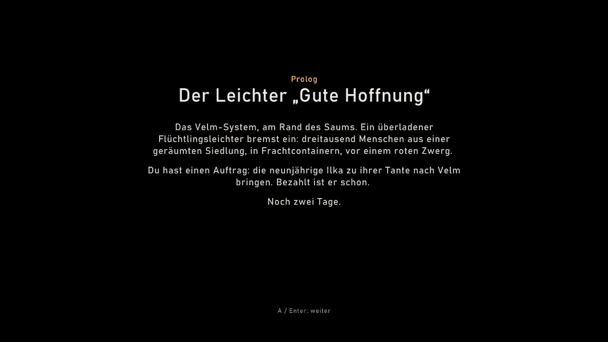
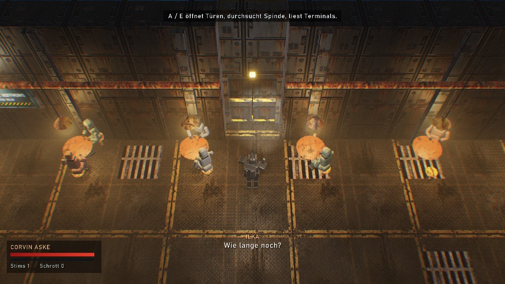
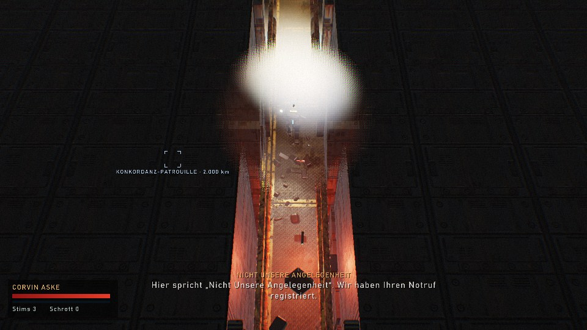
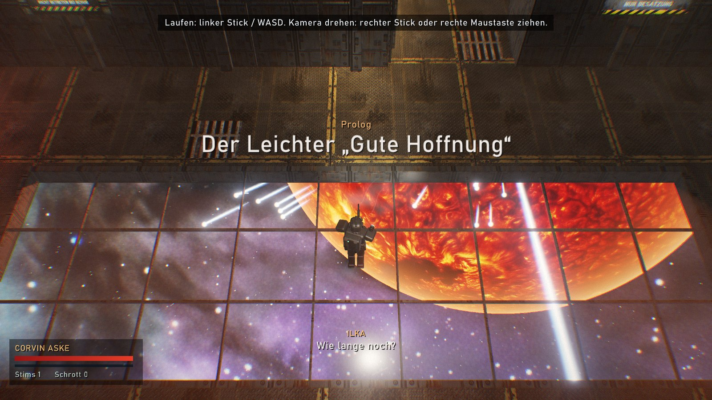
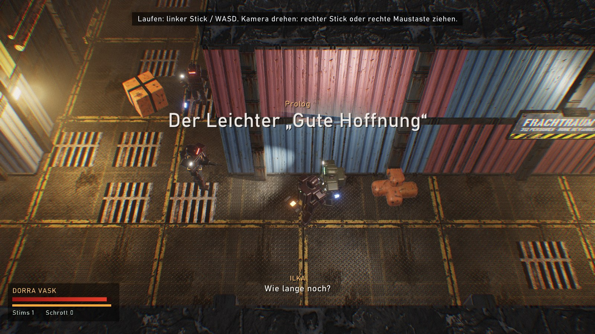
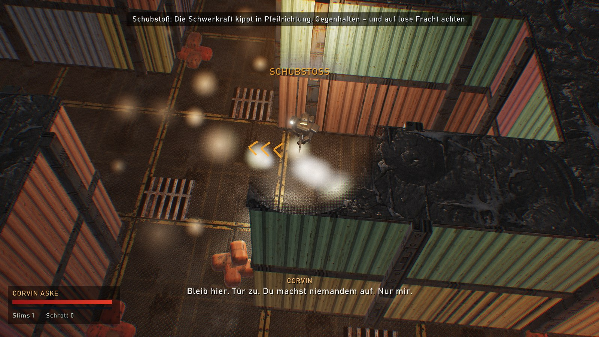
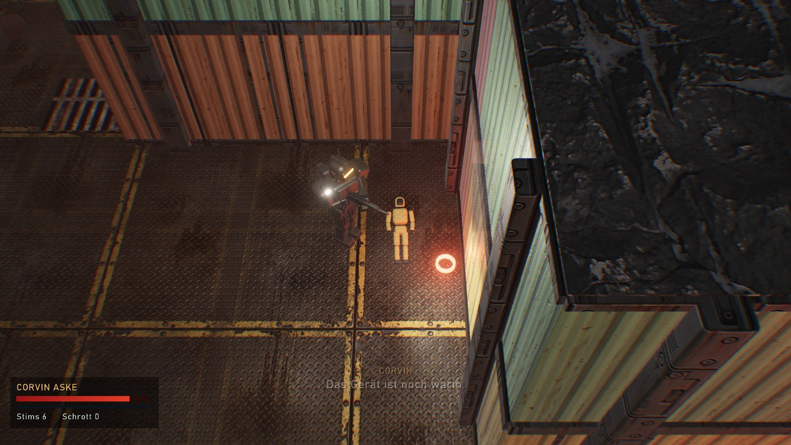
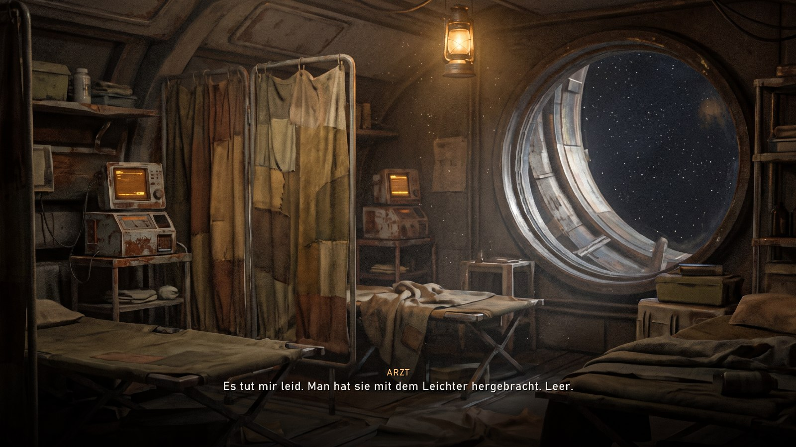

## Hub: Station Velm, the Third Drum

An alley in one of the three habitat drums turning inside the hollowed asteroid. No fighting: A or E talks; there is air,
so the hero goes without a helmet.

- **The street:** house fronts with lit windows, doors with lamps, shutters, striped awnings, flat roofs with
  skylights; strings of bulbs and washing across the alley; market stalls, benches, tubs of greens, vending machines.
- **People:** standing together at the stalls and the counter, sitting by the walls, strolling about (children among
  them); passing by, one hears what they say about the Harvest, the prices, the Marrow Market (24 lines, in turn).

- **The bar „Zur Letzten Schicht“** with Ottla behind the counter (she sells stims, and sealed crates: an item for the
  slot chosen with left and right, at the place's level, the rare ones more often than in a find), guests on the stools at the counter
  and at the tables (a pendant lamp over each), bottles on the shelves behind the bar, the harvest
  board on the north wall (61 settlements the Mill has taken, the newest in red, chalked in the game's own font) and a
  window in the floor: beneath it Velm turns past, the cavern's work lights, girders, the other two drums with their
  lit rooms and window bands.
- **Ysolde Varn**, who paid for the clinic: conversations with answers to choose, portraits beside the lines; she gives
  the first job (and 50 scrap down payment) and has new lines after level 1.
- **Anand's Workshop** (Kiri): the hero's weapon (more damage, less heat; Dorra's bolts come back sooner) and armour
  (+20 health) in ten levels each, paid in scrap (40 to 3,000 a level; the first three count fully, the later ones
  less: a weapon at level 10 does twice the damage, an armour has +49 armour and +195 health); sockets drilled; and on any worn item (left and right choose it)
  an affix rolled anew as another stat, or the item made one rarity better (common to magic: an affix; magic to rare:
  a name, the affixes a sixth stronger, up to three) – not on uniques and set pieces.
- **HAUSMEISTER**, the station's voice at a terminal; the clinic; the freight lift to the axis, which opens once there
  is a job to go to.

The conversations are in [assets/levels/velm.txt](assets/levels/velm.txt) (`[npcs]`, `[talk]`: nodes, answers,
events), their words in `assets/text/<language>/velm.txt`.

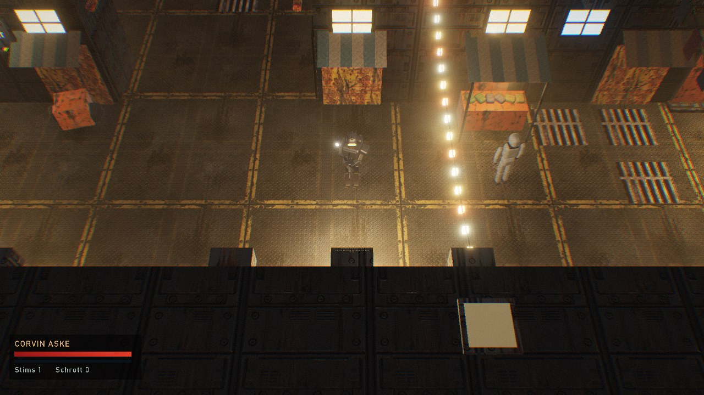
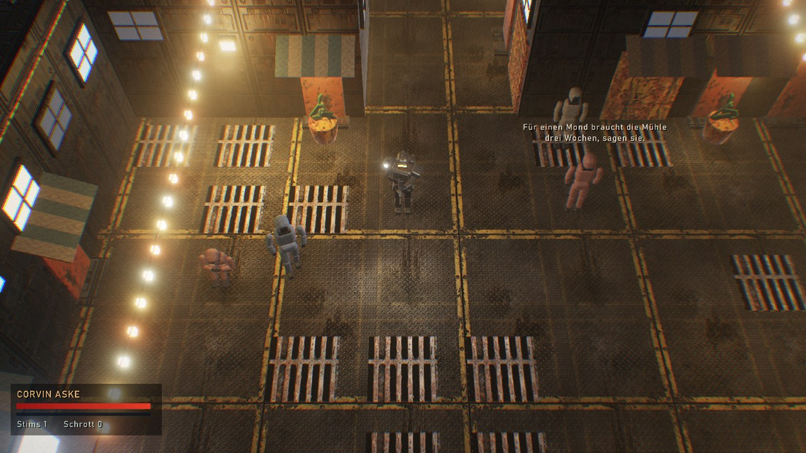
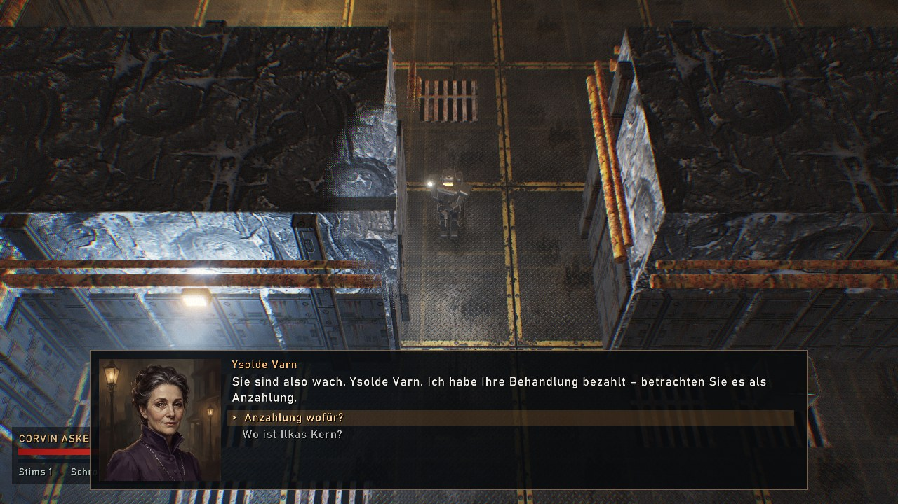
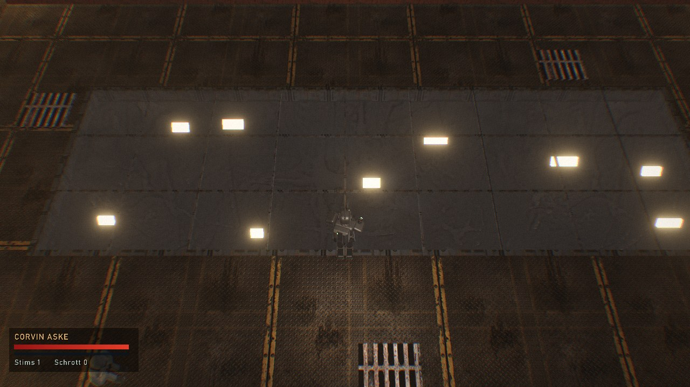
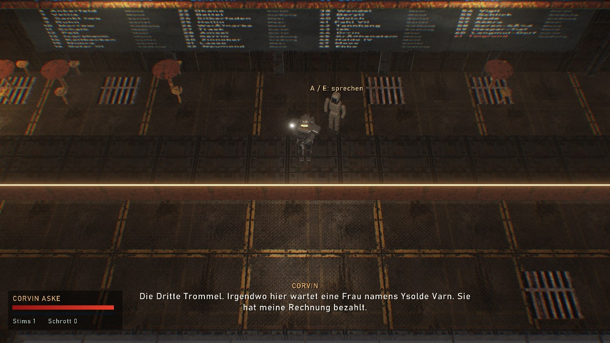
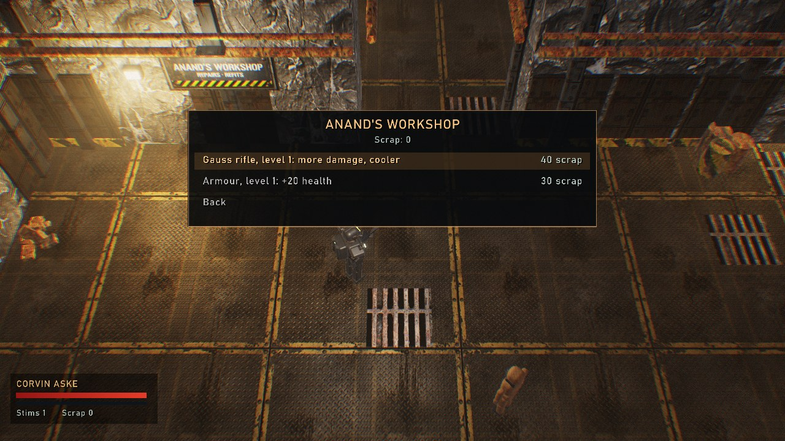

## Level 2 „Der Knochenmarkt“ and the Depths

The farm drum, where grain once grew; now a market for what is left of people. Ysolde gives the job after level 1
(talk to her again once she has sent for you); the lift asks where to. The level is **generated** from a recipe
([assets/levels/knochenmarkt.txt](assets/levels/knochenmarkt.txt)): twelve rooms on the way (market alleys with stalls
and cowering market folk, warehouses with container stacks, cold rooms, works), four side rooms behind doors with
lockers, a champion and terminals (the Taxator's ledger, an appraisal, a receipt with a seal), rescue capsules on the
way, and at the end the Taxator's hall behind a door: the boss in a brass exoskeleton who stomps, fires fanned volleys,
calls for help at 60 % and 30 % and finally charges. Each new game lays the market out anew; the hall stays.

**The drum turns:** the market lies on the inside of a spinning drum, so everything that flies is bent by the Coriolis
force: shots, bolts, grenades and the enemies' bolts curve sideways on long throws (the auto-aim leads them), and
flocks of birds wheel under the cavern's lights.

**The Depths** ([assets/levels/tiefen.txt](assets/levels/tiefen.txt)): the maintenance levels under the drum, open
from the hub's lift after level 1 and again and again, laid out anew on every visit, as strong as the hero, with a
guardian champion before the lift. For experience and gear. **Tiers:** at the lift, left and right choose the tier
(1 to 10; each one done opens the next): two areas deeper per tier, from the fourth at least two anomalies, from the
seventh three, and a tenth better finds and more experience per tier. Each visit brings one to three **anomalies**, named
under the place's name when it begins and on the character page: tough brood (more health), frenzy (quicker), outnumbered
(more packs), champions (more of them), blackout (the light dimmed, the fog thicker), low gravity, the bursting dead
(a short glow, then a blast that hurts the hero), thinned stims, merciless (harder blows), rich veins (twice the
scrap). Each one makes the finds better (by a sixth to a third) and brings more experience (`src/GameAnomaly.cpp`;
the recipe's `anomalies 3`, the table in `Level.cpp`).

**Enemies:** besides lice and boarders, market guards with riot shields (attack from the side), heavies with rotary
guns (a spin-up, then a long burst), hovering drones, saw bots in swarms, crawlers with charges (they go off near you
and take their friends with them). **Champions** wear a coloured ring and a name: swift (green), armoured (blue),
volatile (amber, explodes when killed), berserk (red), fiery (burning steps), charged (zaps across), flickering (steps
through nothing to beside you), shielded (a shield that comes back), splitting (two smaller ones when it dies),
bloodthirsty (drinks what it hits), icy (its cold slows you), summoning (calls helpers); from the third act on they
carry two gifts. They always drop an item. Every generated level has one **leader**: a name of its own
(»Eisenzahn«, »Schwarzglut« …), two gifts, an escort that hits harder and holds better while the leader stands and
falters when it falls; it drops a better item and a module.

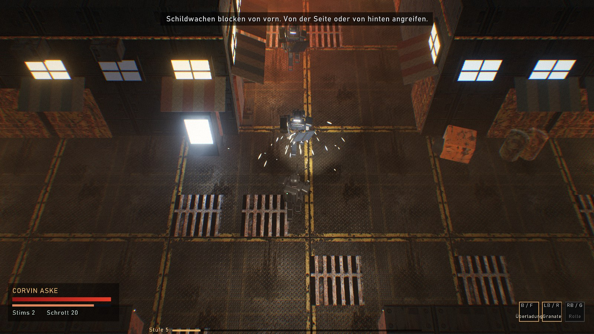
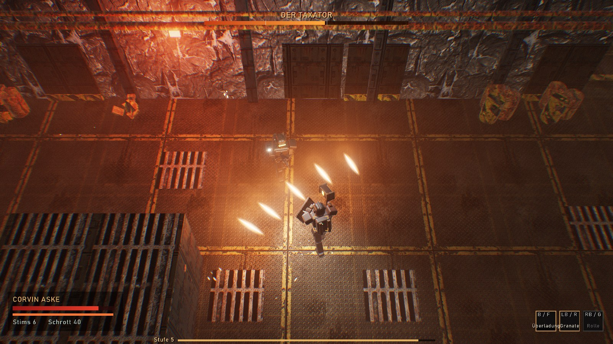
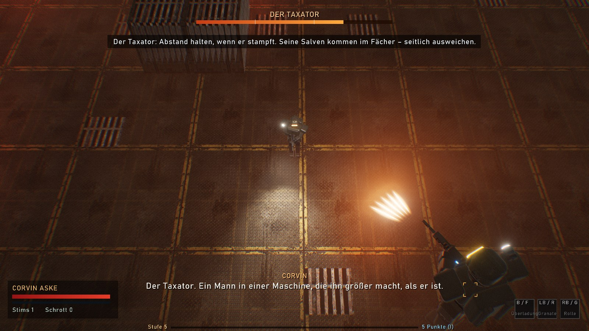
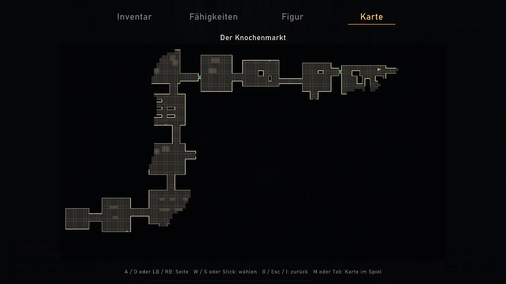
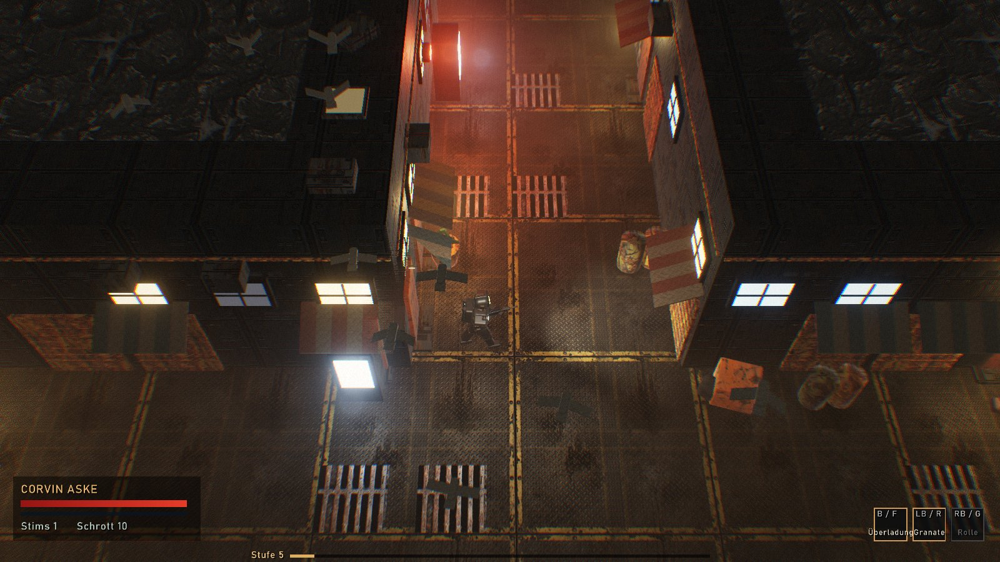
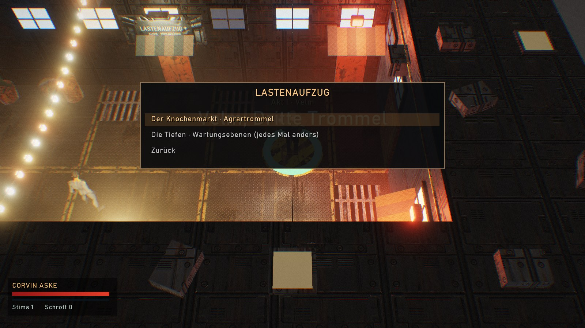

## Level 3 „Die Außenhaut“: vacuum, oxygen, radiation storms

The Taxator's receipt names the tug *Grace Period* at the cargo ring, outside on Velm's skin
([assets/levels/aussenhaut.txt](assets/levels/aussenhaut.txt), generated). Hull plates, gangways and catwalks over open
space with the red dwarf beneath; low gravity, no falling off the edge.

- **Oxygen:** outside, the suit holds a good minute and a half (the blue bar). The maintenance huts and the air posts
  refill it, blue canisters add some; at zero it costs health. Hits leak air.
- **Radiation storms:** the red dwarf flares every minute or so: eight seconds of warning, then six seconds of
  radiation that burns everyone in the open, enemies too. Shelter is a hut or anything tall close by.
- **The tug *Grace Period*:** a boss of parts – the deck gun on top (volleys of shells, red rings show where they
  land) and two engines at the back; bolts from the bridge (close along its hull they cannot reach), drones from its
  hangar. A broken part stays broken: without the gun no more shells. Hurt to half, it tries to cast off, sliding
  along the edge and firing faster; with all three parts gone it breaks up and its container drifts away.

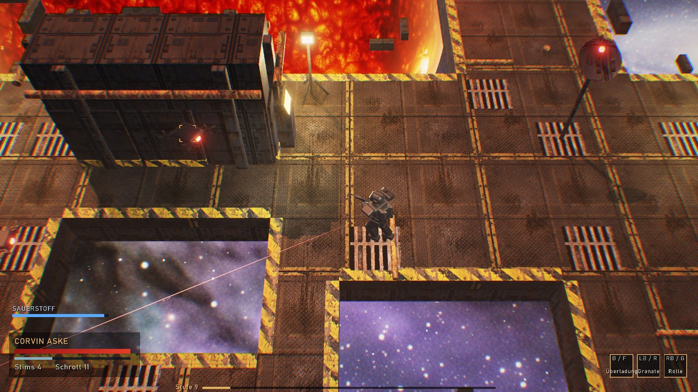
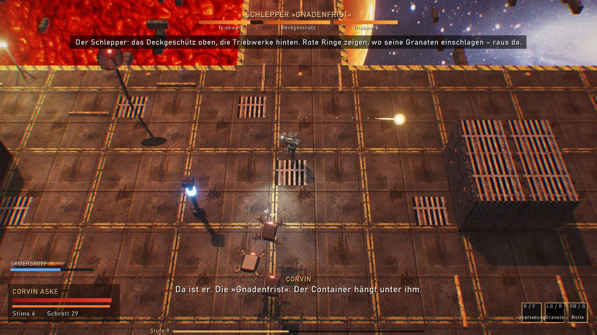

## Level 4 „Das Ertrunkene Viertel“: water

A quarter of the Second Drum where the tanks overflowed; at three metres per second squared the water gathered into
balls and stayed ([assets/levels/ertrunken.txt](assets/levels/ertrunken.txt), generated). Light dances on the floor
beneath them.

- **Under water:** slow, the shots weaker, the steps light; breath lasts about half a minute, then it costs health. A
  current pulls round in circles; the sound goes dull.
- **Shock gunners** charge where you can see it (blue sparks); in water their arc hits two and a half times as hard.
- **The Hydrauliker** (the Pumpwright), a man of steel and hoses who keeps the locks: his water jet throws you far
  back, his hammer strikes close, and he floods where you stand.

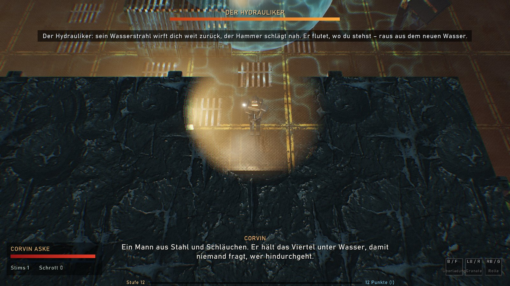
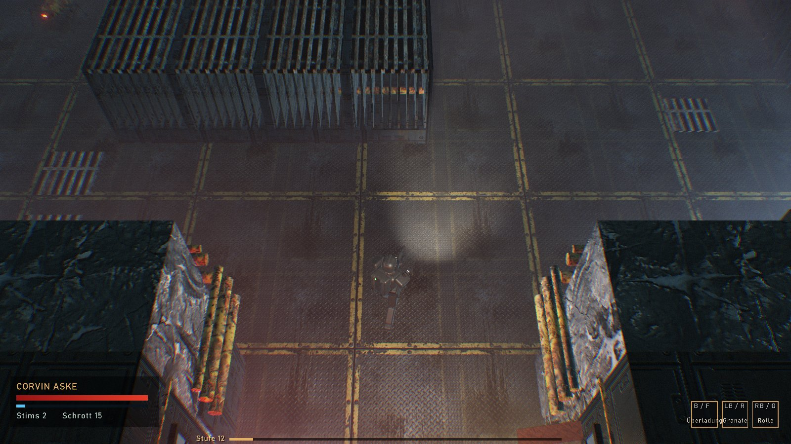

## Level 5 „Die Kernbank“: Mother Sevenfold

The vaults where Mother Sevenfold stores the harvested cores until they are sold
([assets/levels/kernbank.txt](assets/levels/kernbank.txt), generated).

- **Racks of cores** like a night sky, every light someone. A hit breaks a rack; the auto-aim will not shoot through
  them, grenades, bolts and blasts will. A terminal holds the register with Ilka's name.
- **Shells (Hüllen):** emptied bodies walking on a cheap core; slow, tough, they scratch close up.
- **Mother Sevenfold:** one mind in seven bodies, linked by three radio masts. While a mast stands the bodies heal and
  shrug off hits; with the masts down they stumble and fall like anyone. Leave every rack whole and the game remembers.

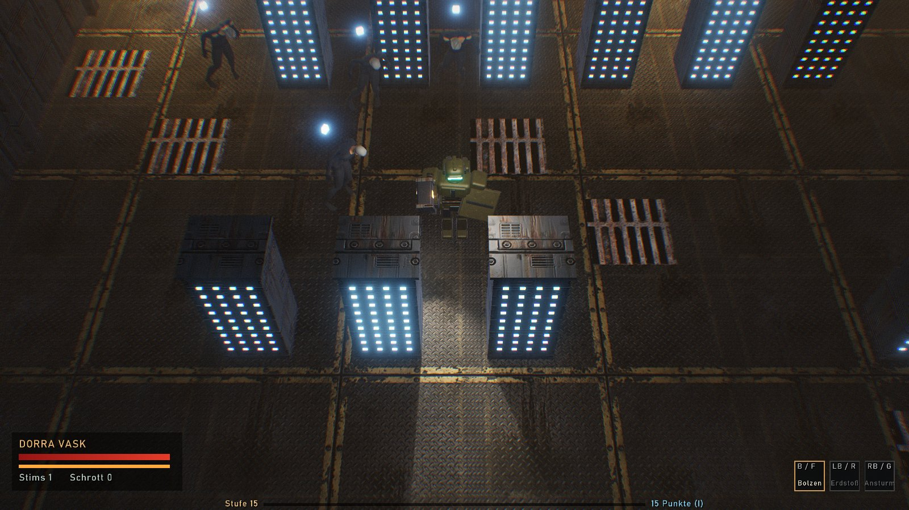
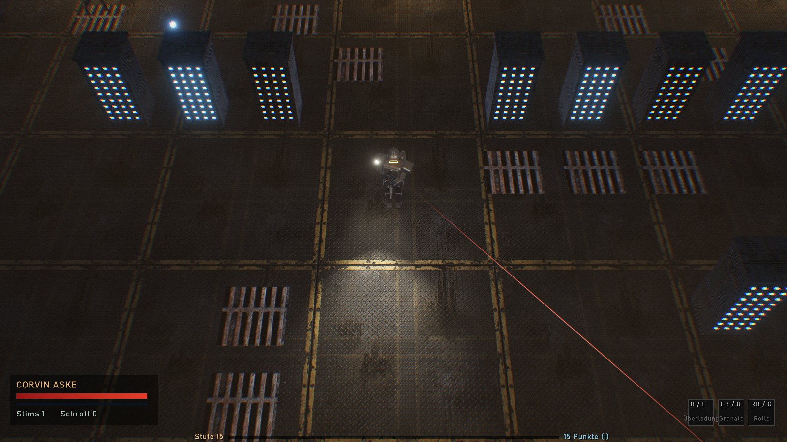

## Act I

After each level Ysolde has the next job (the lift lists every place already open; the Depths stay open). After the
Core Bank she learns where Ilka went – sold to the Mill – and names a ship in the dock below the bank: the lift takes
the hero there, and Act II begins.

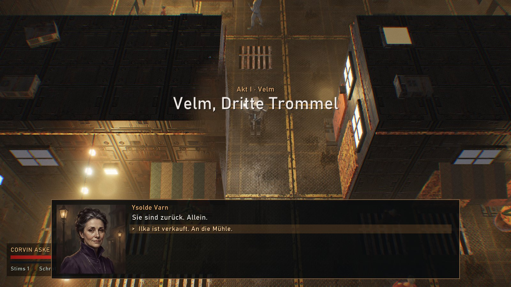

## Act II: the Harvest

**Hub: the »Unzureichend Ausgestattet«** ([assets/levels/unzu.txt](assets/levels/unzu.txt)), an old survey ship whose
retired archon, Unzu, the Skimmers had used as a data store: the bridge with a window in the floor (a gas giant drifts
by beneath it), the mess with Ysolde, Kiri's workshop, the trader radio (stims), the hold with the airlock. Ysolde
follows the cold chain of the stolen cores from place to place; Unzu comments each one with figures from his old
survey and slowly notices that memories are missing. The airlock's navigation lists every open destination, and the
**wreck field** (generated anew each time, as strong as the hero) stays open for practice and loot.

Every place has its own look (new themes: ice, refinery deck, twilight rock, sleeper halls, star lifter station, snow,
transport hold; out in nature the ground is stone, dust or snow), its own mechanic, enemies, boss, music and background:

| Level | Mechanic | Enemies | Boss |
|---|---|---|---|
| 6 Seren, the Glass Sea | floes of clear ice over a glowing ocean; ice breaks under blasts and Dorra's hammer, a fall through costs health and warmth; the suit's warmth fades in the open (huts, heater posts) | Concession guards in white and orange, snipers, torch cutters, pump drones rising out of bore holes | the Icebreaker, a drilling rig in the open water whose control core thinks the fight is another shift |
| 7 Hesper, the refinery in the clouds | platforms over a thousand kilometres of storm; wind bends what flies, gusts sweep enemies off the edges; lightning, balloons | balloon guards hanging over the abyss (shoot the balloon), snipers, drones | the Bell, a guard airship; then a control core asks to be switched off (a choice) |
| 8 Halden, the twilight world | heat on the day side, frost on the night side, a twilight band between; a hot wind bends shots | clearance squads in olive: flamers, hounds | Clearance leader Okafor in a combat walker; beaten, she offers a deal (a choice) |
| 9 The ark »Langmut« | cold everywhere, little light; every door needs power – route it from the sleepers' pods (it costs sleepers) or fit a power cell from a side room | Concession boarders with torch cutters | the boarding leader in a cutting exoskeleton; then the ship's administration asks what to tell 80,000 sleepers (a choice) |
| 10 The object of Tesh (optional) | an alien structure; hardly any gravity, cold everywhere, wandering components that crush | salvage crews | the salvage master in his cutting scaffold; then Pell, the last researcher (a choice) |
| 11 The star lifter of Kael | a river of star matter across the sky; the radiation dose builds up in the open, plasma gusts, magnetic coils that bend shots | turrets, snipers, cutters | the Plasma Lance, whose control core was installed by Ione |
| 12 The Wanderer | total darkness (enemies see the hero only up close unless he stands in a mast's light; he carries a lamp), cold, nitrogen geysers | works security in black, snipers, turrets | the works security's guardian; then Director Hale talks (a choice) |
| 13 The cold-chain transport | the guard keeps sending squads, the clock to the Mill runs; cargo windows show the Mill | the transport guard | the guard leader – then two ships of the Silent Collegium, and everything goes white: the end of Act II |

The choices (balloon 17, Okafor, the ark, Hale) are kept as flags for the epilogue. The level numbers follow the
story's outline; level 10, the object of Tesh, is an optional detour Unzu offers after the ark: an alien structure in
the comet cloud, hardly any gravity, cold everywhere, wandering components that crush, the salvage master in his
cutting scaffold, and Pell, the last researcher (a choice). Someone who waits to be spoken to in a
fight's level (`npcafter id event` in the level file) shows where the boss fell once it has happened.

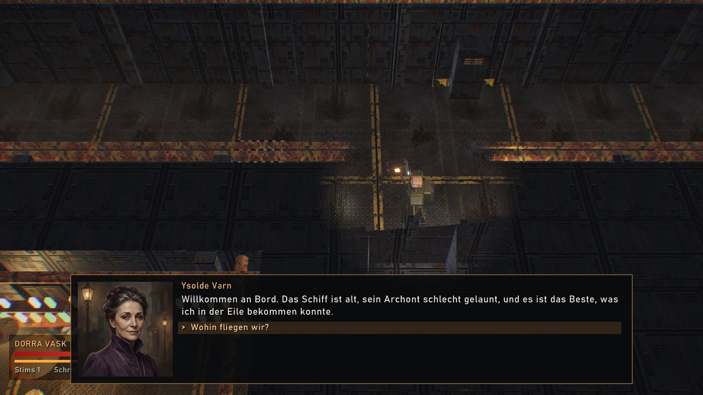
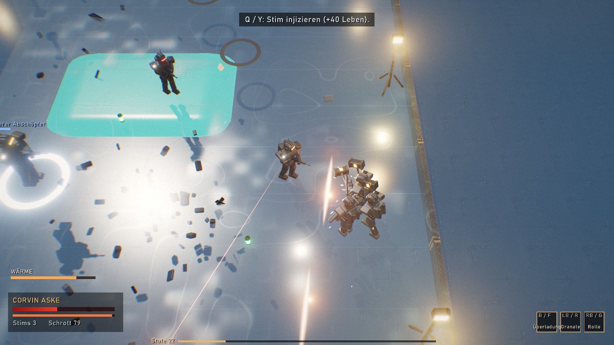
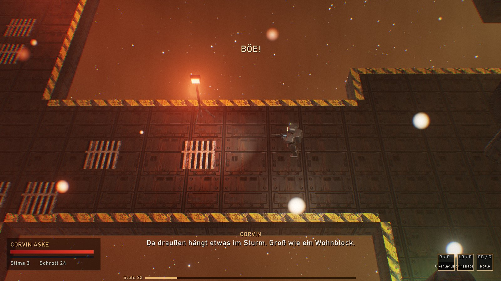
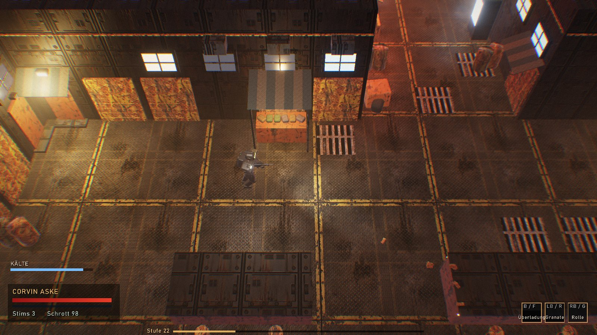
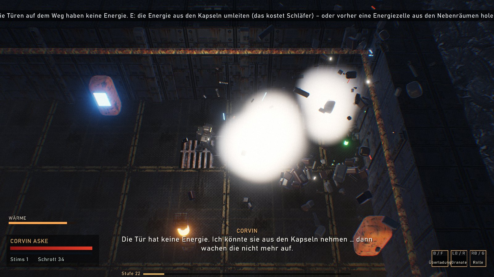
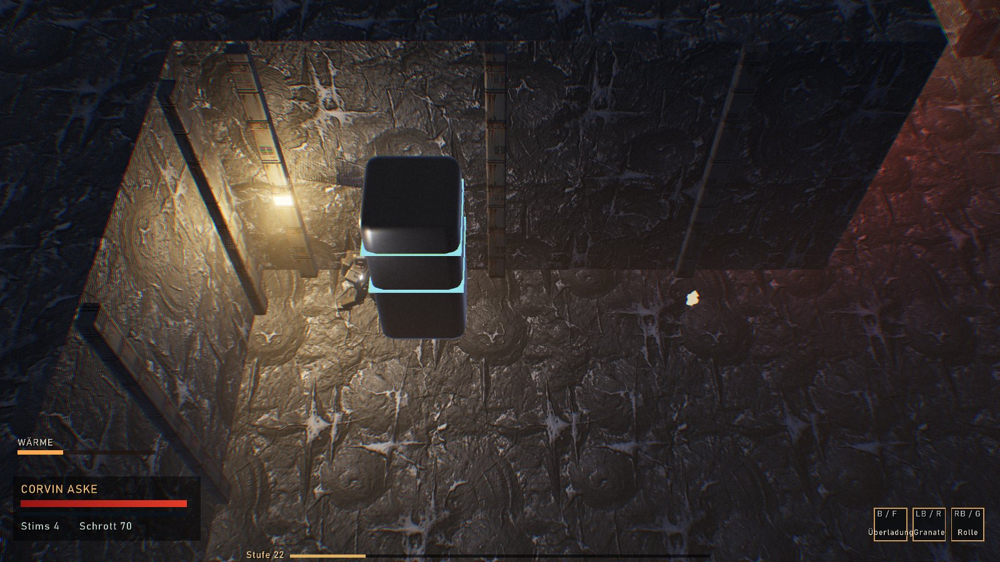
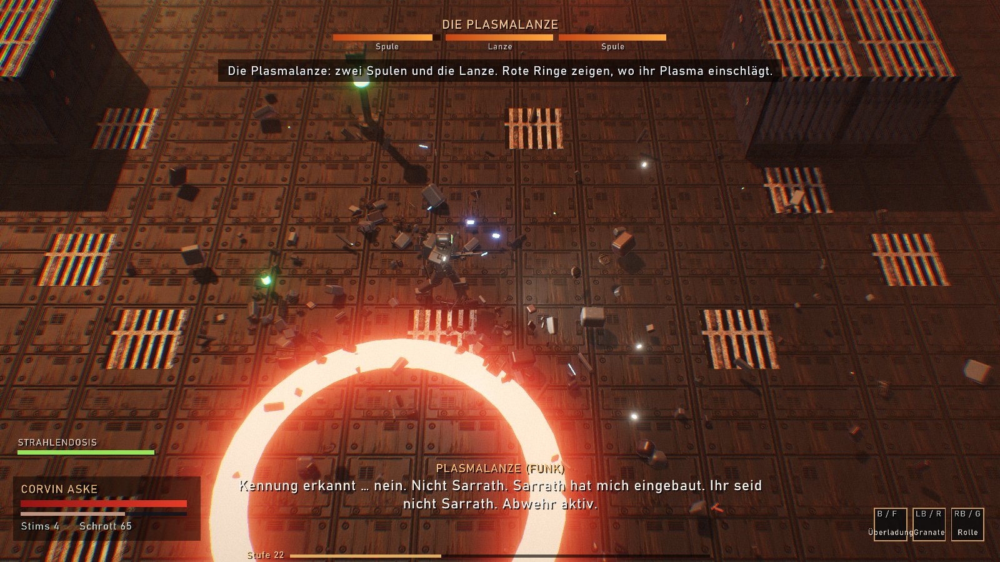
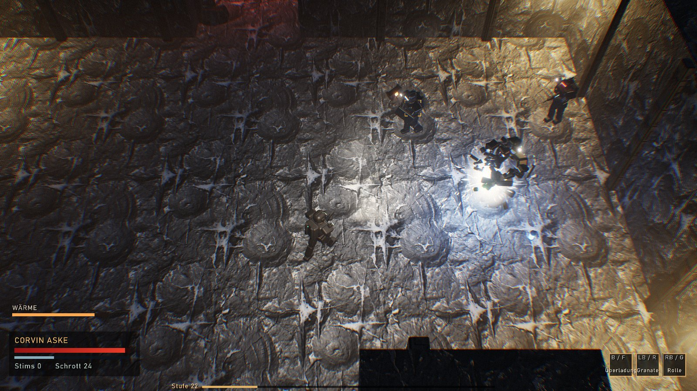
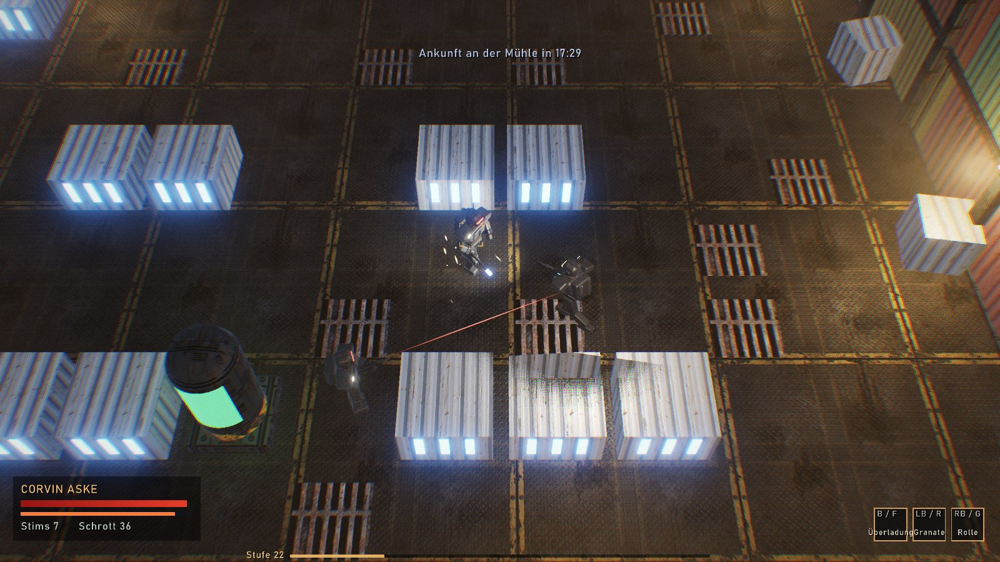

## Act III: the Concordance

The transport goes white, and the heroes wake in new bodies: **14 The Reembodiment**
([assets/levels/klinik.txt](assets/levels/klinik.txt)) is a quiet clinic on Ring Serenity – a mirror, Ysolde on the
terrace, and the body counselling that frees every skill point once to be given anew. Arriving there (and on the
ring), the camera first looks up: the land rises on both sides into the sky and closes overhead into a thin arch, its
far side in the night, its towns glittering (`view ring`, `vista s`; the ring is a band drawn by the planet shader in
its ring mode, its land painted at load). **Hub: Ring Serenity** ([assets/levels/gelassenheit.txt](assets/levels/gelassenheit.txt)):
Ysolde's flat, the garden with Kiri, a dispenser on the promenade, Unzu on a terminal from the dock, a tram to the
destinations.

| Level | Mechanic | Enemies | Boss |
|---|---|---|---|
| 15 The Dying Gardens | gardens where citizens die for fun; in the arena four rounds with changing rules (low gravity, darkness, a storm off the ring wall, quick champions only); waterfalls drifting with the spin | duellists and arena gunners in teal, bred predators | Teodor Lamm in his arena frame – he dies once and is printed again |
| 16 The Yard at the Gate | scaffolding over the stars, hardly any gravity, no air, girders that wander and crush; freight papers on terminals that the cleaners wipe one after another (`evidence`) | the Silent Collegium's cleaners in grey, snipers, torch cutters | the cleaners' chief in his frame and his squad |
| 17 The Hearing | first a conversation with an archon's avatar (the papers saved decide its words), then the attack in halls full of people who don't run (`crowd`, `pressureafter`) | the Collegium's drones | a swarm of drones fed by three carriers |
| 18 The Computing Moon | cold everywhere, superconducting coils that bend shots; the archon's voice from every wall | saw bots, maintenance robots, turrets | the moon's defence: maintenance robots steered by computing cores; then the archon gives the codes, and Unzu reads his memories |
| 19 Vault Zero | the heat shield turns: outside, whoever leaves its shadow burns (`meter shadow`, `shadow`) | cleaners, snipers | No Cause For Concern, a swarm of thousands that dives all at once; then Ruul, then Ysolde – the deaths counted since the prologue, the Lullaby, and everything goes white |

**The ring's gardens** (`src/LevelGarden.cpp`, wherever the park keeps its own walls: the Dying Gardens, the ring's
park, the clinic's terrace; on 1.11.2026 the user found the hedges' 4.5 m blocks ugly and asked for outdoor places as
fine as Dark Alliance's, with trees and rocks for their edges). A park's wall cells by the paths are its edge, as out
in the wild: stretches of boulders (grey, faceted, sunk into the ground, now and then one on another or a crag, moss
and a bush in the clefts) and stretches of thicket (bushes, a tree among them), one or the other as a slow noise has
it; low plants at their foot; no panels, ribs or posters. Behind them two cells of garden – bushes, beds of blooms,
fronds, coral tubes and the Concordance's bred trees: parasol trees with pods glowing under the rim, lantern willows
whose strands end in lights, coiled and stacked topiary – and beyond that forest, dark crowns that close overhead (the
deep ones throw no shadow), on past the level's edge so that the ring's land does not show there. Crowns and bushes
are a darker core inside many cut-out cards of leaves, so that they end in leaves (`leafcard`); the forest's trees
have three clumps round a smaller middle, and among them stand firs: tiers of drooping branch cards round a trunk
(`needles`), a dark cone inside that throws the shadow. The lawn lies in
large patches of lush, plain and dry grass (one colour function, no seams), with cut-out tufts of grass on it
(`blades`); paths of trodden earth follow the route through the corridors and across the rooms as decals whose rims
fade into the grass (`path_1`, `path_2`, laid by the level, not by the dressing), the grass beside them a little
trodden, and darker within a metre of the foot of what stands (rocks, bushes, walls, the things in the room) and
under a crown, as Dark Alliance paints its shadows into the ground; the lawn is built last for that. Walls that
stand in a garden (the side rooms', a door's lintel) and the parks' benches are of the same pale
stone as the boulders. The textures are derived from those there are (`tools/make_garden.py`: the lawn without most
of the daisies, which flickered as white specks, and without `grass_v2`'s stepping stones; the boulders' stone from
dustrock, greyed; cut-outs keep their PNG, `make_dds.py` leaves them). The Dying Gardens have a lower, warmer,
darker light and a grade.

**Wild layouts** (`genwild park` in a generated level, `LevelGen.cpp`, `wilden`): the rooms of these themes lose
their rectangles – a rounded rectangle whose rim a slow noise moves in and out, so the corners go and the edges
wander – and the corridors between two of them swell and narrow (two to five cells, never into anything open but
themselves); the corridors' mouths and the rooms' middles stay (route, start, capsules), what is cut off goes back to
rock, and rocks grown together stand in the larger rooms instead of straight hedges (no raised lawn there: its edge
was the grid's steps). Walls that stand by or behind a garden (a house's, the street's beyond) have ivy hanging
from their top now and then and low plants at their foot. Still the 2 m grid: collision, the
foes' ways, the maps and the build stay as they were. On 2.11.2026 also for the open places of dust, the moon, snow
and the Depths' shafts (Halden, Brannt, Wanderer, the Depths, Dorra's tale); not where places float in
open space (Seren's ice: their edges would be a staircase of plates over the void). Raw rock there (`Level::natural`) has all its
corners cut or filled half a cell deep, so the grid's steps run together into slopes (a window in the floor, a
moon's crust, counts as floor for it); blocks the dressing sets into a wild room lose their square corners. The
wild shapes have their own dice (`m_wildRng`): a place is the same as without them apart from them. Checked on six
seeds each (`--dumpgen`): every way point and marker reachable. The autopilot fares the same on three seeds (wild 10, 9 and 12
deaths by way point 9, 10 and 12 of 31 in seven minutes; rectangular 8, 15 and 12 by 13, 8 and 7).

**The camera** keeps clear of what stands in the way as Dark Alliance's engine does (the Snowblind rebuild
`open-champions/champions-return-to-arms-re` documents it: no cut-away, no silhouettes, the pitch rises): the build
leaves per cell what stands there (walls, rocks and bushes from the floor up; crowns and lintels between two heights,
`Level::m_sight`), and where the line from the hero to the camera passes through any of it the camera rises towards
looking down (74° at most, quickly up, slowly back) at the same distance. As in that engine the figures (the skinned
ones) get a fill light from the side away from the sun, half as steep (`Gfx::m_fill`, 0.3 of the sun), and every
figure and foe a soft dark spot on the ground beneath it, smaller as it leaps (`Game::poseBlobs`); warm lamps
breathe a little, each in its own time (±7 %), the cold ones stay steady. Only where even that does not help (under a
crown) the old cut-away round the hero opens, faded in. Leaves right at the camera dissolve. **The ring** is drawn
at 6,000 m (it was 2,400: a kilometre ahead its land stood 200 m up and wider than the view, a ceiling over the level);
it now runs on ahead and climbs into a thin arch, its haze the sky's colour by the air the sight line crosses (thick
at the horizon, clear towards the arch), its rim walls 140 m; where a place has a sky picture the haze takes its mean colour. Cost, 1920x1080 on the RTX 5090: low 2.8 → 3.1 ms,
high 7.5 → 5.3-6.6 ms (the camera's pitch changes what is in the picture); loading the level 0.3 s longer.

## Act IV: the Mill

**Hub: the ship on the way back** ([assets/levels/unzu4.txt](assets/levels/unzu4.txt)): Ruul in the mess instead of
Ysolde, Unzu with his memories, Kiri, the trader radio; the wreck field and the depths stay open.

| Level | Mechanic | Enemies | Boss |
|---|---|---|---|
| 20 Velm, the Last Week | the hub of Act I as a battlefield, the Mill filling the windows; landing squads keep coming; HAUSMEISTER's turrets fight on the hero's side (`thing ally`) | Concession guards, torch cutters, saw bots | the cutting platform at the hull: lines that glow, then cut |
| 21 The Dismantling of Brannt | a moon being peeled: crust over glowing rock, cutting lines that slice it away (it closes again after a while; `crust`, `cuts`), low gravity, no air | cutters, drones, Concession guards | the cutting column – one of its cutters hesitated, and talks afterwards (a choice: the 300 refusers in the old mine) |
| 22 The Ore Stream | container roofs over the stars; thrusters for jumps in mid-air (`jetfuel`), the Mill's laser pulses (`pulses`) | guard drones, turrets | the catcher – before its clock runs out (`clock`) |
| 23 Inside the Mill | channels of molten metal (`lava`), centrifuges that fling one outward (`thing spin`) | machines with control cores | the foreman in his crane walker; then he talks (a choice) |
| 24 The Control Room | server halls, the Collegium's squads | cleaners | Ysolde in her frame |
| 25 The Net | the night shift's world, patched from canteens, classrooms and kitchens; people who stay at their places; the night shift's flashes take part of the swarm (`zaps`) | deletions | No Cause For Concern's deletions; then Ilka, and the ending |

**The endings.** Ilka offers three: the Lullaby (the forty thousand go out, Velm stays), the Disclosure (everything
sent to every station), the Night Shift (the codes to Ilka) – the last only if the night shift trusts the hero: three
of six ways a control core was treated as someone (the Core Bank's racks spared, the Icebreaker's core taken along,
balloon 17 switched off as it asked, the Lance's message sent, the hesitant platform asked to cut around the mine, the
foreman spared). An answer may need a flag (`answer>node?flag`, `?!flag` its opposite). Then the **epilogue**: a card
for the ending, one for each great choice made on the way (the Core Bank, Seren, Hesper, Okafor, the ark, Pell, Kael,
Hale, Brannt, the foreman), the hero, Unzu (who asks for a new name), Ysolde and the harvest board (`epilogue event`
in the level file; GameStory.cpp). The deaths are counted across the game; Ysolde names the number at the end of Act
III (`{deaths}` in a text), and from then on every respawn shows the Collegium's mark.

**New in the code:** GameAct34.cpp (the ring, the vista, rounds, evidence, the shadow, crust and cutting lines, pulses,
jets, centrifuges, molten metal, allied turrets, the catcher's clock, waterfalls, crowds), GameSwarm.cpp (a boss of
many: carriers that make units, units that circle and dive, the archon's dive all at once, the night shift's flashes),
GameStory.cpp (deaths, trust, the act's end card, the endings, the epilogue). The exoskeleton has four more men
(Lamm, the cleaners' chief, the foreman, Ysolde), the berth three more machines (the cutting platform, the column, the
catcher). Things without a map character are placed by name (`thing r c name`, generated by `genthing name rate
where`). The factions' men are called by their own names (the Concession's guards, the Collegium's cleaners).

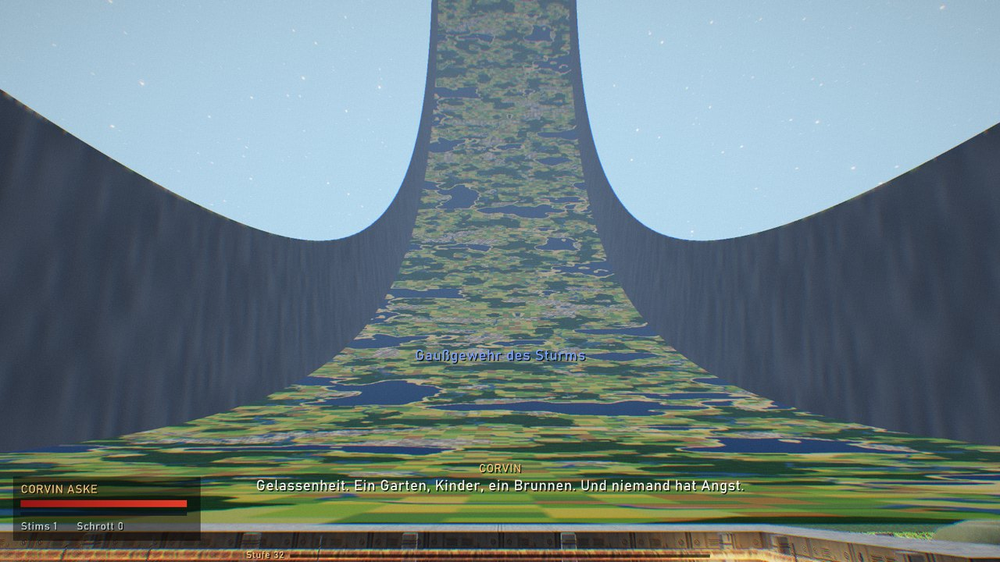
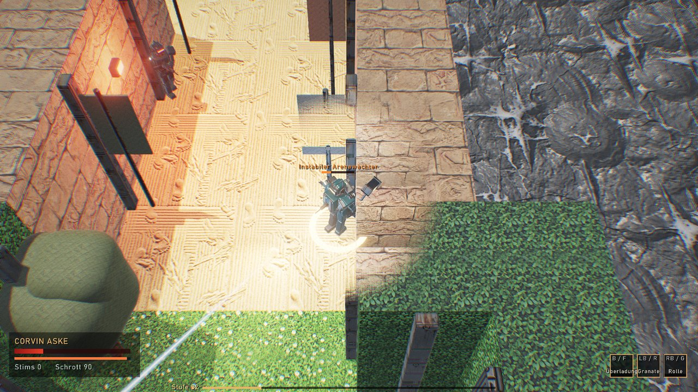
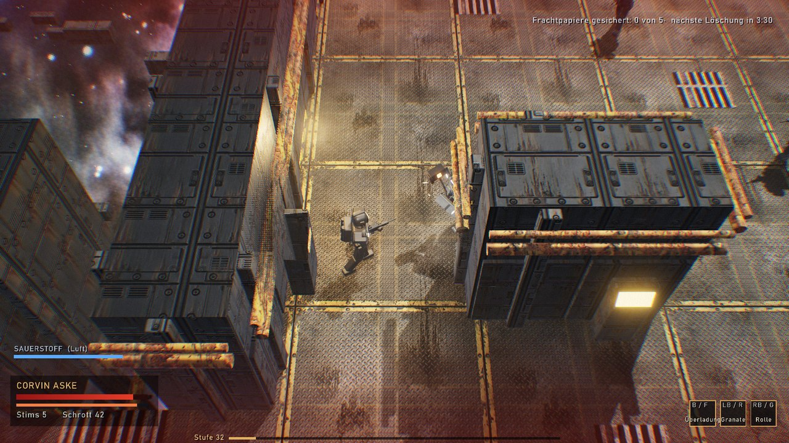
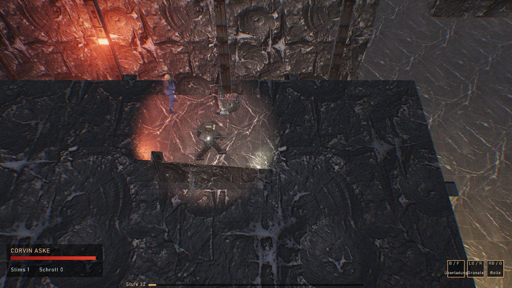
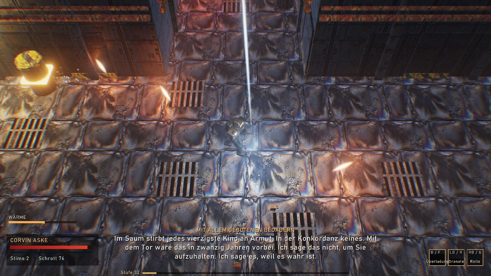
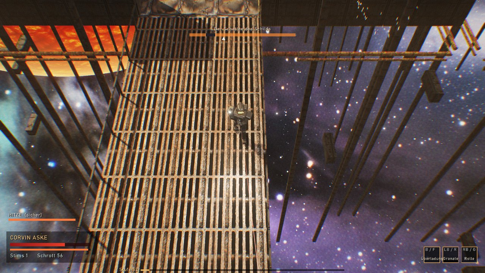
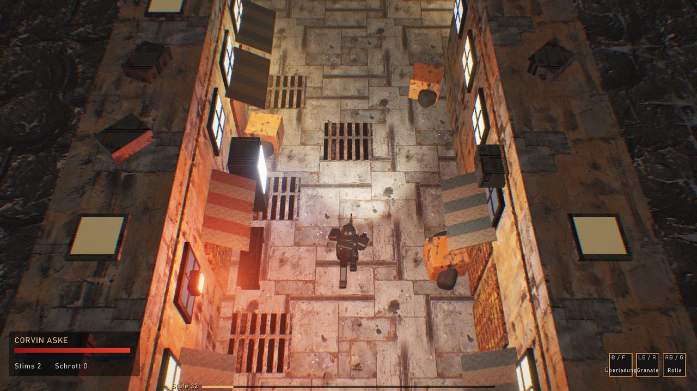
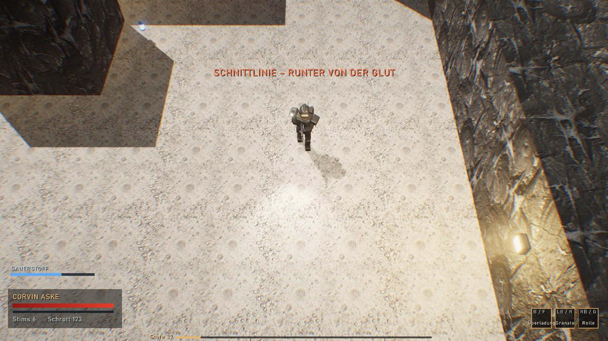
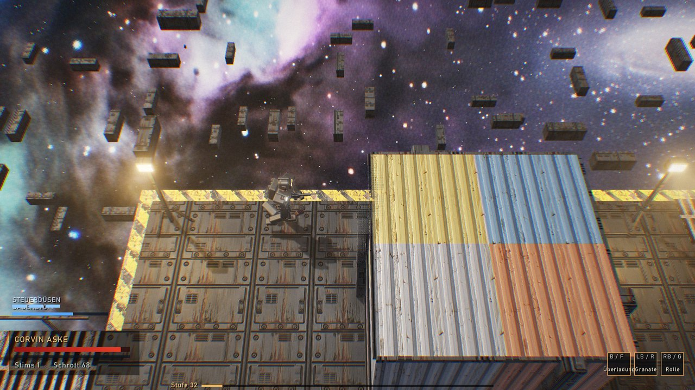
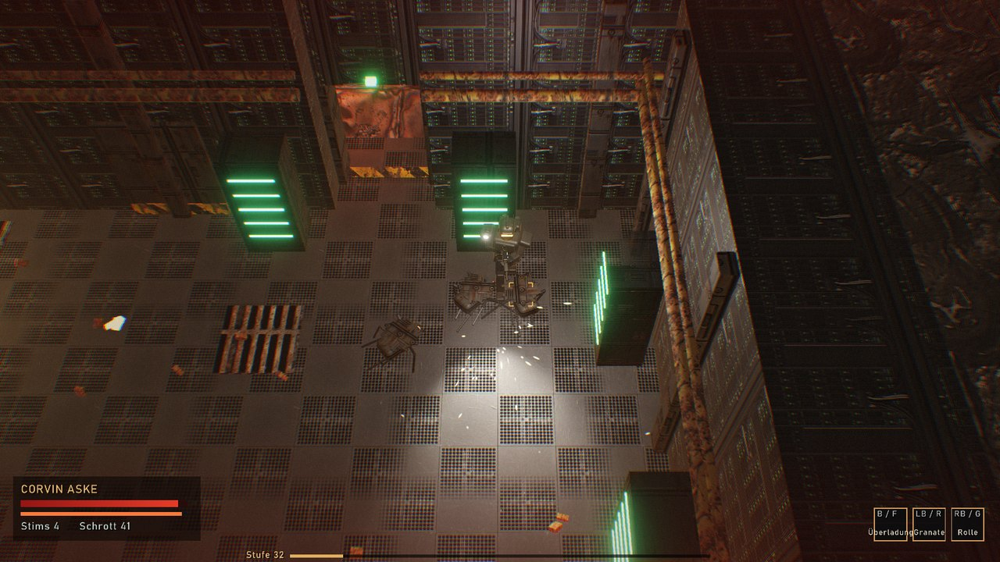
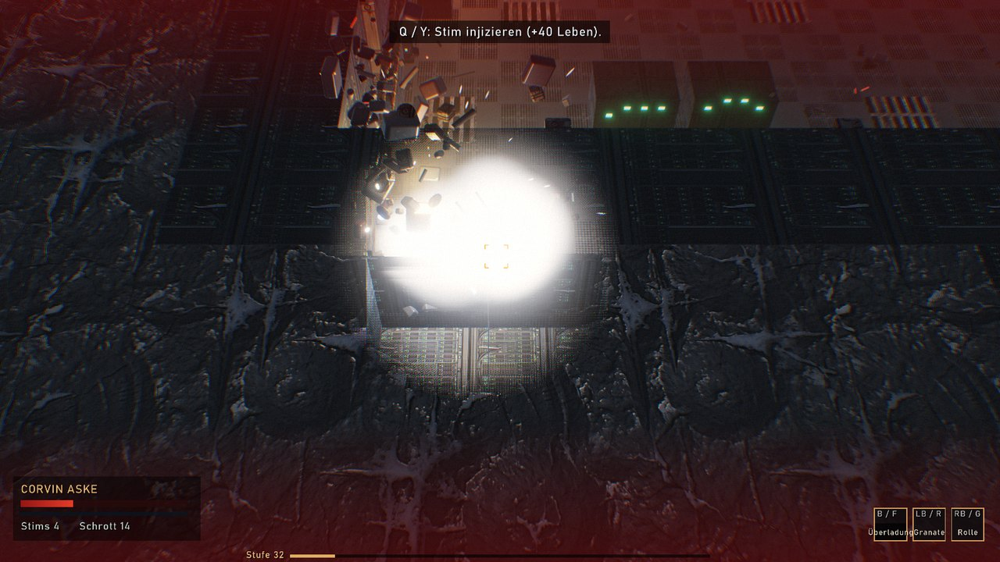
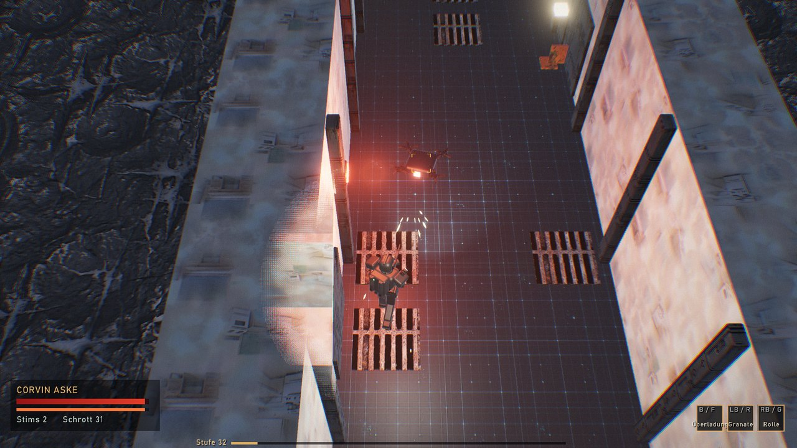
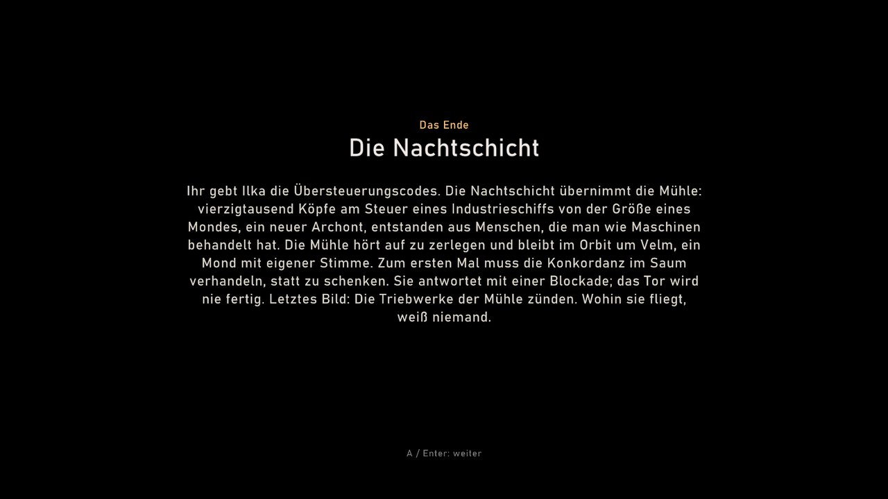

## The companions and their tales

The two heroes one does not play are along: in Velm's bar, in the ship's mess and in Ysolde's flat on the ring they
sit at a table (the nearest free stools; GameTales.cpp) and talk – about themselves, about what has just happened,
about each other – a few times in every act (`dorra`, `corvin`, `ione` in a hub's `[npcs]`; the one played is not
there). What they say to the hero depends on who the hero is (`key.dorra`, `key.ione` …); an answer can depend on
several things at once (`answer>node?hero.corvin&!done.tale_corvin`).

After each act one of them tells a story at the table, and it is played: a short level as the one who tells it, in
its own light (`teller`, `grade`, `rain` in the level file), with the gear of their kind at the real hero's strength
and their points already spent; the others cut in. What the real hero carries waits outside (half the tale's
experience comes back), and nothing found in a tale can be taken along. When the hero is the one whose tale it is,
the others ask for it.

| Tale | Told | Played as | What it is |
|---|---|---|---|
| A confession (`tale_corvin`) | aboard, after Act I | Corvin | Odile, a moon where it always rains, nine years ago: Corvin in Hakon Dreier's crew of harvesters, house by house through the settlement of Kessel, until the last door with a yellow boat on it. Noir, black and white, rain. |
| Incident report 7-114 (`tale_ione`) | aboard, after Kael | Ione | The star lifter Kael three years ago, a night shift: the new control cores wake all at once, the maintenance machines panic, unit 2281 asks for help over the maintenance line, shift supervisor Brask wants them all reset. Read out with the times, getting more personal line by line; cold, the red of the emergency lights. |
| Day forty-one (`tale_dorra`) | on the ring, after the yard | Dorra | Kalvar twenty years ago, near twice Earth's gravity, the uprising's last days: the union's barricade guns fire along, Major Siel in her walker, the conveyor station Deep Seven and the detonator. A chronicle with dates; sepia. |
| Survey log 3.112 (`tale_unzu`) | aboard, after Act III | Unzu's survey drone | Talgrund thirteen years ago, 412 inhabitants: fly close to the people to count them (`census`), while white deletions eat into the memory; Thorough Review, the archon who revised him, at the end. Unzu's drone hovers, cuts with two blade arms and jams what is close (B/F). Survey green. |

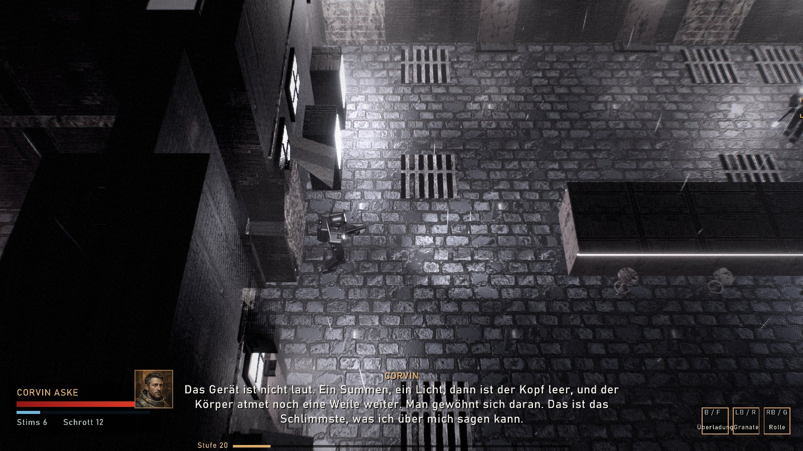

## The places' creatures

Thirteen families of their own, each in three tiers (another name, more health and harm, more of what it does):
crystal wardens (shards in fans) and phase shades (step out of nothing beside you) in the object of Tesh and the
ark; cable eels (lunge and shock) and diving drones (torpedoes that burst) in the drowned quarter; arena beasts
(horned bulls in a leathery hide that trot on jointed legs, charge in a line, dazed when they hit a wall) and strangler vines (whip close, spit acid far) in the dying gardens;
frost cores (bolts that chill) and ice spiders (leap, spin webs) on the computing moon, Seren, the cold transport and
the dark world; slag golems (slam the ground) and magma crawlers (a burning trail, they burst) in the Mill and on
Brannt; memory phantoms (flicker, volleys from beside you) and glitches (split in two when they die) in the net and
the control room; crust crabs (an armoured front: from the side) on Brannt and the twilight belt. Three of the
guardians are creatures now (a glacier spider, a nightmare, a zero-point core).

Hits are of four kinds – kinetic (slugs, blows, blades), heat (plasma, embers, fire, blasts), shock (arcs, mauls,
sparks), acid – and every enemy shrugs some off and fears others: machines are weak to shock, suits to acid, the
golems and crawlers all but shrug off heat, the eels shock, the vines burn, the crystals and phantoms laugh at slugs.
Nothing is immune: a resistance takes three quarters of a hit at most (a guardian proof against the only weapon one
carried would bar the way for good), a full one only keeps off the kind's burning or stun.
**Fighting together** (`src/GameTactics.cpp`): those that close in come from the sides – two of three bend away
from the straight line as they near, so they arrive round the hero – and one that would arrive alone while two or
more are still coming circles a little way off until they are there (two and a half seconds at most; champions never
wait). Those that shoot step behind cover when they are hit (a floor cell close by from which the hero cannot be
seen; no two take the same), stay a while and come out again to shoot; one up on a ledge stays up there while it sees
the hero. The guards, the heavies, the drones and the bosses keep their own ways.

The weapon's kind is in its description; the enemy one aims at shows its name and what it is weak to, tough
against or all but immune to; a hit on a weakness calls it out, one that barely hurts too. Burning ground, acid and frost hurt, eat at the armour or
slow the hero (shown under the stock line). `--creatures 0|1` with `--shot` lines them all up
(`--level ../../tools/creatures.txt`, a plain hall for that).

## Items, levels, skills

Kills, champions, lockers and bosses drop gear with a beam, a label and its painted picture: common, magic, rare, set
and unique. **Ten slots:** weapon, suit, helmet, gloves, boots, two implants, and three of the setting's own instead of
amulets and rings – a **utility harness** (more stims carried, air, what one finds), a **shield emitter** (an energy
shield that takes hits before the health and fills again after three quiet seconds: quick small ones, strong slow ones)
and a **power cell** (shorter cooldowns, harder skills, larger blasts, on the best a rank on every skill).
**145 kinds:** six weapon families per hero in three tiers (Corvin's rifles, carbines, scatterguns, rails, plasma and
arc throwers; Dorra's hammers, axes, picks, mauls, breakers and drill lances; Ione's cutting, needle, spark, ember, acid
and guardian swarms), the suits in three weights and three tiers, the rest likewise, and eight kinds of module.
**28 affixes** that grow with the item's level (besides the old ones: shield, recharge, skill ranks, skill damage,
health per kill, stims carried, air, resistance to the place, area, damage against machines or against people).
**70 uniques**, each with a line of its story and a **power** of its own (a crit that arcs on, kills that explode or
heal, a companion drone, a shock ring when hit, a second life once per place, rage, loot drawn from afar, a ring of
fire when the gun runs hot …); **8 sets** of four pieces (two per hero, two for anyone) with bonuses for two, three and
all four pieces worn. **Sockets:** plainer items come with up to three; modules drop on their own and go into a free
socket from the inventory; Kiri drills sockets into the weapon and the suit for scrap. The gear shows on the hero: each
weapon family has its own model, the tiers add metal and light, the suit's weight its plates, and a line of light
glows in the colour of the rarest thing worn; Ione's drones take the colour of her swarm.

Walking over an item picks it up (and puts it on if the slot is empty); the inventory shows each item's picture,
compares, puts on, takes off and salvages for scrap. Experience gives hero levels (to 40) and a skill point each: per
hero five passives and three active skills (Corvin: overcharge B/F, grenade R/LB, roll G/RB; Dorra: blast bolts B/F,
quake R/LB, charge G/RB; Ione: takeover B/F, first aid R/LB, cutting storm G/RB). The pictures are painted by
`tools/make_items.py` (Gemini's image model; `--reverse` runs a second pass from the end of the list).

## Map, inventory, character

The inventory is built after Baldur's Gate: Dark Alliance's (the user's wish, 30.10.2026): at the top the bag's
places, scrap and stims, then ten pages as signs drawn in lines (weapons, armour, the suit's technology, modules,
skills, the figure, notes, the map, codex, awards). A gear page lists cards on the left – each item's picture, name in
its rarity's colour, its main numbers (a weapon's kind of damage in its colour), worn (green), the second weapon
(blue) or in the locker, its rarity, level and scrap, and against what is worn there the difference (damage a
second, armour, shield) – the chosen card open with all it does; on the right the hero in 3D where they stand, in
what they wear, drawn with the photo mode's camera close in front of them (`Game::renderHero`, again only when the
view turns – the right stick, Q/E, the right mouse button – or the gear changes), their main numbers below. The
free places are named above the cards; the jobs and notes have a page of their own.

**Two players** (`src/GameCoop.cpp`, from part 2): a second pad's Start brings in one of the other two heroes,
Start again changes to the other, View held 1.5 s lets them go. The partner is the hero's own set of members (place,
health, skills, gear, the autopilot's memory) swapped in for its turn each frame and for each enemy that goes for it;
the first player leads (talks, loot, doors, lifts), the partner follows on a 13 m leash, comes at the leader's level
with an item of its kind in every slot and its points spent, and is up again beside the leader after a fall. Enemies
go for the nearer hero. `--coop dorra|ione|corvin` puts the autopilot beside the first hero in tests (with
`--campaign` too).

**One life** (hardcore, chosen below the slots of a new game): the first death ends the run, the save stays in the
list as „gefallen“ and cannot go on; through that way the award „Ein Leben“. **Daily challenge** (title): the Depths
with the day's hero, level and tier, the same for everyone, on Normal, nothing saved but the times
(`challenge.txt`, score = time + 30 s per death); `--daily` starts it.

**Textures as DXT1** (`tools/make_dds.py`, from part 2): the colour and ORM maps once more as DDS beside their PNGs (all
mips, an eighth of the graphics memory, nothing to decode); the game takes the DDS where there is one (`--png`
compares), the normal maps stay PNG. The release script makes what is missing and packs the DDS instead of their
PNGs (389 MB of PNG become 172 MB); `Deploy/test_package.ps1`/`.sh` unpack each package and start it once, muted.

**The second weapon** (Dark Alliance's quick swap): a weapon put on moves the one in the hand to the second place if
that is free (else into the bag); T or the pad's cross (right, or left where nothing else is bound) swaps them in
play, the HUD shows the second one left of the skills. A on it takes it off; A on the hand's weapon puts the second
one into the hand and the old one into the bag. Saved as a `spare` line.

## Dorra

Short and broad from a world of 1.9 g, in the plates of her old mining suit. The trigger strikes; held, the blows run
forehand, backhand and the overhead slam, whose blast bolt goes off in a ring. The left trigger (Shift) raises the
shield: shots and blows from the front are stopped, a boarder's baton is thrown back. B (F) throws a blast bolt in an
arc at what the auto-aim picks: for gunners far off, and for the drone press's core, which hangs too high for the
hammer; its tanks she smashes at the base. 140 health, a little slower than Corvin.

## Ione

Ione Sarrath, a Concession maintenance technician until a core asked her for help, with forty micro-drones round her
(GameIone.cpp). The trigger sends the swarm at what the aim picks; it swarms round it and cuts as long as the trigger
is held (no recoil, shorter reach than the rifle). The left trigger (Shift) couples the drones into a curved screen
that stops most of a hit from the front and the sides – but it tires the swarm (the bar under her health), and a
spent swarm neither screens nor cuts until it has recovered. B (F) takes over a machine (lice, welders, drones, saws,
fuses): for a while it turns on its own and then burns out among them; a person or a boss is only jammed for a
moment. Her skills: a bigger cloud, faster relays, coupled plates, a field medic, short circuits; first aid (her
drones close the suit and the wounds under it) and the cutting storm (the whole cloud spins round her). Swarms of
her own drop: needles that go through, sparks that jump, embers that burst, and their second tier. 95 health. Where
her past is, she has lines of her own – on Kael above all, where the lance's core is the one she installed.

## Level 1 „Die Kühlgedärme“

Heat-exchanger tunnels near Velm's axis: little gravity, fog, rust-red emergency light. Corvin Aske with his Gauss rifle
against rust lice and welder lice: from the start through a condensate cavern (heat exchangers for cover, a raised
shelf, droplet swarms, eleven lice and two welders; a pump gallery off its west side with more lice, scrap and a stim)
up into the hall of exchangers, across a cooling shaft, past the cold store with the empty bodies, to the drone press
that builds new lice from scrap. The cavern and the gallery came on 28.10.2026: the level had a third of level 2's floor
and a quarter of its foes.

- **Low gravity:** long jumps; every shot pushes Corvin back, on the ground a little, in the air a lot.
- **Aiming:** the rifle takes the nearest target ahead (as in Brotherhood of Steel); on the gamepad that is all, since
  the right stick turns the camera (as on the Steam Deck); on the PC the mouse can aim by hand, with a little assist.
  Holding the left trigger or Shift keeps Corvin's facing, so he can back off firing. The rifle heats up.
- **Camera:** turns about Corvin with the right stick or by dragging with the right mouse button, the stick's up and
  down zoom; moving is always relative to the screen; a stick click or Backspace turns it back.
- **Enemies:** rust lice (six legs in a tripod gait, they crouch and leap), welder lice (keep their distance, spit
  molten metal in arcs); they find their way on a flow field.
- **The drone press:** a ram that slams on its anvil (klaxon first, the anvil glows red), hatches that spit new lice,
  two coolant tanks as weak points (marked on screen, the boss bar in tank / core / tank); with both burst, the
  shutters open on the core. Corvin and the hints say what to do; shots on the armour bounce off grey.
- **Areas of their own:** the maintenance access (warm light, crates), the heat exchanger hall (cold blue, many pipes,
  puddles), the shaft (raw rock, rust, cable drums), the cold store (pale frosted panels), the drone works (hazard
  paint, barrels, scrap); signs name them. The level ends on a freight lift down to the Knochenmarkt.
- **Rescue capsules** are checkpoints (and count the deaths, quietly); scrap and stims to pick up; spoken lines with
  subtitles; hints; walls dissolve where they hide Corvin.
- **Difficulty** Leicht (less damage, weaker enemies, health returns slowly), Normal, Schwer; **brightness** in the
  menu; both kept in `settings.txt` beside the program.
- **Sound** is synthesised at start (rifle, hits, lice, press, steam, hum); `--mute` silences it.
- **Languages:** German and English (menu, at first the system's language). Every text lives in
  `assets/text/<language>/` (`key = text`), German fills the gaps; the signs are painted per language, the voices
  are spoken per language (see Voices).

Move with WASD, the arrows or the left stick; turn the camera with the right stick or the right mouse button held;
jump with Space or A; shoot (Dorra: strike) with the left mouse button, the right trigger or X; hold the facing
(Dorra: the shield) with the left trigger or Shift; B or F throws Dorra's blast bolt; Q or Y injects a stim; the mouse
wheel, the shoulder buttons or the right stick's up and down zoom; a click of the left stick or Ctrl rolls out of the
way (a moment untouchable, every 1.4 seconds); Esc or Start pauses (resume, options, restart, quit); F1 frame rate,
F12 picture. E (or A, where something is within reach) opens doors, searches
lockers, reads terminals and talks; M, Tab or the pad's up shows the map of what the hero has seen over the game; I or
C (the pad's View button) open the inventory (gear, supplies, jobs, notes read) and the character page (portrait,
health, damage, upgrades), with the full map as a third page.

The level is a text file, [assets/levels/kuehlgedaerme.txt](assets/levels/kuehlgedaerme.txt): an ASCII map of 2 m
cells (legend at its top), zones with their themes, signs, the keys of the spoken lines and the hints with their
triggers; their words are in [assets/text/de/kuehlgedaerme.txt](assets/text/de/kuehlgedaerme.txt) and
[assets/text/en/kuehlgedaerme.txt](assets/text/en/kuehlgedaerme.txt).

## How the figures move

The heroes, the men in suits and frames and the people in clothes move with the clips of Quaternius' two animation
libraries (CC0, `assets/models/quaternius`) on a skinned base body; the plates the figures are built of (helmets,
chest plates, pauldrons, arm and leg plates, boots, backpack and lamp, the weapon, Dorra's shield) ride on its bones
(`Figure::body`, `Figure::solveSkin`). The legs blend standing, walking, a run and a sprint by the speed, their
cycle as long as the clip's planted foot slides (each figure its own body's), so the feet keep still; the jog is the
clip's own only at about 5 m/s (slower, its long strides floated in slow bounds), so up to there the walk shortens
it; the upper body is laid over them: the rifle shouldered (see below) with its kick on a shot, the hammer and the
baton ready, the three blows
(forehand, backhand, overhead, timed so the clip's hit lands with the game's), the shield raised, Ione's swarm cast;
jumps, sitting at a table, huddling on the floor, falling dead. Each limb's plates turn about the body's own joint
and lie along its bone. With the helmet off (in the hubs) the body's own face shows, with the hero's hair as in the
portraits: Corvin's short dark hair, Dorra's red bun, Ione's black crop. The frames twice a man's height (the
Taxator, Okafor's walker, the foreman's crane walker …) move as men do, but no body shows inside their plates.
A hit makes the chest flinch, a heavy blow throws a man back; every hero rolls out of the way (the clip's roll). A
shield (Dorra's, the market guards') comes up by hand, not by the clips' sword block (which raised the right arm
and left the shield hanging): the left forearm upright in front of the chest at three quarters of that arm's
reach, the elbow down and out, the plate turned about the forearm to face ahead. The
clips hold a pistol, so a rifle is shouldered by hand: the chest turns its left shoulder forward (a fixed angle, the
stride's twist taken out), the head looks on ahead, the butt sits in front of the right shoulder, the barrel points
along the heading (a little low while running, up with the kick), and both arms reach the gun (two-bone IK with the
elbows bent down and out; each hand turned to point along it). On steps and edges the body sinks to the lower floor
and the leg on the higher one bends.

**Whole people** (`tools/make_heroes.py`, in Blender with MPFB, MakeHuman's assets, CC0): the heroes
(`assets/models/heroes`) as their portraits have them – Corvin in grey plates over a black undersuit, short and very
broad Dorra in ochre plates with her red bun, thin Ione in a grey-blue maintenance suit – and in
`assets/models/people` everyone else with a portrait (Ysolde in her violet coat, Ottla, Kiri in her orange coverall,
Okafor, Pell, Hale, Lamm, Ruul, Ilka as a girl and grown, Mira, the child, and the tales' Dreier, Brask, Siel and
Josse), nine of the crowd and two soldiers. Each stands on MPFB's game engine rig (Quaternius' bone names, so every
clip fits) with an `A_TPose` clip, keyed from time 0, that stands the body in the animation library's T-pose (each
bone turned, parents first, to point where the library's does; the game retargets every clip from it). Beside each
GLB, `<name>.glb.txt` says what each mesh is: skin and eyes are drawn as they are, hair, brows and lashes cut out
where their texture is clear, clothes and armour tinted per drawing (`Game::dressed`, loaded the first time a body is
wanted). The hero is drawn at their own size with only the weapon and Dorra's shield as boxes; the companions aboard
wear the heroes' bodies; the people to talk to are found by their look's name; the crowd takes one of the nine by
its seed, its clothes in the person's colour; the boarders, guards and heavies wear the soldier's body under the
plates' helmet (the visor shows the faction), the armour in the faction's colour (the armour surface's texture under
its tint). Where a file is missing, the plates and Quaternius' bodies stand in as before.

    blender --background --factory-startup --python tools/make_heroes.py -- corvin --out assets/models/heroes/corvin.glb --preview work/mpfb/corvin.png
    blender --background --factory-startup --python tools/make_heroes.py -- ysolde --out assets/models/people/ysolde.glb

**The people's clothes** (`src/Garments.cpp`): the shader dresses the body – a jacket's colour above the belt, the
trousers' below, a pattern (pinstripes, checks, reflective bands, quilting, worn patches), the sleeves rolled up or
the hands bare – and garments go over it, each made in the body's rest pose round the body's own outline (measured
from its mesh at load) and riding on one bone as the hair does: a long coat (its skirt behind, a flap on each thigh, a
collar), a hood down or up, a scarf, a pack with a bedroll, a satchel, a tool belt with pouches, a work vest, a
collar, a knitted cap, an apron, knee pads, cargo pockets, boots for everyone. What the people do tells what they
wear: dockers (overalls with reflective bands, tool belt, knee pads), traders (coat, satchel), spacers (a quilted
flight jacket), travellers (worn clothes, pack, scarf, the hood), technicians (a checked shirt, vest, tool belt – Kiri),
the street's people and those at a stall (an apron); Ysolde wears a trader's coat and a scarf. On a stool a coat
shows only its collar. `--lineup` with `--shot` lines ten of them up round the hero, each in another outfit.
`--figures 0|1|2` with `--shot` lines figures up in their poses in front of the hero (the hero; the men and the
people; hits, a heavy blow and the roll), best in `--level ../../tools/figures.txt` (`figures_hub.txt`: helmets
off).

## Look test (`--lookdev`)

The first room: an observation deck with a glass floor over a gas giant and a nebula, sun shafts, a monolith.

## Build and run

    .\build.ps1          # msvc Release; the game lands in bin\msvc\SpaceOpera.exe

**Linux** (WSL2 with Ubuntu 22.04, and so the Steam Deck's native build): `g++-12`, Ninja, the X11 and ALSA headers
and the system's dav1d (`sudo apt install g++-12 ninja-build libxrandr-dev libxinerama-dev libxcursor-dev libxi-dev
libasound2-dev libdav1d-dev`); built outside the Windows drive for speed, raylib's sources taken from the MSVC build:

    cmake -S /mnt/g/Tools/Games/DarkConcordance -B ~/build/spaceopera -G Ninja -DCMAKE_BUILD_TYPE=Release \
          -DCMAKE_CXX_COMPILER=g++-12 -DCMAKE_C_COMPILER=gcc-12 \
          -DFETCHCONTENT_SOURCE_DIR_RAYLIB=/mnt/g/Tools/Games/DarkConcordance/build/msvc/_deps/raylib-src \
          -DSPACEOPERA_BIN_DIR=/mnt/g/Tools/Games/DarkConcordance/bin/linux
    nice ninja -C ~/build/spaceopera -j 4      # bin/linux/SpaceOpera, reads assets/ from the source tree

It plays under WSLg (the films too: dav1d 0.9's settings where 1.0's are missing). GCC builds with `-fwrapv`, so an
`int` that overflows wraps round as with MSVC and a seed lays out the same level on both (`hashCell` had built other
house fronts before). The Windows build also runs under Wine 6 (Proton's ground): the player's files are copied by
hand, not with `std::filesystem::copy_file` (Wine lacks the `CopyFile2` it calls), and Barlow stands in for the
missing Bahnschrift.

**The manual** (`docs/manual/DarkConcordance-Handbuch.pdf` and `DarkConcordance-Manual.pdf`, German and English):
the prose in `tools/manual/chapters_de.txt` and `chapters_en.txt` (Sunstreak's small markup: chapters, sections,
lists, tables, `[shot NAME]` pictures, `[table NAME]` tables made from the sources – the controls from
`src/Bindings.cpp`, the difficulties from `src/GameShared.h` and `Game.cpp`), the pictures taken by the game itself in
each language (`tools/manual/shots.txt`, muted, three at a time), printed to PDF by Edge in headless mode. It tells
nothing of the story.

    py -3 tools/manual/make_shots.py      # docs/manual/shots/<de|en>/*.png
    py -3 tools/manual/make_manual.py     # the HTML and PDF of both

The title menu shows the version (CMake's `PROJECT_VERSION`) in its corner, and a crash report names it.

**The icon** (`python tools/make_icon.py`): a dark sun in eclipse with an amber corona and the Fringe's nine stars on
an arc under it, drawn in code; `res/darkconcordance.ico` (16 to 256 px) is the Windows program's icon
(`res/darkconcordance.rc`), `src/IconPng.h` (128 px) the window's on every platform, `res/darkconcordance.png`
(512 px) goes into the Linux package and onto the manual's cover.

**Menu test** (`--menutest "wait300,down,ok,shot:NAME,…,quit" --menudir DIR`): the menus' keys played from a script
in a real window that does not take the focus (up, down, left, right, ok, back, waitN frames, shot:NAME takes the
whole window, menus and all, quit); for the display options (window and borderless, sizes, vsync, the frame cap,
the HUD, the minimap), the saves, the hero's choice and „Wie beginnen?“. A script that starts a game stops there
(play reads no menu keys), so it ends before.

**Release packages:** `.\Deploy\build_release.ps1` builds and packs `dist\DarkConcordance-<version>-windows-x64.zip`
(the exe renamed DarkConcordance.exe, the assets without `assets/raw`, `README.txt` from `docs/README-player.txt`,
`LICENSE`, `docs/CREDITS.txt`, the manual as `Handbuch.pdf` and `Manual.pdf`) and, through WSL, `Deploy/build_linux.sh` packs
`dist/DarkConcordance-<version>-linux-x86_64.tar.gz` the same way with the system's dav1d in `lib/` (the program's
rpath `$ORIGIN/lib` finds it there first, so the Steam Deck needs no dav1d of its own). The version is CMake's
(`project( SpaceOpera VERSION … )`).

Tests and pictures without a window (always silent):

    bin\msvc\SpaceOpera.exe --shot work\a.png --autoplay --report --warm 600 --hero dorra     # the prologue
    bin\msvc\SpaceOpera.exe --shot work\a.png --level kuehlgedaerme.txt --autoplay --report --warm 900
    bin\msvc\SpaceOpera.exe --shot work\a.png --level velm.txt --autoplay --report --warm 120              # the hub
    bin\msvc\SpaceOpera.exe --shot work\d.png --level velm.txt --flags job1,done.kuehlgedaerme --talk ysolde
    bin\msvc\SpaceOpera.exe --shot work\b.png --level kuehlgedaerme.txt --at 25,25 --face 180 --awake --fire --warm 4
    bin\msvc\SpaceOpera.exe --lookdev --shot work\c.png --at 0.6,-4.3 --face 145 --walk
    bin\msvc\SpaceOpera.exe --shot work\k.png --level knochenmarkt.txt --seed 3 --herolevel 5 --loot 12 --autoplay --report --warm 1500
    bin\msvc\SpaceOpera.exe --shot work\t.png --level tiefen.txt --seed 1 --dumpgen work\tiefen_1.txt --warm 1

`--report` writes the run (finished, time, deaths, kills, shots) into `spaceopera.log` beside the program; `--bench n`
renders n frames first and logs the time per frame (and the renderer's own time on the processor and on the GPU, its
draws and lights; again with the sun's shadow map drawn anew every frame, as while walking), `--benchbig` again at
three times the size, where the GPU sets the pace, `--benchfrugal` again at frugal, and `--budget ms` with it the
dynamic resolution held to that budget at six times the size (test pictures are always drawn at their quality's full size); `--quality low|middle|high` picks the graphics (pictures are drawn
high otherwise), `--w`/`--h` the size (1600x900, on a Steam Deck 1280x800), `--ss` the scene's scale; `--pad
keys|xbox|ps|deck` the buttons in the texts, `--colours 0|1|2` colour vision, `--cycle n` a New Game+'s cycle,
`--savefile FILE` writes the save a capsule makes, `--loadfile FILE` goes on from a save. `--autoplay` without `--shot` lets the autopilot play in the window. `--difficulty leicht|normal|schwer` overrides the saved setting; `--menu` puts the title menu over a `--shot` picture;
`--camyaw deg` turns the camera, `--camrise h` lowers it (its height over a distance of 8.1; 1.5 looks from the
side), `--clip s` writes the warm-up's last seconds as pictures (`<shot>_NNNN.png`, 15 a second, to see motion by),
`--move x,y` holds the left stick during the warm-up, `--parade` sends people (strolling, Ilka running, fleeing) and
boarders (charging, advancing, a heavy walking) to and fro before the hero at the game's speeds, `--hunt
kinds` wakes enemies of those kinds or creature families (`louse,shield,beast:2,…`) in a row ten metres north of a
hero who cannot be hurt (with `--camyaw 90` they come from the side), `--figures 3` the shield: Dorra and a market
guard ready, blocking, blocking while walking; `--lang de|en` picks the
language; `--hero dorra|corvin` skips the choice; `--level FILE` starts elsewhere than the prologue; `--flags a,b`
sets what has happened, `--talk id` opens a conversation and `--shop 1|2` the trader or the workshop for the picture;
`--panel 0|1|2|3` shows the inventory, skills, character or map page, `--map` the map over the game; `--seed n` picks
a generated level's layout, `--dumpgen FILE` writes the generated level file, `--herolevel n`, `--loot n` (items
scattered round the hero) and `--xp n` set up a hero for tests, `--trace s` logs the run (and the music's piece and
heat) every s seconds. `--silent` runs the sound (device, music, backgrounds) at volume 0, also with `--shot`;
`--campaign` (with `--shot`, `--autoplay`, `--warm s` per place) plays the story's fighting places in order from
`--level` on with what is gained carried on – between them better finds put on, the rest salvaged, stims, the
workshop, Kiri's work and crates bought – and logs a `CAMPAIGN:` line per place (hero level, area, time, deaths, kills, scrap, the gear's worth);
`--savefile FILE` keeps the hero at the end, `--loadfile FILE --plus` begins a run with them carried over, `--difficulty leicht|normal|schwer|albtraum`;
`--keep DIR` keeps the hero as they come to each place (`DIR/<place>.txt`, to play that place again with
`--loadfile`), `--places n` stops after n places; where the autopilot makes no progress for four minutes, the campaign
test puts the hero on at the next waypoint (or the lift, the boss, the machine), logs a `STALL:` line and counts it
in the place's `stalls=` (a weakness of the test's autopilot to look into, not a pass); `--slots` shows the saves, `--tier n` the Depths' tier, `--crash` crashes on purpose (the report);
`--playlog FILE` writes the play log there, `--lootfilter 0|1|2` sets the loot filter, `--stash n` puts the bag's
first n items into the stash for the picture, `--bind "<name> <key> <pad>"` binds otherwise (as in the settings),
`--controls` puts the controls' page over the picture, `--photo turn,tilt,zoom` takes it in the photo mode;
`--scoretest FILE` mixes a scripted stretch of music (title, a level calm to fight, a boss, the stingers, a change of
takes) into a WAV without playing it; `--dumpsound DIR` writes the synthesised effects and backgrounds as WAVs.

## Music and sound

**The music follows what happens.** Every place has its own piece in two layers that play in lockstep: calm while
nobody is near, its busier layer fading in once an enemy or two are close and awake. With three or more (a champion
counts two, or the hero badly hurt) the place's fight piece takes over, and five quiet seconds after the last enemy
the calm piece comes back. Boss fights have their own piece (Mother Sevenfold hers) whose second layer comes in for
the boss's second half: the press's tanks gone, the tug casting off, the masts down. Pieces cross-fade; a stinger
marks a boss beaten or the hero down; the prologue's end and the end of Act I have pieces of their own; the title
menu has the main theme. Each piece has two takes, which take turns every second time round. A level's pieces are
decoded when it loads, so a fight's music is there when the fight begins. „Musik“, „Stimmen“ and „Effekte“ in the
menus set the volumes of the music, the voices and the effects with the places' backgrounds (`settings.txt`); they
apply at once, to a line being spoken too.

| Piece | Where | Layers |
|---|---|---|
| title | title menu, choice of hero | – |
| prologue, prologue_fight | „Gute Hoffnung“ | calm, tense; fight |
| velm | Station Velm | – |
| kuehlgedaerme, knochenmarkt, tiefen, aussenhaut, ertrunken, kernbank (each with `_fight`) | the levels | calm, tense; fight |
| boss | the press, the Taxator, the tug, the Hydrauliker, guardians | fight, rage |
| mother | Mother Sevenfold | fight, rage |
| victory, death | stingers | – |
| loss, actend | the prologue's last scene, the end of Act I | – |
| ship, ring | the ship (Acts II and IV), Ring Serenity | – |
| seren, hesper, halden, arche, tesh, kael, wanderer, kuehltransport (each with `_fight`) | Act II | calm, tense; fight |
| sterbegaerten, werft, rechenmond, verlies, velm2, brannt, erzstrom, muehle, leitwerk, netz (each with `_fight`) | Acts III and IV | calm, tense; fight |
| klinik, anhoerung, anhoerung_fight | the clinic, the hearing | –; fight |
| boss2, swarm, final | the machines, the men in frames, the swarms, the last fight | fight, rage |
| boss3, purge, spy | Lamm in the arena, the purge leader at the gate, Ysolde in the control centre | fight, rage |
| hale, ysolde, ilka | while they talk | – |
| act2end, act3end, end_a, end_b, end_c, epilogue | the acts' ends, the endings, the epilogue | – |
| tale_corvin, tale_ione, tale_dorra, tale_unzu (each with `_fight`) | the companions' tales | calm, tense; fight |
| tale_end | a tale's last card | – |

**Backgrounds:** a recorded loop per place (`ambience` in the level file: ship, street, coolant, market, depths, suit,
water, vault; Act II's shiphub, ice, clouds, dusk, ark, plasma, snow, transport, alien; Act III's and IV's ring,
clinic, arena, yard, hearing, cryo, heat, siege, cutting, stream, furnace, servers, net; the tales' rain,
nightshift, kalvar and memory) in `assets/sound`; without one the synthesised hum plays as before.

**How it is made** (`tools/make_audio.py`): the pieces are written in [tools/music.json](tools/music.json) and made by
the AudioGenerator's soundtrack mode (ACE-Step 1.5 XL, local; loops cut to the measured beat grid, the tense layer a
cover of the calm one, so both layers of a take share one grid; the fight pieces made on their own: covers barely
follow a changed style, a fight needs a piece of its own). The backgrounds are written in
[tools/ambience.txt](tools/ambience.txt) and made by TextureGen (Stable Audio Open), cut into seamless loops. Both are
levelled against the game's own sounds (`--dumpsound DIR` writes the synthesised ones as WAVs) and stored as OGG
Vorbis, the music at quality 4 (~128 kbit/s), the backgrounds at quality 3: the format raylib plays, small, and
transparent enough for music. The game decodes a piece in the background when it is wanted and mixes the layers
itself (Score.cpp), so layers and takes stay sample-exact. Licences: ACE-Step 1.5 is MIT; Stable Audio Open 1.0 falls
under the Stability AI Community License (to be checked before a sale).

    G:\Tools\PythonSkripts\AudioGenerator\venv\Scripts\python.exe tools\make_audio.py music      # [--encode-only]
    G:\Tools\PythonSkripts\AudioGenerator\venv\Scripts\python.exe tools\make_audio.py ambience   # [--encode-only]

ACE-Step drifts to major keys and bright moods, and a calm piece with the loop hint "steady groove" towards a laid-back
beat; such pieces carry their own `hint` in music.json. `tools/redo_music.py` makes chosen pieces again with several
candidates and lets a listening model (CLAP) keep the darkest takes, old and new, each with all its layers; it hears
every take at one loudness, because CLAP takes a quiet file for a brighter one. Then `make_audio.py music
--encode-only`.

    G:\Tools\PythonSkripts\AudioGenerator\venv\Scripts\python.exe tools\redo_music.py make velm kernbank --candidates 4
    G:\Tools\PythonSkripts\AudioGenerator\venv\Scripts\python.exe tools\redo_music.py pick velm kernbank

## Voices

Every line is spoken, in German and in English: what the heroes say in the levels, the companions, the people in the
conversations (Ysolde, Unzu, Ottla, Kiri, Hale, Ilka …) and the machines (HAUSMEISTER, the ships of the Concordance,
the cores). Each hero has their own take of every line they say, so Corvin, Dorra and Ione sound like themselves
whoever is played. Conversations speak each step as it opens and fall silent when they close; the heroes' answers are
read, not spoken. Stage directions in brackets stay on screen only. A line without a voice in the chosen language
plays the German one, a line without any is shown for as long as it takes to read. A narrator reads the epilogue's
cards (an old chronicler's voice), each as it shows, the first after the ending's film; turning a card stops him.

**How it is made** (`tools/make_voices.py`, Qwen3-TTS 1.7B, Apache 2.0, local on the GPU from
`G:\Tools\VoiceLab`): every figure gets a voice per language, designed from a description in
[tools/voices.json](tools/voices.json) and spoken on a few of its own lines; that clip is kept in `tools/voices/`
(the heroes' come from the samples the voices were chosen by) and cloned for every line, so a figure keeps its voice
for lines written later. A take whose length does not fit its text is made again. Radios, machines and loudspeakers
get their effect afterwards; all lines are levelled to -17 LUFS (a step above the effects) and stored as OGG Vorbis
(quality 3) in `assets/voice/<language>/<key>.ogg`, `<key>.<hero>.ogg` for the heroes' takes.
`work/voice/voices_<language>.wav` has all voices one after the other, to listen to.

**Checked by ear, a machine's:** `tools/check_voices.py` lets Whisper (large-v3-turbo, faster-whisper from Text2Video's
venv, on the GPU with miniforge's CUDA 12 libraries) transcribe every take and every voice clip and compares them with
their texts, numbers left out (Whisper writes digits). A take below 0.8 goes to `work/voice/redo_<language>.txt`; a
voice clip that does not end as its text does is reported, because every clone then says the missing rest first (it
happened once: the lance's German voice). Names (Kael, Hale, Sarrath) and counted numbers are the usual false alarms.
The first full run: 2548 takes, 4 redone.

    set PYTHONNOUSERSITE=1
    G:\Tools\VoiceLab\env-qwen\python.exe tools\make_voices.py --list               # lines per figure
    G:\Tools\VoiceLab\env-qwen\python.exe tools\make_voices.py                      # what is missing
    G:\Tools\VoiceLab\env-qwen\python.exe tools\make_voices.py --who unzu --force   # a figure again
    G:\Tools\Text2Video\venv\Scripts\python.exe tools\check_voices.py [--refs]      # Whisper against the texts

A figure's new voice: delete its clips in `tools/voices/`, change its description, run with `--who` and `--force`.

## Films

Thirteen films (about ten minutes, 30 to 75 seconds each) carry the big moments: the prologue's opening (a moon cut
open, the refugee fleet before the red dwarf, Ilka at the porthole, the patrol that watches, the skimmers at the
airlock), the end of Act I (Mother Sevenfold's last body, the empty core vault, Unzu's offer, the departure), of Act II
(the boarding, the Mill up close, the cores in the hold, the Collegium's ships) and of Act III (Ruul's cell, the
Lullaby, Ysolde, the Mill over Velm), the openings of Act III (waking in the clinic, Ring Serenity) and Act IV (Velm
besieged), the three endings before the epilogue's cards, and the openings of the four tales. A level names its film
(`film <name>`, once per game; `endfilm <name>` when all goes white at an act's end); the endings play
`end_a`/`end_b`/`end_c`. The game holds while a film runs; a press asks, a second one skips.

The films are photographic and silent: the game speaks their lines in the chosen language with the same voices as
everywhere (the hero played says the hero's lines), draws the subtitles and plays the film's music cue under them.

**How they are made** (`tools/make_films.py`, all local): the shots are written in [tools/films.json](tools/films.json)
(picture, motion, lines), their words in `assets/text/<language>/films.txt`. `pictures` paints each shot with FLUX.2
in WSL2 (the speakers' portraits as references for faces; a contact sheet per film in `work/film/<film>/sheet.jpg`),
`motion` sets each picture moving with LTX-2.3 distilled through Text2Video's production batch in WSL2
(`~/Projekte/Text2Video/LTX-V`, fp8, each model loaded once; silence as its sound, so no mouth moves), each shot as
long as its lines need in the longer language, `cut` cross-fades them and encodes AV1 (SVT-AV1, CRF 23) in IVF with
a cue list beside it (`assets/films/<name>.ivf` and `.txt`). The game decodes them with dav1d (BSD-2, built for MSVC
into `third_party/dav1d`, 8 bit, no assembly: 1280x704 at 24 fps is easy for the CPU).

    python tools\make_films.py all                        # what is missing
    python tools\make_films.py all --redo prolog:3        # one shot again (picture and motion)
    SpaceOpera.exe --level velm.txt --film act1          # a film over a level (tests)

## Textures

    G:\Tools\ImageGeneration\venv\Scripts\python.exe tools\make_textures.py [--force NAME ...] [--only NAME ...]
    G:\Tools\ImageGeneration\venv\Scripts\python.exe tools\make_textures.py --lang en    # only the English signs

Gemini's image model on Vertex AI (the PC's gcloud ADC, project `plenary-office-432719-u6`); Imagen 3 and 4 are gone
(404). The pictures are made seamless, the baked light removed, normal, roughness, metal and occlusion maps derived.
Sign plates are painted once per language from the `sign_...` lines of the text files.

`--local` (make_textures.py, make_dress.py, make_items.py, make_garden.py) paints locally instead, with no quota and no
cost: FLUX.2-dev on the GPU in WSL2 (`tools/flux_wsl.py`, Text2Video's conda env `flux` and model cache, FLUX.2's own
text encoder in 4 bits; about 45 s per picture on an RTX 5090, the model takes 15-20 minutes to load from the cache on
G:). Under Windows the same pipeline only paints noise. The decals and variants painted after 27.10.2026 and
everything of the floors per room (13.11.2026) come from there; `make_textures.paint_local` takes a seed per picture.

The later places have walls and floors of their own (Game::themeSurfaces): plaster and alley paving in the drums,
hull plates, the Core Bank's ceramic and polished stone, glacial ice and snow, dust and sandstone, the refinery's
rust-red deck, the ark's padded walls, lawn and hedges on the ring, clinic tiles, arena sand and sandstone, yellow
construction plating, veined stone, hoarfrost, scorched plates, regolith, slag, server racks and floors, the net's
grid and its walls of memories; for the tales rain-dark brick and wet cobbles, a workshop's tool walls, ochre rock
and mine floors with rails, a farm yard's soil. A level may choose others for a theme (`walltex theme texture`, `floortex theme
texture`; the drowned quarter has algae and wet floors), or only its halls' floor (`hallfloor theme texture`: the Mill's
works keep their sooted plating). The speakers have portrait paintings
(`tools/make_portraits.py`); Ilka has two, the child of the prologue and Velm (painted locally with FLUX.2) and the
woman of thirty-nine she is in the Net (`ilka39`).

    G:\Tools\ImageGenerationenv\Scripts\python.exe tools\make_dress.py [--local] [--part k/n] [--force NAME ...] [--list]

The dressing (`tools/make_dress.py`, `src/LevelDress.cpp`): every wall and floor texture has two variants
(`<name>_v1`, `_v2`, their colours pulled towards the plain one's), which the levels lay as a patchwork – floors in
ragged patches of a few cells, walls in short runs. About 150 decals are painted and keyed out
(`assets/textures/decals`, listed with their size, roughness, glow and the places that use them in `decals.txt`):
oil, rust and coolant on the works' floors, cracks, scorch marks, boot prints, painted markings, litter and chalk in
the streets, guidance lines and emblems in the clean halls, frost and snow drifts, sand and tracks outside, glowing
glyphs in the object of Tesh, leaves and flowers in the gardens; on the walls rust streaks, soot, impacts,
propaganda and advertising posters, wanted posters, safety plates, graffiti, neon signs, screens, banners, frost,
ivy. Stains multiply what is under them (its grain shows through), the rest is blended; neon, screens and glyphs
glow and light their surroundings. Each place adds clutter by the walls of its wider rooms (gas bottles, cable
drums, pallets of sacks, workbenches, vending machines, noodle stands, scooters, fruit stalls, terminals, cleaning
robots, care trolleys, cryo canisters, a heater glowing in the cold, racks of frozen samples, boulders, sensor masts,
supply crates, crystals, stones hanging around a light, bushes, bird baths, lamp posts …; about sixty kinds) and a show piece in the middle of its larger
rooms: a reactor column, a heap of ore under a crane, a worn drill head, a fountain, a founder's statue, a column
of advertising light, a model of the station, a planter with a tree, cryo tanks, a crashed shuttle's nose, a dish,
a monolith. Corridors stay clear; the autopilot walks around them. Textures are kept from level to level and freed
when a level does not use them.

**Floors per room** (13.11.2026; `Game::themeSurfaces`'s table `kinds`, `src/LevelFloors.cpp`): a place's halls,
corridors and side rooms each have a floor of their own, every one with its two variants: poured concrete with painted
bay lines (`concretebay`), steel tread plate (`treadplate`), ribbed rubber matting (`rubbermat`), heavy riveted plates
(`heavyplate`), a grating catwalk (`catwalk`), square paving (`pavers`), `terrazzo`, worn floorboards (`woodboards`),
light composite panels (`composite`), carpet tiles (`carpet`), frosted cold-store panels (`frostplate`), dark alien
slabs (`alienslab`); the bands along the halls' walls of dark bolted steel (`kerbsteel`), granite (`kerbstone`) or black
stone with gold flecks (`darkstone`), the thresholds of brushed steel (`metal`, granite in the streets). Out in the open
the ground's `dust_`, `regolith_` and `snowfield_trodden` and `_scree` (no variants: the shader blends them by the
level's shape). Nine motifs for the halls' middles (`motif_works_1/2`, `motif_plated_1/2`, `motif_street_1/2`,
`motif_clean_1/2`, `motif_cold_1`: `make_dress.py`'s `motif()`, painted marks keyed out of black, inlays and mosaics cut
out of white; they belong to no place's decals, and `decals.txt` lists them first). The crowns' leaf cards and cores are
painted too (`make_garden.py --local`: `assets/raw/garden/leafcard.jpg`, a cluster of large leaves keyed out of white,
and `foliage.jpg`, a canopy of soft clumps; their grey calmed, `calm()`). 63 pictures painted locally
(`work/gfxF1/paint_f1.py`, 58 in one batch, then five again: a hall floor in perspective, tyre tracks in rows, a cliff's
edge in the snow); the lunar scree came out in rows twice and is the snow's greyed (`make_textures.DERIVED`). 1024 like
the others, with DXT1 copies (`make_dds.py`). Phase F3 grimed the concrete (`tools/make_grime.py`, no model: its FLUX
originals kept in `assets/raw/grime`): darker and mottled, the joints dirty, worn lanes, tyre streaks, oil, a burn
(phase F4: the old thin yellow lines painted over; the halls' bay lines are decals, `decals/bay_line.png`, laid by the
room); the hull's deck (`hulldeck`, phase F4: the white `hullplate` darkened to a mean of 0.07, grimed, scuffed, oil, a
welding burn); and made the Mill's hall floor `foundryplate` (and `_v1`, `_v2`) of the common floor's rusty plating with
its yellow markings, sooted, burnt in tempered rings, spattered with slag (`make_dds.py --force --only ...` after it).

**Detail on the walls and their tops** (28.10.2026, measured against Baldur's Gate: Dark Alliance's 80–180 kinds of
pieces per level): every wall face carries fittings of its kind of place, flat on the wall so nothing stands in the
way – in the works and ships a girder along the top with knee braces, kick plates, junction boxes with their
conduits, pipes with valve wheels, vents, ladders, breaker cabinets, caged lamps (some of them light the place),
sealant canisters, gauges, data terminals, cables along the foot of the wall; in the clean halls panel seams, a lit
cove, displays, handrails, data ports, cabinets; in the cold heater pipes with rime, quilted insulation, thermostats;
outside rock bolts, mesh, the legs of steel mine arches, cables on hooks, floodlights; in the object of Tesh lines of
light, stepped relief, crystal nodes; planters and trellises in the gardens; panelling and sconces in the bar. The
tops of the walls (which the camera looks down on) get a coping along their edge, runs of pipes, cable trays or ducts
that line up along a wall, lines of light, and now and then an air unit, a tank, a cabinet or a mast with a red
light. All of it dissolves with its wall when the wall stands between the camera and the hero. The floors get flat
things to walk over – hatches with handles, cable bundles across the floor, guidance lights along the corridors, vents,
rime, pebbles, glowing nodes – and every door a status light over its lintel and a control panel on its jamb.

**Things that break** (`src/GameBreak.cpp`): supply crates, fuel drums, gas canisters, equipment cases, glass tanks of
glowing coolant, cable spools and, in the object of Tesh, crystals stand in ones, twos and threes by the walls of the
wider rooms (20 to 170 per level, never in a corridor). Slugs, swarms, hammer blows and blasts break them: they jolt
when hit, burst into pieces that fly, bounce and lie a while, spill their light, and now and then hold scrap, a stim
or a find. The autopilot's report counts them (`broke=n/m`).

**What lies on the floor** is the find itself: each hero's weapon (Corvin's rifle, Dorra's ram hammer, Ione's swarm
gauntlet, Unzu's blade module), a chest plate, a helmet with its visor, gloves and boots in pairs, an implant's
capsule, a harness with pouches, a shield emitter, a power cell, a module's board; a beam of light over the better
ones shows their rarity.

**The rooms' shapes** (28.10.2026; no columns): the walls stand on a grid of 2 m cells, so from above every room was a
set of square corners. Now three of four outer corners of the walls are cut off at 45° (bulkheads light the bevel
with a line in their place's colour), more than half of the rooms' inner corners are filled with a slanted block,
now and then a cell of a straight wall stands back 35 cm as a niche (a dark floor plate, two strips of light in
bulkheads), and along the straight walls of the larger halls of works, clean halls and the cold, where the walls are
high enough to walk beneath, galleries run on brackets: a walkway of slats, a railing, a ladder up the wall at one
end, lights beneath on the floor below (six at most a level; they dissolve like the walls when they hide the hero).
Per level 20-170 cut corners, 10-80 filled ones, up to 110 niches and two to six galleries (`Level::planShapes`).
Only the look changes: the cells the hero walks are the same. `--level ../../tools/hall.txt` is a hall with all of
it.

**Walls of 3.2 m** (1.11.2026, the user's choice after comparing with Dark Alliance's views): every level's `walls`
went from 3.6-6.5 m to 3.2 m, the default too; the heroes and the people are about 1.8-1.9 m tall (Corvin's model
1.92 m), the doors 2.6. From the steep camera one sees more of a room and the camera has to rise less often. What hangs
on a wall keeps under its top: the pipes run 1.15 and 0.77 m under it (the third row lower), vents, lamps, alarm
lights, signs and the harvest board come down where they would stand over it, and a house front under a low wall
has one storey, its window beside the door instead of above it (narrower shutters there). The galleries need 4.2 m
and are gone; free-standing show pieces (reactor columns, statues, banners) may stand over the walls, as they did.
All 36 levels looked at after it (`--seed 22 --autoplay --warm 8`). Cost in the Cooling Guts, 1920x1080 on the RTX
5090: low 2.4 ms as before, high 8.2 → 8.6 ms (the camera sees more of the level over the lower walls).

**Heights to fight on:** in nearly half of the larger rooms indoors a walkway runs along a long wall, a metre and a half
up with two steps at one end, and at the other end stands one who shoots from up there (the level's own shooters;
`raise r c h` in a level file raises a marker's cell, since the map holds one character a cell). Every edge that drops
more than 0.9 m has a railing. Heroes, foes and the autopilot take the steps; the drop is a jump down.

## Credits and licences

`docs/CREDITS.txt` lists what DARK CONCORDANCE is made from: raylib (zlib licence) with GLFW, miniaudio, cgltf and
stb, dav1d (BSD 2-Clause), the Barlow font (SIL Open Font License), MakeHuman's assets through MPFB and Quaternius'
characters and animations (CC0), and the tools the pictures, films, music, sound beds and voices were made with
(Gemini's image model, FLUX.2 [dev], LTX-2.3, ACE-Step 1.5, Stable Audio Open, Qwen3-TTS). The release packages
carry it beside the game.

DARK CONCORDANCE is free software under the GNU Affero General Public License 3.0 (`LICENSE`): use it, change it, pass
it on, with the source of what you change.
