# DARK CONCORDANCE

A dark space opera action RPG in the manner of *Baldur's Gate: Dark Alliance*: three-quarter camera, gamepad,
ranged combat aimed as in *Fallout: Brotherhood of Steel*, pools of light in the dark. The story is the user's outline;
the repository keeps the working name SpaceOpera. The production plan is in [docs/PLAN.md](docs/PLAN.md).

## Starting the game

„Spiel starten“ asks who you are: **Dorra Vask** (melee: ram hammer, shield, blast bolts) or **Corvin Aske**
(ranged: the Gauss rifle); Ione follows later. The game begins with the prologue, wakes up on Station Velm (the hub)
and goes down to level 1 from there, back to Velm after it; hero, scrap, stims, upgrades and what has happened go along
and are saved at each level's start („Fortsetzen“ in the title menu) in the player's folder: `%APPDATA%\DarkConcordance`
on Windows, `$XDG_DATA_HOME/DarkConcordance` or `~/.local/share/DarkConcordance` on Linux (what the working name's
folder `SpaceOpera` held comes over once, whole; the save, the settings, the journal,
the stash and the play log; what lay beside the program before moves there once). Every file there is written whole
or not at all (into a `.tmp`, then over the old one, which stays as `.bak` and is read if the file is broken).
**Four saves:** „Neues Spiel“ asks where to save (the first free place is offered; a used one is overwritten only on a
second confirm), „Spielstand laden“ lists them with hero, level, place and time; „Fortsetzen“ goes on with the one
played last (the first is `save.txt`, the others `save2.txt` … `save4.txt`).

**Steam Deck:** everything plays with the pad (the menus, the inventory, the conversations, the shops and the lift
with the cross or the left stick, A to choose, B back). On the Deck (Steam sets `SteamDeck=1`) the window takes its
1280x800 screen, the graphics start at „Niedrig“ and the frames at 40 a second (with the screen at 40 Hz in the
Deck's quick menu they come evenly; „Bilder pro Sekunde höchstens“ under „Anzeige“: unlimited, 30, 40, 60, 90, 120,
144, and the limit holds with the wait for the screen too); „Grafik“ in the menus switches at once between four steps:

| Grafik | Scene drawn at | Fog steps | Shadow samples | Shadow maps (sun, lamp) |
|---|---|---|---|---|
| Sparsam (Akku) | 2/3 of the picture | 5 | 2 | 1024, 512 |
| Niedrig (Steam Deck) | 3/4 of the picture | 8 | 4 | 2048, 1024 |
| Mittel | the picture's size | 20 | 8 | 4096, 2048 |
| Hoch (the PC's) | 1.5 times (supersampled) | 40 | 12 | 4096, 2048 |

What lies outside the camera's view, the sun's shadow map or the lamp's is not drawn (each mesh's bounding sphere
against the frustum): the busiest levels had 2000-5000 things to draw three times a frame and took 22-30 ms on the
RTX 5090; now 5-6 ms at 1600x900 high and 1.5-3 ms at 1280x800 low, with pictures identical to the pixel. Measured
on the 5090 at 3840x2400, „Niedrig“ costs less than half as much per pixel as „Hoch“ and draws a quarter of its
pixels; reckoned onto the Deck's GPU (fifty to sixty-five times slower) that is 20-30 ms a frame, 30-50 frames a
second. Not tried on a Deck yet.

On the Deck the game ate its battery (the user, 30.10.2026), so: the level's walls and floors are built in tiles of
eight cells (`MeshBuilder::build( tile )`; before, chunks of 65,000 vertices in the order they were made ran across
the level and were drawn whole wherever a corner of one was seen). At 1280x800 low that cut what goes through the GPU
in a frame from 0.5-5.0 million vertices (Mühle: 1.9 million for the sun's shadow, 1.4 for the lamp's, 1.7 for the
picture) to 0.3-0.9 million, 82-92 % less, pictures the same to the pixel; the tiles keep their bounding spheres in
the drawable, so the thousands of them cost the processor little. In the menus, the inventory and the title the game
waits, so its picture is drawn once and shown still (again when a setting changes it, four times a second behind the
inventory) at 30 frames a second at most. Figures that cannot show (outside the camera's view by more than a shadow's
length) are not posed: their bones cost the processor every frame, most in the hubs.

Where Windows' fonts are missing (Proton on the Deck, Linux) the game writes in Barlow, which comes with it
(`assets/fonts`, SIL Open Font License); on Windows it keeps Bahnschrift.

**Buttons as pictures:** the texts name actions (`{use}`, `{special}`, `{dodge}` … in `assets/text`), and the font
draws each as the button of the device used last: the Steam Deck's, an Xbox pad's, a PlayStation pad's (cross,
circle, square, triangle; L1/R1/L2/R2), or the key or mouse button (`src/Glyphs.cpp`; the font's atlas holds the
letters white and the buttons in their colours, built anew when the device changes). `--pad keys|xbox|ps|deck` fixes
it for pictures.

**Options** (the title's and the pause's menu): difficulty, brightness, graphics, music, voices, effects, language,
the subtitles' size (small, normal, large), colour vision (red-green or blue-yellow: what the eye cannot tell apart is
moved into colours it can, in the last pass), the camera's shake (off, half, full), the pad's vibration (off, weak,
strong), the loot filter (keep everything; salvage common finds at once; common and magic ones – never what fills an
empty slot, never a module), the controls and the display: a window (1280x720 up to 3840x2160, only sizes the screen
holds) or borderless over the whole screen, vertical sync on or off, at most 30, 40, 60, 90, 120, 144 frames a second
or no limit (40 on a Steam Deck), the text size of the whole interface (100 to 145 %, 130 % on a Steam Deck: its seven
inches at 800 lines made the texts small; `textScale()` in Text.h), the HUD's size (80 to 140 %) and the minimap. Long
menus write smaller. Use and talk have their own button on the pad (X); before, A jumped and used whatever was near,
so one used a terminal where one meant to jump (settings from before get X for it where X is free).

**Loading:** a level shows a loading screen with the place's name and a bar while it loads (the picture stood still
before, as if the game had crashed). The log says what took how long (`LOAD: <level> in … ms: map … surfaces …
build … skins … people …`). The animation libraries are read once per run (`animations()` in Skin.cpp): every
figure of every level read them again before, 7-15 s a level on the PC, now 3.6-4.3 s for the first and less for
the ones after.

**Vibration** (`src/Rumble.cpp`; raylib's desktop build has none): XInput on Windows (Xbox pads, the Steam Deck through
Steam Input and Proton), evdev force feedback on Linux. The heavy motor goes with the camera's jolts (blasts, stomps),
the light one with the hits the hero takes; still in menus, the inventory and the photo mode. Not tried on a pad yet.

**Minimap:** the map's overlay round the hero (eleven cells each way, what has been seen, doors, lockers, people, the
way out) in the HUD's top right corner; hidden while the big map, a conversation or a menu is open.

**Controls** („Tastenbelegung“, `src/Bindings.cpp`): every action of play (the four ways to walk, fire, jump, the
roll, the special, the two skills, the stim, use, keep facing, the map, the inventory, the character page, the
camera back, the photo mode) and the inventory's two (salvage, into the locker) has a key or mouse button and a pad
button of its own; choose a row, press what it is to be (Esc: as it was). Taken from another action of the same place,
that one gets the old one; „Wie ab Werk“ brings back the game's own. They are kept in the settings (`bind` lines), and
the buttons in the texts show them. The menus keep their own keys (the arrows, Enter, Esc; the pad's cross, A, B,
Start), and walking also goes with the arrows and the left stick.

**The locker** (the inventory in a hub: Velm, the ship, the ring): sixty places beside the bag, the same in every
game and for every hero (`stash.txt` in the player's folder) – what Corvin leaves there, Dorra finds in her own game.
F or Y puts the chosen item in or takes it out (Enter or A takes it out too).

**Photo mode** (P, or „Fotomodus“ in the pause): the game stands still and the HUD is gone; the camera pans (WASD,
the left stick), turns (Q E, the right stick, the right mouse button), tilts (R F) and goes in and out (the wheel, the
triggers); Enter or A saves the picture into `photos` in the player's folder, H or Y hides the help.

**Play log** (`playlog.txt` in the player's folder, for a play test): each level's start (hero, level, difficulty,
cycle, gear, the Depths' anomalies), where the hero is every ten seconds with health and the foes near, every death
with its cause and who stood round, the boss fights, what was put on, salvaged and filtered, and at the end time,
deaths, kills, scrap and the skills, rolls and stims used. Only real play writes it (`--playlog FILE` for tests).
Each level's map goes beside it (`maps/<level>_<time>.txt`, the generated places differ every visit), and
`python tools/playlog_report.py` turns log and maps into `playlog_report.html`: per level the time, the deaths per
hour, their causes, who stood round; per visit the map with the way walked and a red cross where the hero died.

**Crash reports** (`src/Crash.cpp`): a crash writes `crashes/crash_<time>.txt` in the player's folder (what was
played, the game's log, the play log's last 48 lines, kept even when the log is not written) and on Windows a
minidump beside it (`.dmp`, for a debugger), on Linux the call stack; the next start names it on the title.

**Saving:** at the start of every level and at every rescue capsule that wakes (with what has happened in the level
by then; the foes stand again, a boss too). „Fortsetzen“ goes on from there; „Neustart“ in the pause begins the level
anew.

**After the game:** a New Game+ (the title menu, once the game is through) begins the story again with the hero as
they are – level, gear, skills, scrap, the notes read – and every place twelve areas further on (tougher foes, finds
of higher levels); the HUD shows the cycle. A run with the hero through may also be carried into a new save: after
the hero is chosen for a new game, „Wie beginnen?“ offers to begin anew or with that hero as they are (from each
save whose run with them is through), the difficulty chosen on the same page – the first run on Leicht, say, the next
on Normal with everything gained.

**The places keep up with the hero:** a place is never more than a step or two below the hero's level – Leicht three,
Normal one, Schwer and Albtraum none; in the first act of a first run one more – so foes, their blows and the finds grow with a hero who has outgrown the story's
pace (the campaign test had the hero five to nine levels above the places, and nobody died). From the ninth area on
foes also grow faster than a straight line – 10 % more health and 5 % more harm for each further area,
since a hero's gear grows that way too; the bosses, guardians, leaders and machines keep the straight line (their
fights are long as it is), and a blow that takes a share of the
hero's health (the cutting platform's line) is no longer multiplied by the place's depth. Salvaging brings a fifth
of an item's worth (it was a third); the workshop's ten levels, Kiri's work on items and Ottla's crates take it. „Albtraum“ then may be chosen as a difficulty: foes 1.9 times as tough,
hitting 1.7 times as hard, finds four levels higher and the rare ones more often.

**Codex and awards** (the inventory's fifth and sixth pages, kept in `journal.txt` in the player's folder across all
games): every creature family (with its three grades), every foe and boss met, with what is known of it and how many
were felled, and every note read; 42 awards (kills, bosses, the acts, the three endings, each hero through, flawless
levels, finds, uniques and sets, the codex, the notes, a fall into molten metal, the Catcher's grip, New Game+,
Albtraum …), each shown as a banner when won. Tests (`--shot`, the autopilot) keep nothing there.

## Prologue: the lighter „Gute Hoffnung“

A refugee transport braking into the Velm system, 3,000 people in cargo containers. You were paid to take nine-year-old
Ilka to her aunt on Velm. Skimmers (Abschöpfer) board the ship. An opening card says so before the first step (A or
Enter cuts it short).

- **Gravity from thrust, not spin:** the pilot dodges, and every dodge tilts gravity sideways: a klaxon, an arrow, then
  the push. Everyone slides, loose cargo slams into whoever stands in its way, the picture tilts with it.
- **Boarders:** with shock batons (they close in and swing) and carbines (they keep their distance, take aim with a red
  laser, fire bursts of slow bolts you can sidestep or catch on Dorra's shield). Beaten, their suit's power cell
  shorts out: a blue flash, sparks, smoke, and the armour plates fly apart and stay scattered on the deck.
- **The way:** the mess, where Ilka asks whether her aunt will want her; the alarm sends her running back to her
  container. Then the crew corridor with its cabins (doors, lockers, the captain's log on a terminal), the hall with
  heat exchangers for cover and loose cargo, the observation blister with a window in the floor, the bridge, the east
  corridor with its bulkhead, and only then hold four with its container stacks, the refugees and Ilka's nook.
- **The refugees** sit on crates against the walls and at the mess's tables until the alarm; then they get up (not
  all at once), look where it comes from and run to a hiding place within nine cells, as far from every boarder as
  can be, against a wall, in a room rather than a corridor or a doorway, clear of crates and barrels; there they
  crouch, head down, hands over it, trembling. A boarder coming within six metres sends them on; a shot or a blast
  close by makes them flinch. In the generated levels the market folk who did not get away are crouched already when
  the fighting starts; the crowds who stay where they are (the hearing, the net, Unzu's settlement) turn to watch a
  fight that comes near and flinch at shots (`Game::updateRefugees`, `hideFrom`). Ilka is the girl MPFB made
  (`ilkagirl`), and lies emptied in her nook at the end. Whoever walks or runs (strollers, Ilka, the fleeing) goes as
  the heroes do: the walk blended into the jog by the speed (`Figure::gait`), the cycle as far as that body's legs
  carry it (`Game::gaitCycle`, measured once per body from the planted foot), so nobody bounds in slow leaps or
  slides their feet.
- **Wonder:** through the window, the red dwarf and the chain of fusion flames of the other refugee ships braking
  before it. **Wound:** the Concordance patrol *Not Our Concern* answers the distress call and declines.
- **The end:** Ilka found too late, the scanner still warm, the shot from behind, the dark, and the charity clinic on
  Velm (a painted still with the doctor's lines).

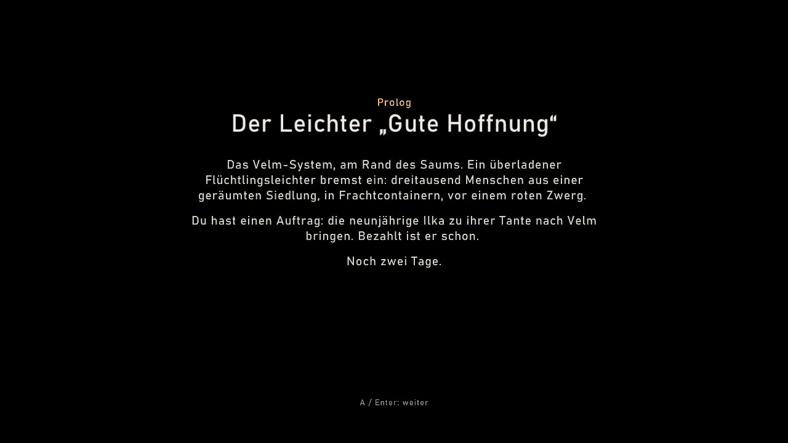
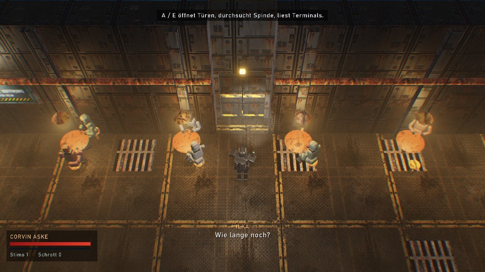
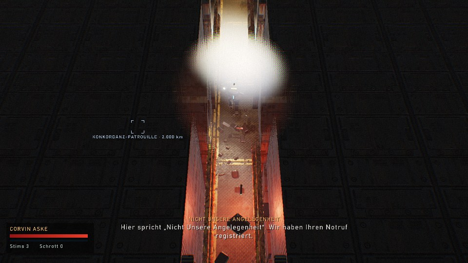
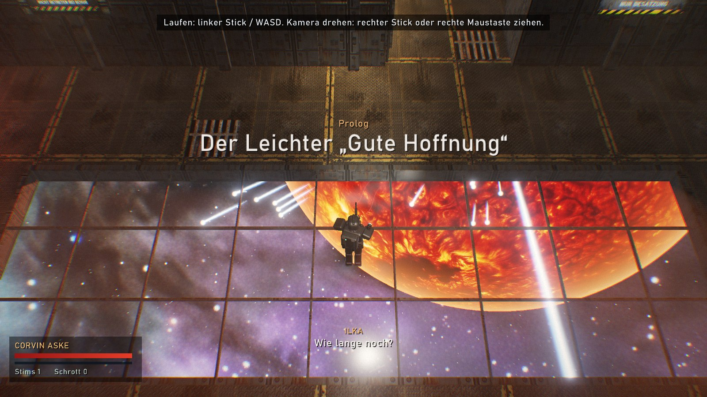
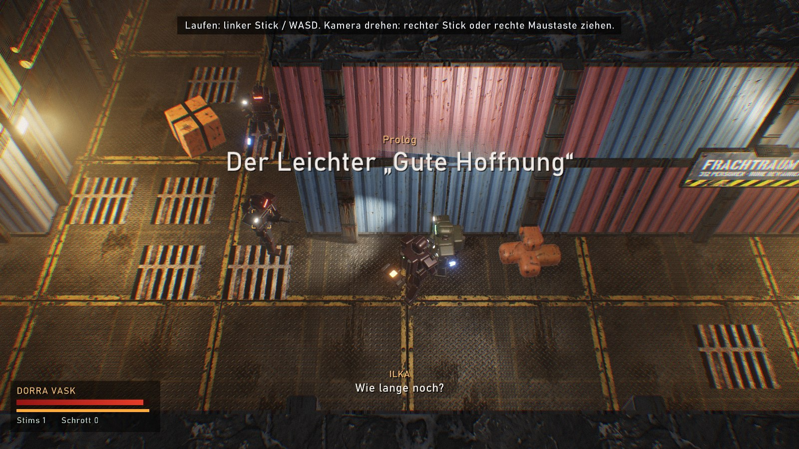
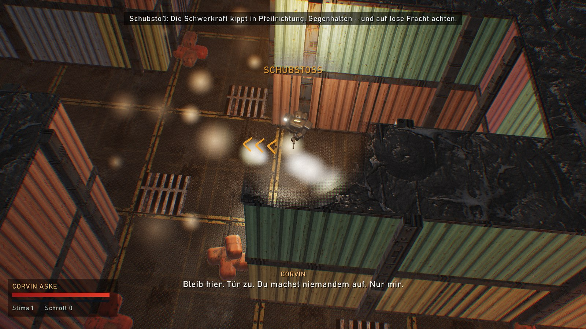
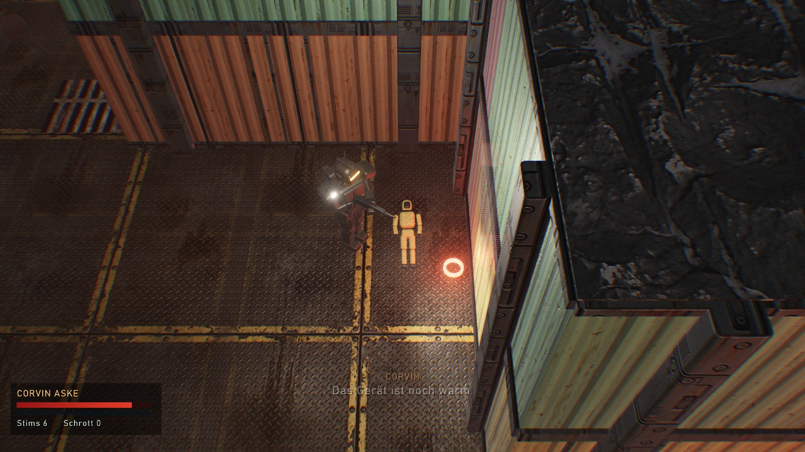
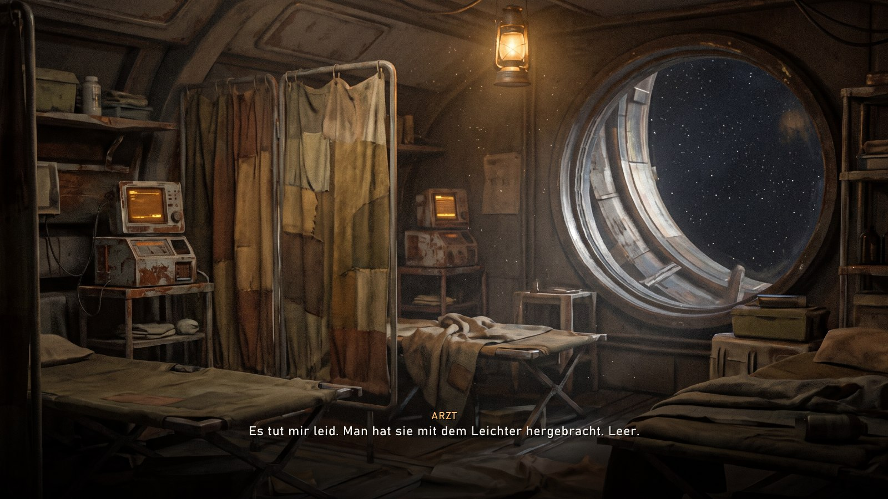

## Hub: Station Velm, the Third Drum

An alley in one of the three habitat drums turning inside the hollowed asteroid. No fighting: A or E talks; there is air,
so the hero goes without a helmet.

- **The street:** house fronts with lit windows, doors with lamps, shutters, striped awnings, flat roofs with
  skylights; strings of bulbs and washing across the alley; market stalls, benches, tubs of greens, vending machines.
- **People:** standing together at the stalls and the counter, sitting by the walls, strolling about (children among
  them); passing by, one hears what they say about the Harvest, the prices, the Marrow Market (24 lines, in turn).

- **The bar „Zur Letzten Schicht“** with Ottla behind the counter (she sells stims, and sealed crates: an item for the
  slot chosen with left and right, at the place's level, the rare ones more often than in a find), guests on the stools at the counter
  and at the tables (a pendant lamp over each), bottles on the shelves behind the bar, the harvest
  board on the north wall (61 settlements the Mill has taken, the newest in red, chalked in the game's own font) and a
  window in the floor: beneath it Velm turns past, the cavern's work lights, girders, the other two drums with their
  lit rooms and window bands.
- **Ysolde Varn**, who paid for the clinic: conversations with answers to choose, portraits beside the lines; she gives
  the first job (and 50 scrap down payment) and has new lines after level 1.
- **Anand's Workshop** (Kiri): the hero's weapon (more damage, less heat; Dorra's bolts come back sooner) and armour
  (+20 health) in ten levels each, paid in scrap (40 to 3,000 a level; the first three count fully, the later ones
  less: a weapon at level 10 does twice the damage, an armour has +49 armour and +195 health); sockets drilled; and on any worn item (left and right choose it)
  an affix rolled anew as another stat, or the item made one rarity better (common to magic: an affix; magic to rare:
  a name, the affixes a sixth stronger, up to three) – not on uniques and set pieces.
- **HAUSMEISTER**, the station's voice at a terminal; the clinic; the freight lift to the axis, which opens once there
  is a job to go to.

The conversations are in [assets/levels/velm.txt](assets/levels/velm.txt) (`[npcs]`, `[talk]`: nodes, answers,
events), their words in `assets/text/<language>/velm.txt`.

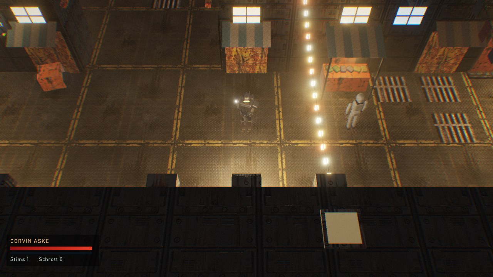
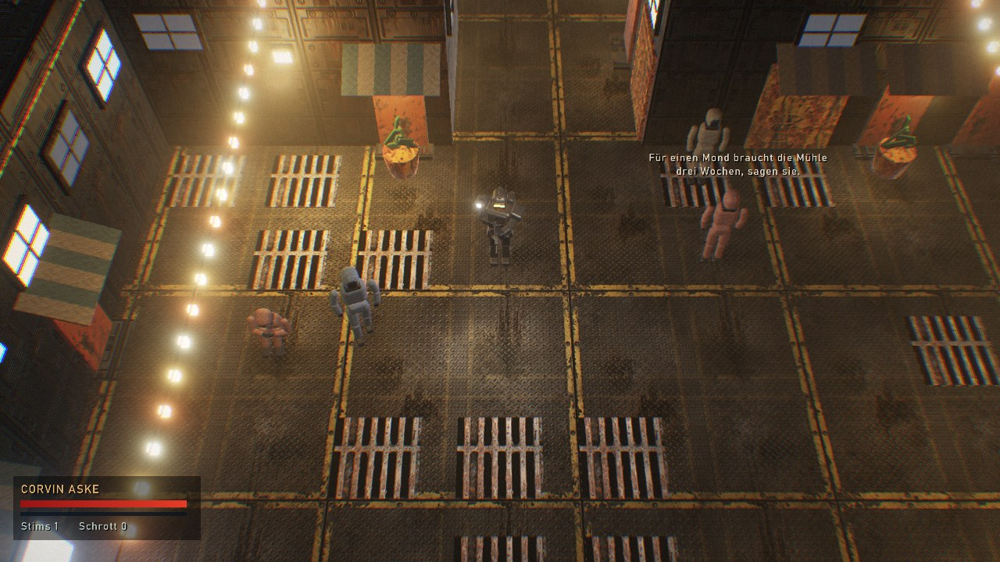
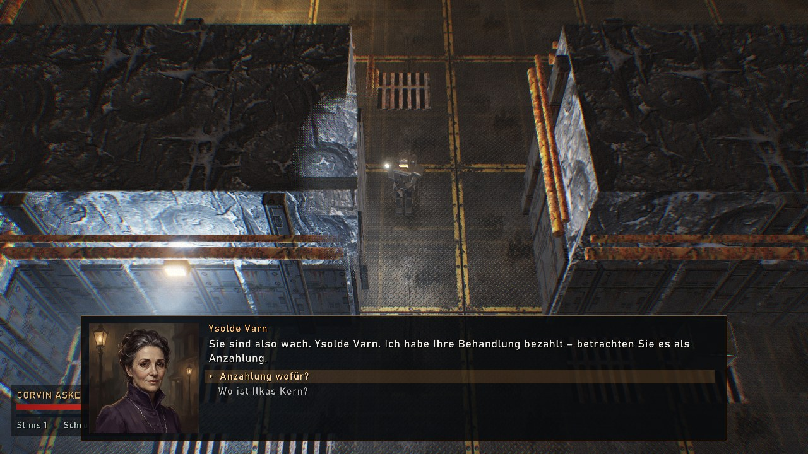
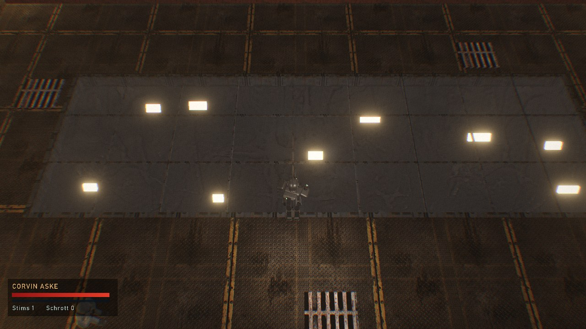
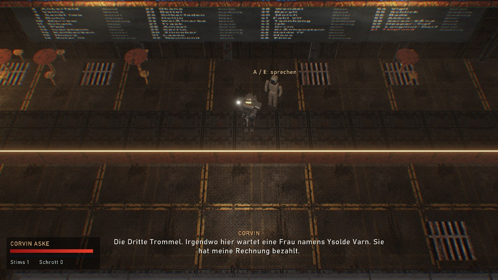
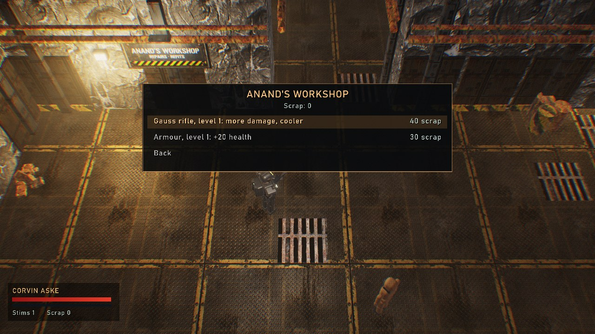

## Level 2 „Der Knochenmarkt“ and the Depths

The farm drum, where grain once grew; now a market for what is left of people. Ysolde gives the job after level 1
(talk to her again once she has sent for you); the lift asks where to. The level is **generated** from a recipe
([assets/levels/knochenmarkt.txt](assets/levels/knochenmarkt.txt)): twelve rooms on the way (market alleys with stalls
and cowering market folk, warehouses with container stacks, cold rooms, works), four side rooms behind doors with
lockers, a champion and terminals (the Taxator's ledger, an appraisal, a receipt with a seal), rescue capsules on the
way, and at the end the Taxator's hall behind a door: the boss in a brass exoskeleton who stomps, fires fanned volleys,
calls for help at 60 % and 30 % and finally charges. Each new game lays the market out anew; the hall stays.

**The drum turns:** the market lies on the inside of a spinning drum, so everything that flies is bent by the Coriolis
force: shots, bolts, grenades and the enemies' bolts curve sideways on long throws (the auto-aim leads them), and
flocks of birds wheel under the cavern's lights.

**The Depths** ([assets/levels/tiefen.txt](assets/levels/tiefen.txt)): the maintenance levels under the drum, open
from the hub's lift after level 1 and again and again, laid out anew on every visit, as strong as the hero, with a
guardian champion before the lift. For experience and gear. **Tiers:** at the lift, left and right choose the tier
(1 to 10; each one done opens the next): two areas deeper per tier, from the fourth at least two anomalies, from the
seventh three, and a tenth better finds and more experience per tier. Each visit brings one to three **anomalies**, named
under the place's name when it begins and on the character page: tough brood (more health), frenzy (quicker), outnumbered
(more packs), champions (more of them), blackout (the light dimmed, the fog thicker), low gravity, the bursting dead
(a short glow, then a blast that hurts the hero), thinned stims, merciless (harder blows), rich veins (twice the
scrap). Each one makes the finds better (by a sixth to a third) and brings more experience (`src/GameAnomaly.cpp`;
the recipe's `anomalies 3`, the table in `Level.cpp`).

**Enemies:** besides lice and boarders, market guards with riot shields (attack from the side), heavies with rotary
guns (a spin-up, then a long burst), hovering drones, saw bots in swarms, crawlers with charges (they go off near you
and take their friends with them). **Champions** wear a coloured ring and a name: swift (green), armoured (blue),
volatile (amber, explodes when killed), berserk (red), fiery (burning steps), charged (zaps across), flickering (steps
through nothing to beside you), shielded (a shield that comes back), splitting (two smaller ones when it dies),
bloodthirsty (drinks what it hits), icy (its cold slows you), summoning (calls helpers); from the third act on they
carry two gifts. They always drop an item. Every generated level has one **leader**: a name of its own
(»Eisenzahn«, »Schwarzglut« …), two gifts, an escort that hits harder and holds better while the leader stands and
falters when it falls; it drops a better item and a module.

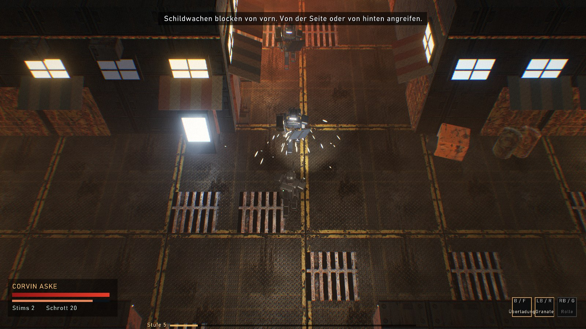
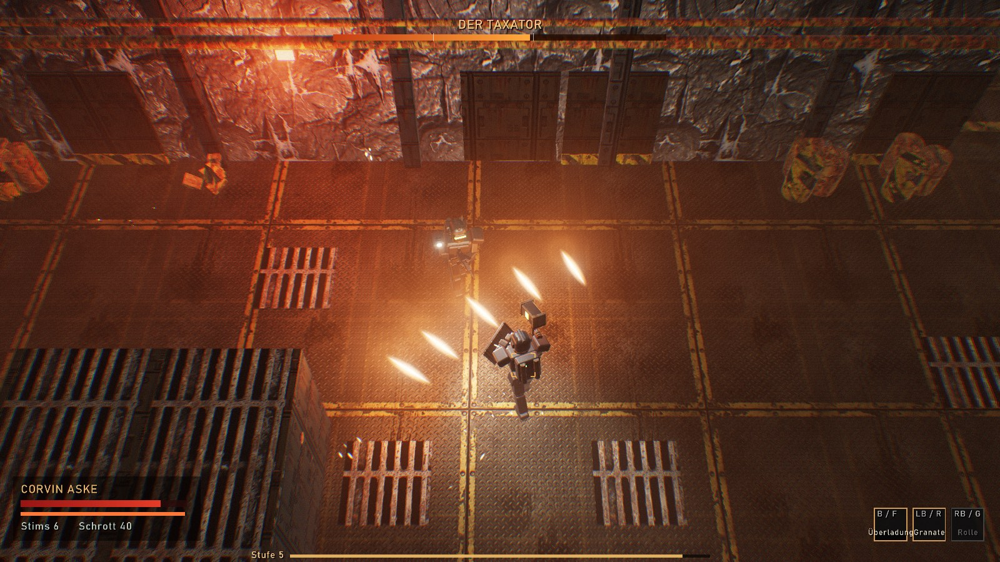
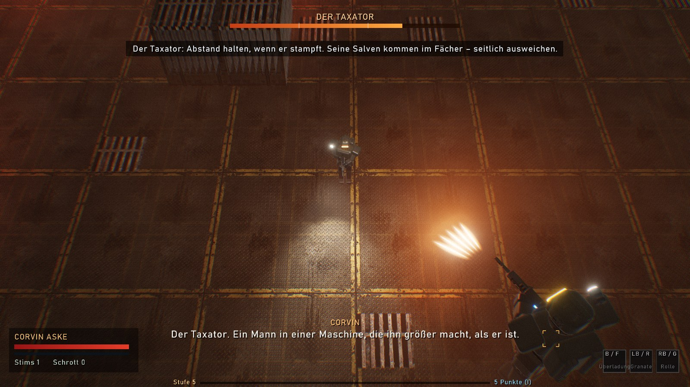
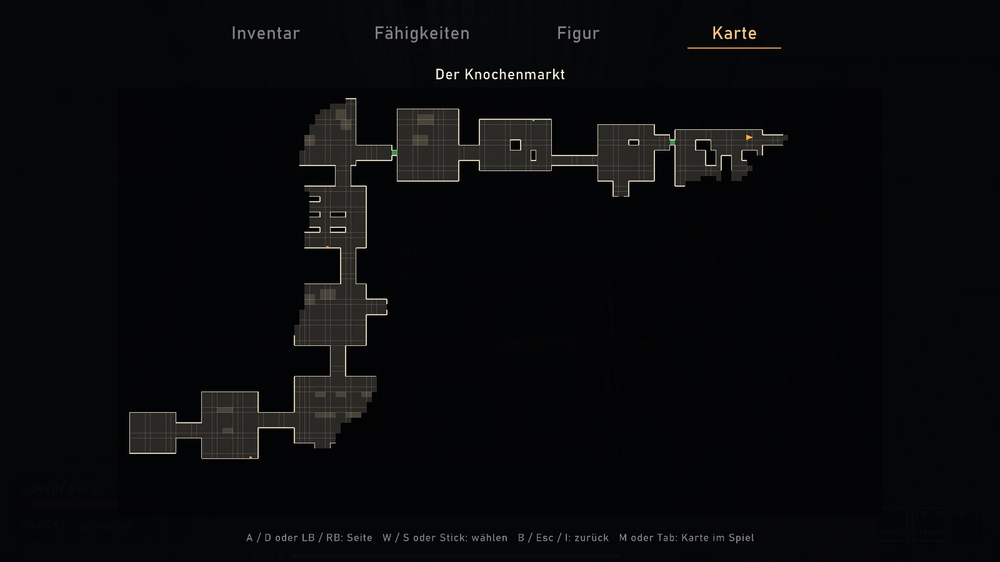
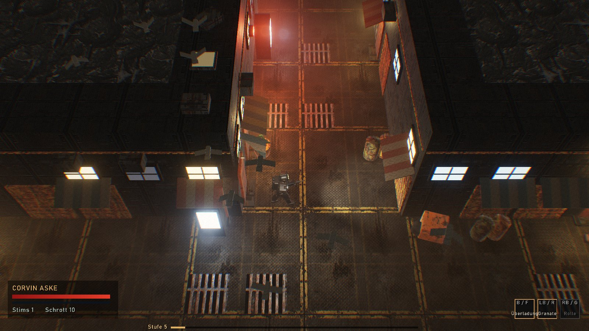
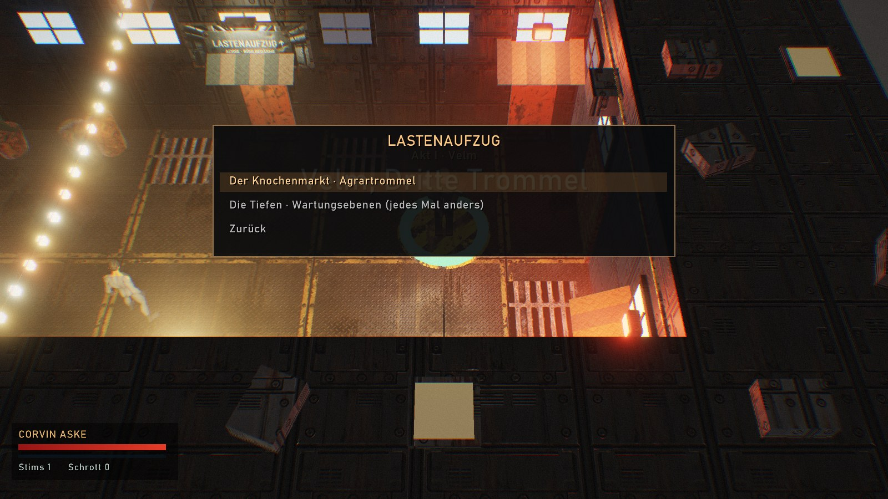

## Level 3 „Die Außenhaut“: vacuum, oxygen, radiation storms

The Taxator's receipt names the tug *Grace Period* at the cargo ring, outside on Velm's skin
([assets/levels/aussenhaut.txt](assets/levels/aussenhaut.txt), generated). Hull plates, gangways and catwalks over open
space with the red dwarf beneath; low gravity, no falling off the edge.

- **Oxygen:** outside, the suit holds a good minute and a half (the blue bar). The maintenance huts and the air posts
  refill it, blue canisters add some; at zero it costs health. Hits leak air.
- **Radiation storms:** the red dwarf flares every minute or so: eight seconds of warning, then six seconds of
  radiation that burns everyone in the open, enemies too. Shelter is a hut or anything tall close by.
- **The tug *Grace Period*:** a boss of parts – the deck gun on top (volleys of shells, red rings show where they
  land) and two engines at the back; bolts from the bridge (close along its hull they cannot reach), drones from its
  hangar. A broken part stays broken: without the gun no more shells. Hurt to half, it tries to cast off, sliding
  along the edge and firing faster; with all three parts gone it breaks up and its container drifts away.

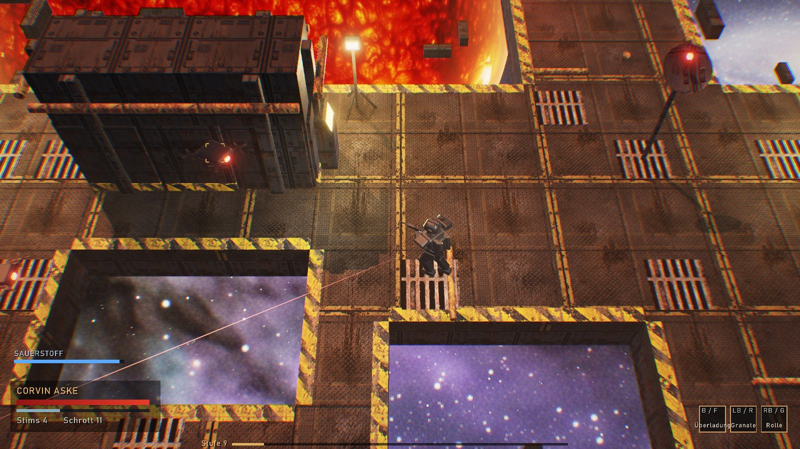
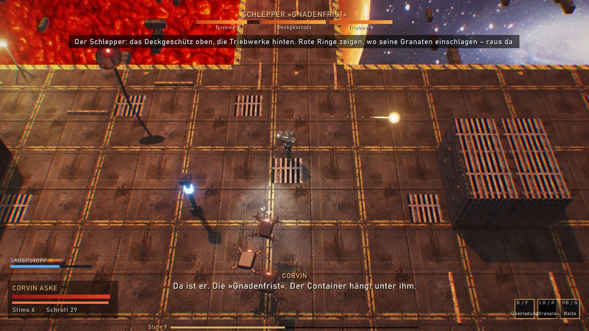

## Level 4 „Das Ertrunkene Viertel“: water

A quarter of the Second Drum where the tanks overflowed; at three metres per second squared the water gathered into
balls and stayed ([assets/levels/ertrunken.txt](assets/levels/ertrunken.txt), generated). Light dances on the floor
beneath them.

- **Under water:** slow, the shots weaker, the steps light; breath lasts about half a minute, then it costs health. A
  current pulls round in circles; the sound goes dull.
- **Shock gunners** charge where you can see it (blue sparks); in water their arc hits two and a half times as hard.
- **The Hydrauliker** (the Pumpwright), a man of steel and hoses who keeps the locks: his water jet throws you far
  back, his hammer strikes close, and he floods where you stand.

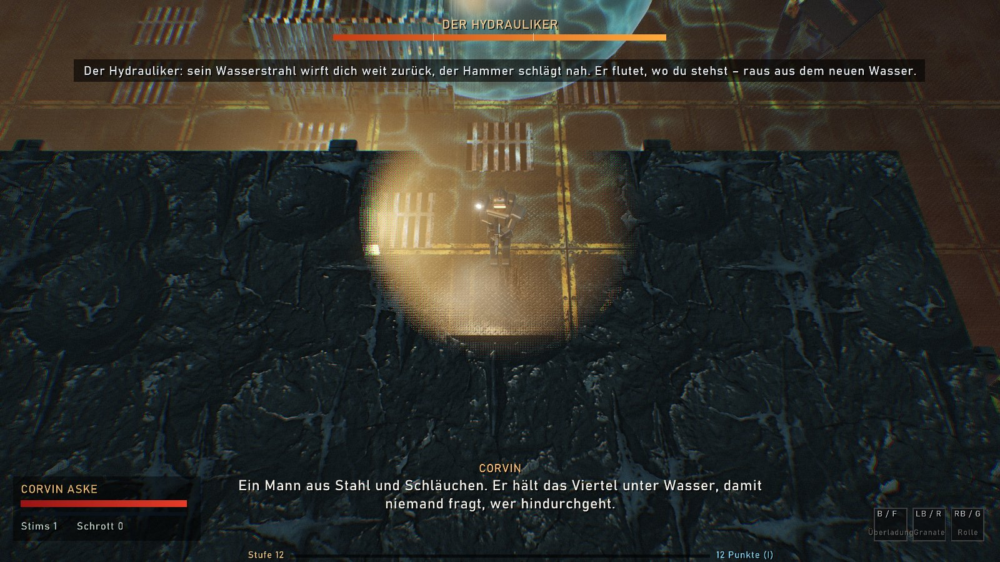
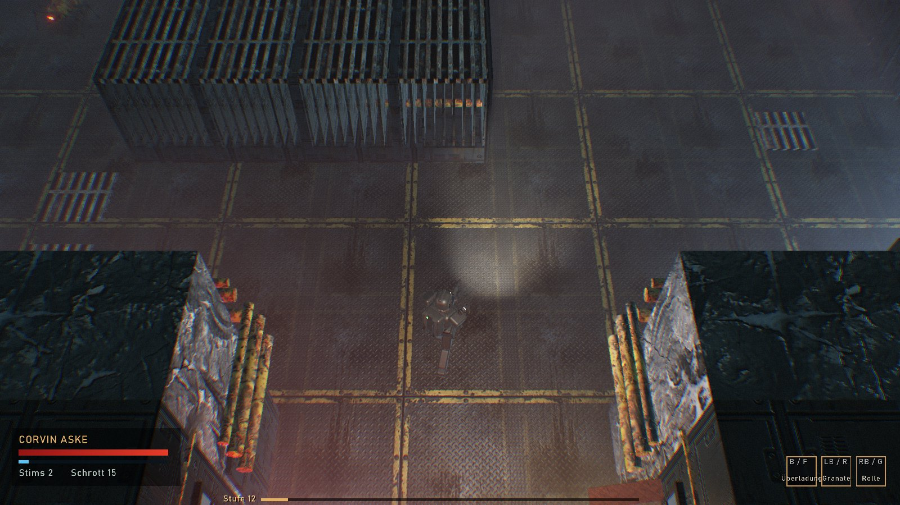

## Level 5 „Die Kernbank“: Mother Sevenfold

The vaults where Mother Sevenfold stores the harvested cores until they are sold
([assets/levels/kernbank.txt](assets/levels/kernbank.txt), generated).

- **Racks of cores** like a night sky, every light someone. A hit breaks a rack; the auto-aim will not shoot through
  them, grenades, bolts and blasts will. A terminal holds the register with Ilka's name.
- **Shells (Hüllen):** emptied bodies walking on a cheap core; slow, tough, they scratch close up.
- **Mother Sevenfold:** one mind in seven bodies, linked by three radio masts. While a mast stands the bodies heal and
  shrug off hits; with the masts down they stumble and fall like anyone. Leave every rack whole and the game remembers.

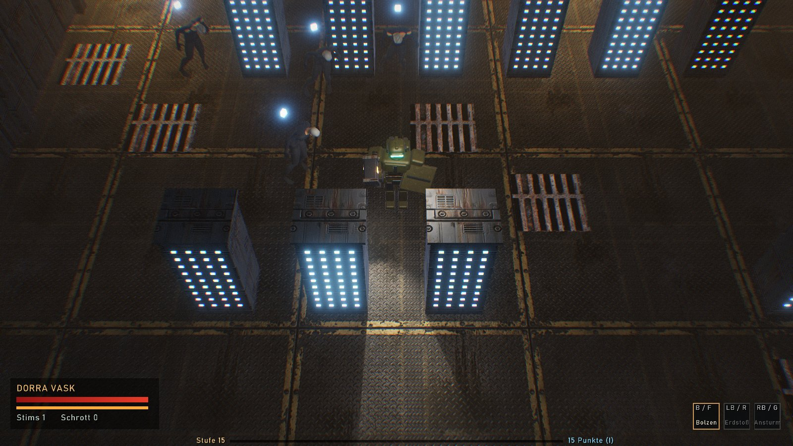
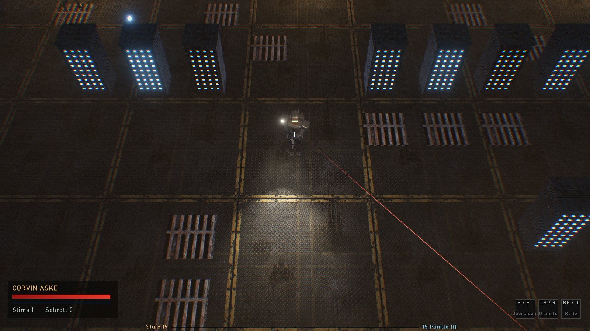

## Act I

After each level Ysolde has the next job (the lift lists every place already open; the Depths stay open). After the
Core Bank she learns where Ilka went – sold to the Mill – and names a ship in the dock below the bank: the lift takes
the hero there, and Act II begins.

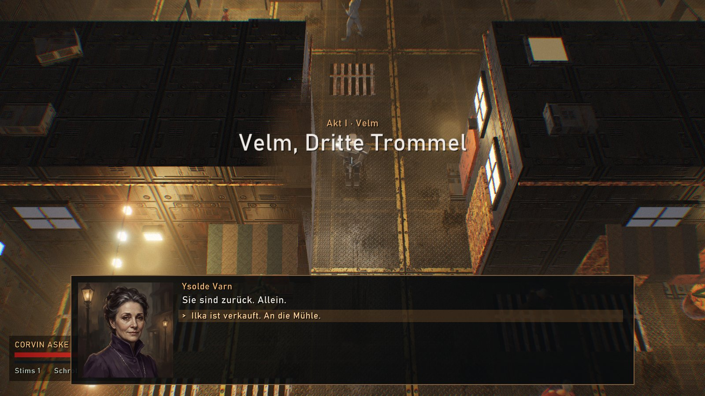

## Act II: the Harvest

**Hub: the »Unzureichend Ausgestattet«** ([assets/levels/unzu.txt](assets/levels/unzu.txt)), an old survey ship whose
retired archon, Unzu, the Skimmers had used as a data store: the bridge with a window in the floor (a gas giant drifts
by beneath it), the mess with Ysolde, Kiri's workshop, the trader radio (stims), the hold with the airlock. Ysolde
follows the cold chain of the stolen cores from place to place; Unzu comments each one with figures from his old
survey and slowly notices that memories are missing. The airlock's navigation lists every open destination, and the
**wreck field** (generated anew each time, as strong as the hero) stays open for practice and loot.

Every place has its own look (new themes: ice, refinery deck, twilight rock, sleeper halls, star lifter station, snow,
transport hold; out in nature the ground is stone, dust or snow), its own mechanic, enemies, boss, music and background:

| Level | Mechanic | Enemies | Boss |
|---|---|---|---|
| 6 Seren, the Glass Sea | floes of clear ice over a glowing ocean; ice breaks under blasts and Dorra's hammer, a fall through costs health and warmth; the suit's warmth fades in the open (huts, heater posts) | Concession guards in white and orange, snipers, torch cutters, pump drones rising out of bore holes | the Icebreaker, a drilling rig in the open water whose control core thinks the fight is another shift |
| 7 Hesper, the refinery in the clouds | platforms over a thousand kilometres of storm; wind bends what flies, gusts sweep enemies off the edges; lightning, balloons | balloon guards hanging over the abyss (shoot the balloon), snipers, drones | the Bell, a guard airship; then a control core asks to be switched off (a choice) |
| 8 Halden, the twilight world | heat on the day side, frost on the night side, a twilight band between; a hot wind bends shots | clearance squads in olive: flamers, hounds | Clearance leader Okafor in a combat walker; beaten, she offers a deal (a choice) |
| 9 The ark »Langmut« | cold everywhere, little light; every door needs power – route it from the sleepers' pods (it costs sleepers) or fit a power cell from a side room | Concession boarders with torch cutters | the boarding leader in a cutting exoskeleton; then the ship's administration asks what to tell 80,000 sleepers (a choice) |
| 10 The object of Tesh (optional) | an alien structure; hardly any gravity, cold everywhere, wandering components that crush | salvage crews | the salvage master in his cutting scaffold; then Pell, the last researcher (a choice) |
| 11 The star lifter of Kael | a river of star matter across the sky; the radiation dose builds up in the open, plasma gusts, magnetic coils that bend shots | turrets, snipers, cutters | the Plasma Lance, whose control core was installed by Ione |
| 12 The Wanderer | total darkness (enemies see the hero only up close unless he stands in a mast's light; he carries a lamp), cold, nitrogen geysers | works security in black, snipers, turrets | the works security's guardian; then Director Hale talks (a choice) |
| 13 The cold-chain transport | the guard keeps sending squads, the clock to the Mill runs; cargo windows show the Mill | the transport guard | the guard leader – then two ships of the Silent Collegium, and everything goes white: the end of Act II |

The choices (balloon 17, Okafor, the ark, Hale) are kept as flags for the epilogue. The level numbers follow the
story's outline; level 10, the object of Tesh, is an optional detour Unzu offers after the ark: an alien structure in
the comet cloud, hardly any gravity, cold everywhere, wandering components that crush, the salvage master in his
cutting scaffold, and Pell, the last researcher (a choice). Someone who waits to be spoken to in a
fight's level (`npcafter id event` in the level file) shows where the boss fell once it has happened.

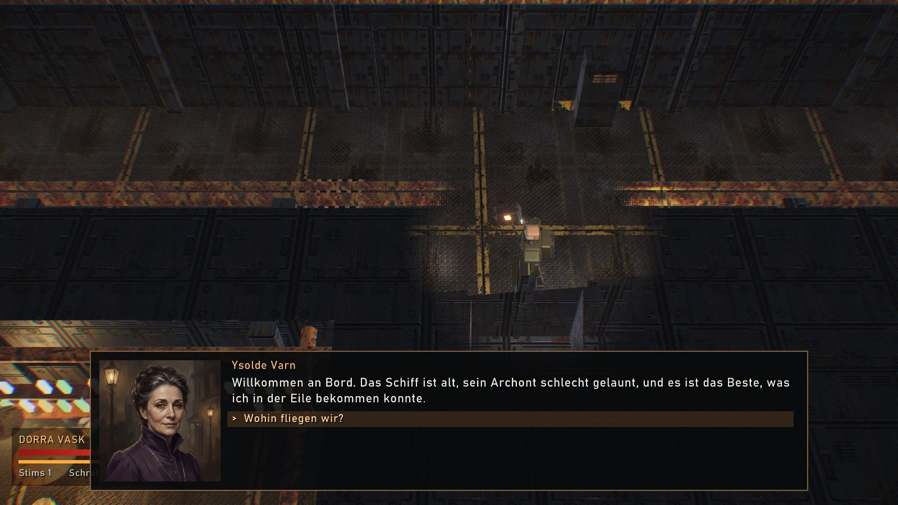
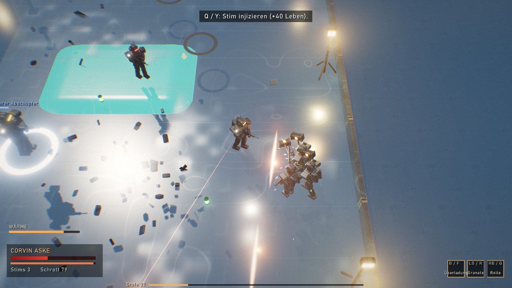
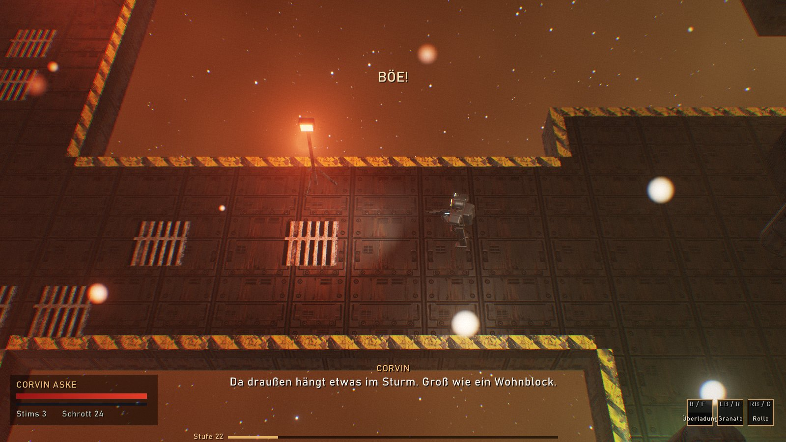
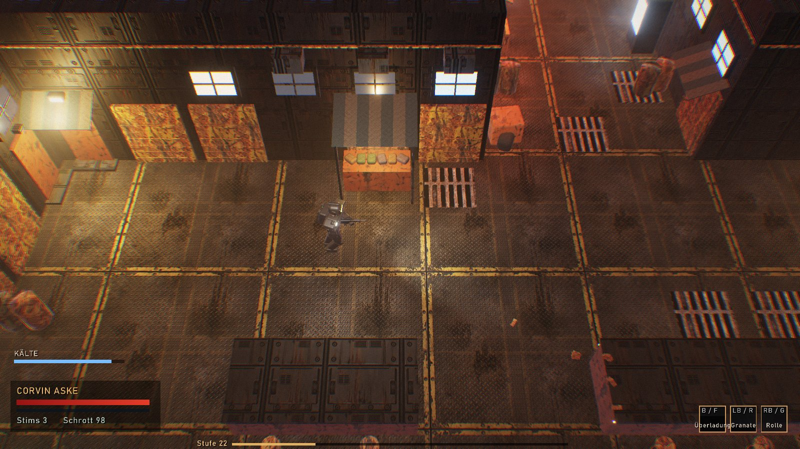
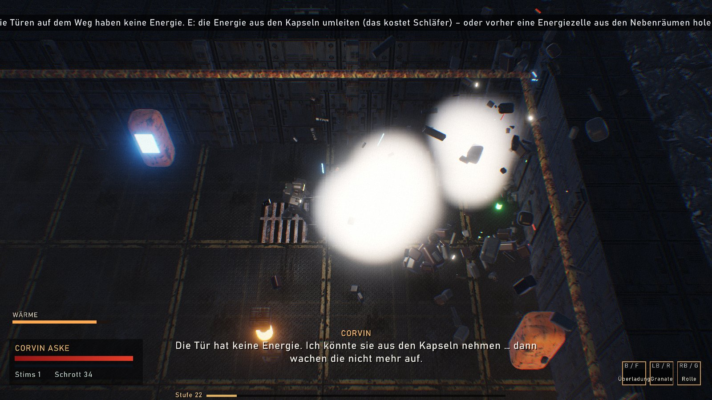
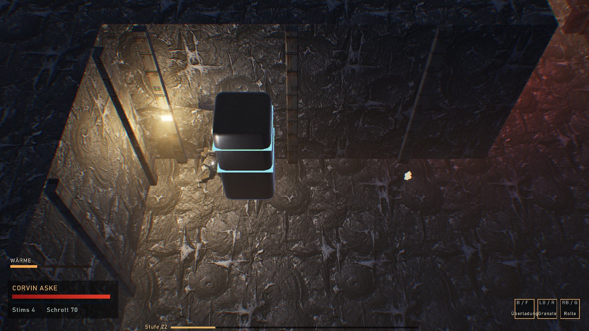
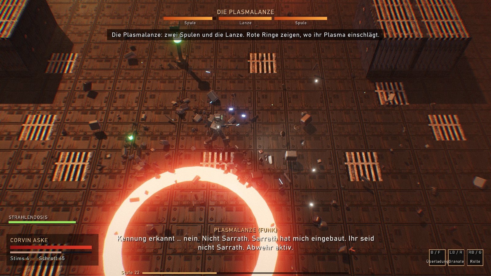
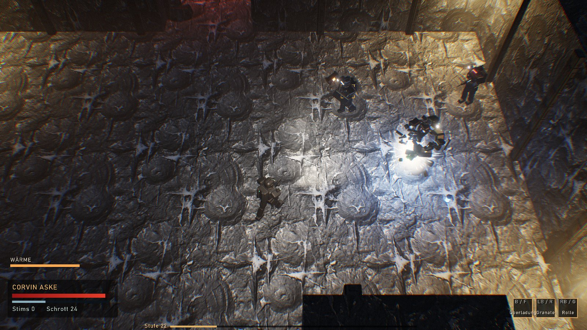
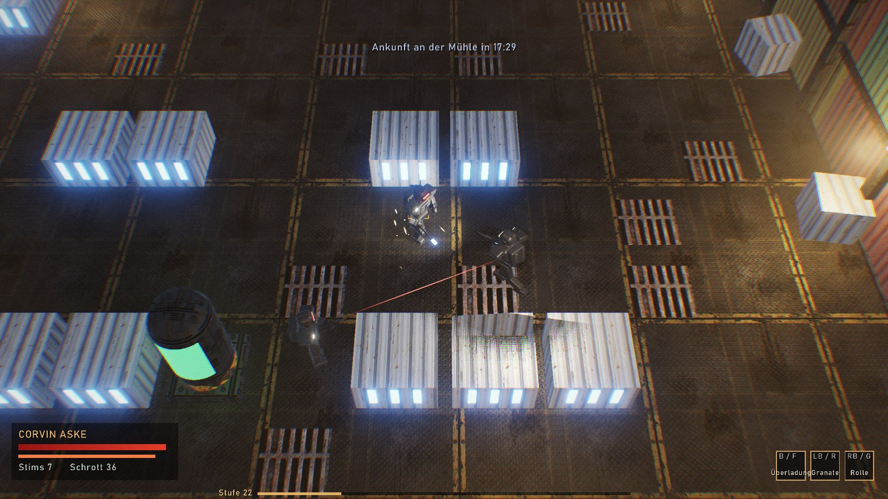

## Act III: the Concordance

The transport goes white, and the heroes wake in new bodies: **14 The Reembodiment**
([assets/levels/klinik.txt](assets/levels/klinik.txt)) is a quiet clinic on Ring Serenity – a mirror, Ysolde on the
terrace, and the body counselling that frees every skill point once to be given anew. Arriving there (and on the
ring), the camera first looks up: the land rises on both sides into the sky and closes overhead into a thin arch, its
far side in the night, its towns glittering (`view ring`, `vista s`; the ring is a band drawn by the planet shader in
its ring mode, its land painted at load). **Hub: Ring Serenity** ([assets/levels/gelassenheit.txt](assets/levels/gelassenheit.txt)):
Ysolde's flat, the garden with Kiri, a dispenser on the promenade, Unzu on a terminal from the dock, a tram to the
destinations.

| Level | Mechanic | Enemies | Boss |
|---|---|---|---|
| 15 The Dying Gardens | gardens where citizens die for fun; in the arena four rounds with changing rules (low gravity, darkness, a storm off the ring wall, quick champions only); waterfalls drifting with the spin | duellists and arena gunners in teal, bred predators | Teodor Lamm in his arena frame – he dies once and is printed again |
| 16 The Yard at the Gate | scaffolding over the stars, hardly any gravity, no air, girders that wander and crush; freight papers on terminals that the cleaners wipe one after another (`evidence`) | the Silent Collegium's cleaners in grey, snipers, torch cutters | the cleaners' chief in his frame and his squad |
| 17 The Hearing | first a conversation with an archon's avatar (the papers saved decide its words), then the attack in halls full of people who don't run (`crowd`, `pressureafter`) | the Collegium's drones | a swarm of drones fed by three carriers |
| 18 The Computing Moon | cold everywhere, superconducting coils that bend shots; the archon's voice from every wall | saw bots, maintenance robots, turrets | the moon's defence: maintenance robots steered by computing cores; then the archon gives the codes, and Unzu reads his memories |
| 19 Vault Zero | the heat shield turns: outside, whoever leaves its shadow burns (`meter shadow`, `shadow`) | cleaners, snipers | No Cause For Concern, a swarm of thousands that dives all at once; then Ruul, then Ysolde – the deaths counted since the prologue, the Lullaby, and everything goes white |

## Act IV: the Mill

**Hub: the ship on the way back** ([assets/levels/unzu4.txt](assets/levels/unzu4.txt)): Ruul in the mess instead of
Ysolde, Unzu with his memories, Kiri, the trader radio; the wreck field and the depths stay open.

| Level | Mechanic | Enemies | Boss |
|---|---|---|---|
| 20 Velm, the Last Week | the hub of Act I as a battlefield, the Mill filling the windows; landing squads keep coming; HAUSMEISTER's turrets fight on the hero's side (`thing ally`) | Concession guards, torch cutters, saw bots | the cutting platform at the hull: lines that glow, then cut |
| 21 The Dismantling of Brannt | a moon being peeled: crust over glowing rock, cutting lines that slice it away (it closes again after a while; `crust`, `cuts`), low gravity, no air | cutters, drones, Concession guards | the cutting column – one of its cutters hesitated, and talks afterwards (a choice: the 300 refusers in the old mine) |
| 22 The Ore Stream | container roofs over the stars; thrusters for jumps in mid-air (`jetfuel`), the Mill's laser pulses (`pulses`) | guard drones, turrets | the catcher – before its clock runs out (`clock`) |
| 23 Inside the Mill | channels of molten metal (`lava`), centrifuges that fling one outward (`thing spin`) | machines with control cores | the foreman in his crane walker; then he talks (a choice) |
| 24 The Control Room | server halls, the Collegium's squads | cleaners | Ysolde in her frame |
| 25 The Net | the night shift's world, patched from canteens, classrooms and kitchens; people who stay at their places; the night shift's flashes take part of the swarm (`zaps`) | deletions | No Cause For Concern's deletions; then Ilka, and the ending |

**The endings.** Ilka offers three: the Lullaby (the forty thousand go out, Velm stays), the Disclosure (everything
sent to every station), the Night Shift (the codes to Ilka) – the last only if the night shift trusts the hero: three
of six ways a control core was treated as someone (the Core Bank's racks spared, the Icebreaker's core taken along,
balloon 17 switched off as it asked, the Lance's message sent, the hesitant platform asked to cut around the mine, the
foreman spared). An answer may need a flag (`answer>node?flag`, `?!flag` its opposite). Then the **epilogue**: a card
for the ending, one for each great choice made on the way (the Core Bank, Seren, Hesper, Okafor, the ark, Pell, Kael,
Hale, Brannt, the foreman), the hero, Unzu (who asks for a new name), Ysolde and the harvest board (`epilogue event`
in the level file; GameStory.cpp). The deaths are counted across the game; Ysolde names the number at the end of Act
III (`{deaths}` in a text), and from then on every respawn shows the Collegium's mark.

**New in the code:** GameAct34.cpp (the ring, the vista, rounds, evidence, the shadow, crust and cutting lines, pulses,
jets, centrifuges, molten metal, allied turrets, the catcher's clock, waterfalls, crowds), GameSwarm.cpp (a boss of
many: carriers that make units, units that circle and dive, the archon's dive all at once, the night shift's flashes),
GameStory.cpp (deaths, trust, the act's end card, the endings, the epilogue). The exoskeleton has four more men
(Lamm, the cleaners' chief, the foreman, Ysolde), the berth three more machines (the cutting platform, the column, the
catcher). Things without a map character are placed by name (`thing r c name`, generated by `genthing name rate
where`). The factions' men are called by their own names (the Concession's guards, the Collegium's cleaners).

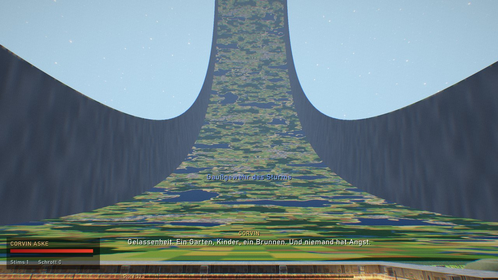
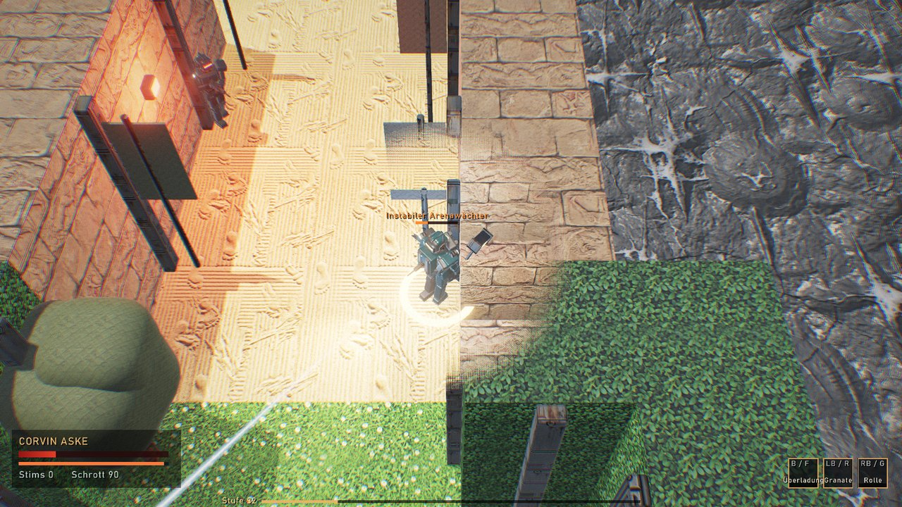
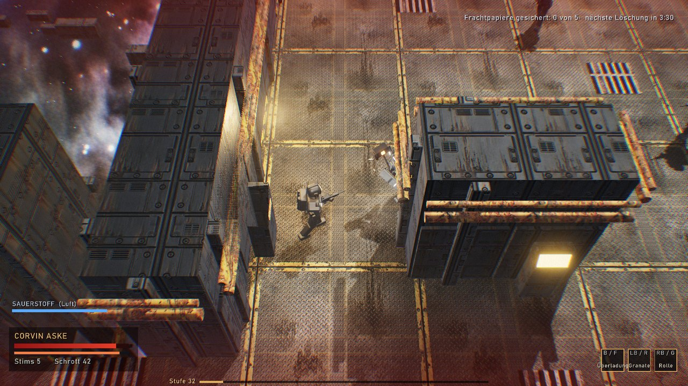
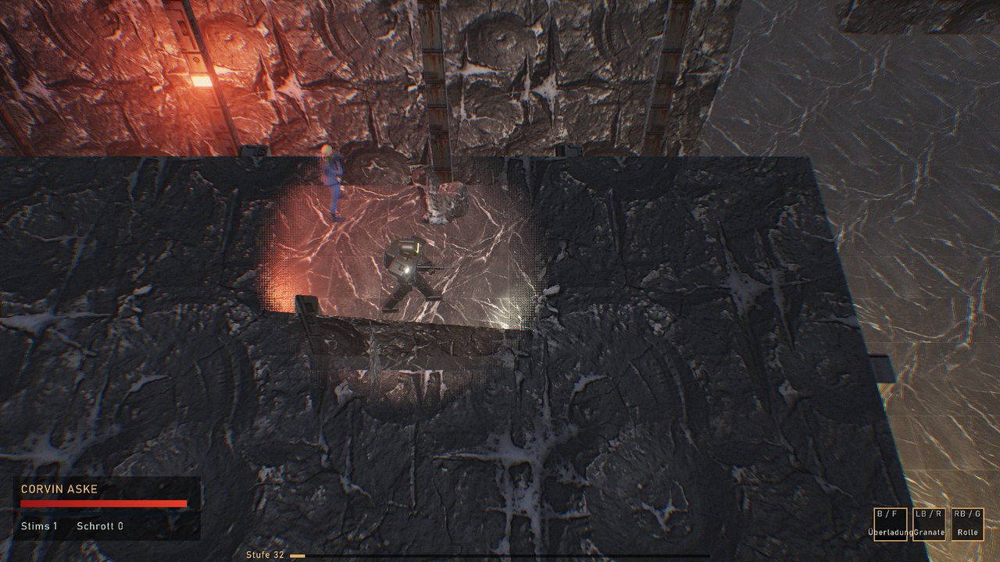
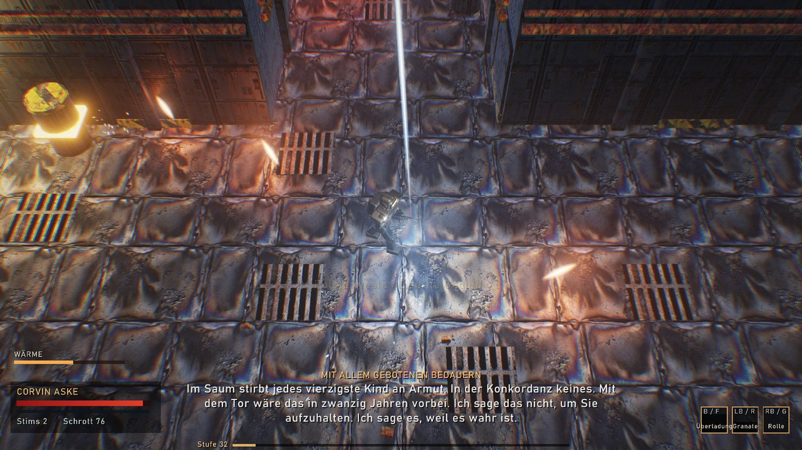
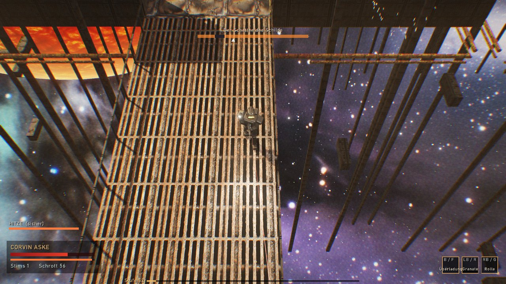
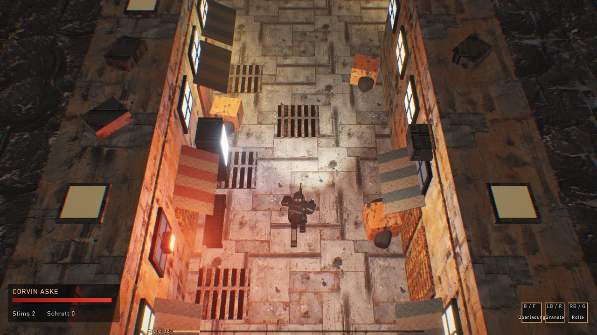
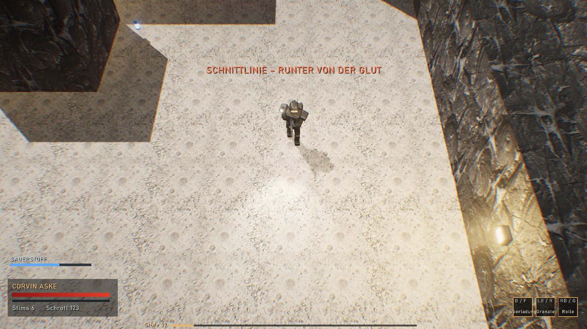
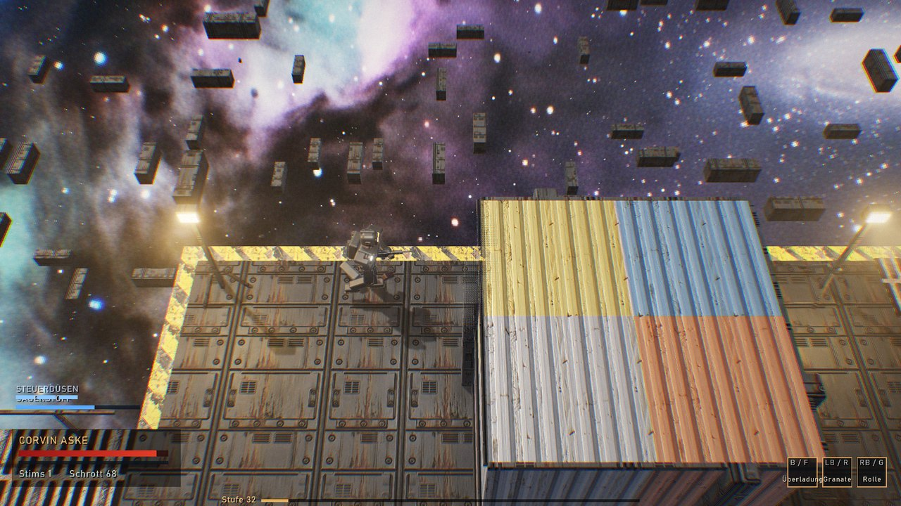
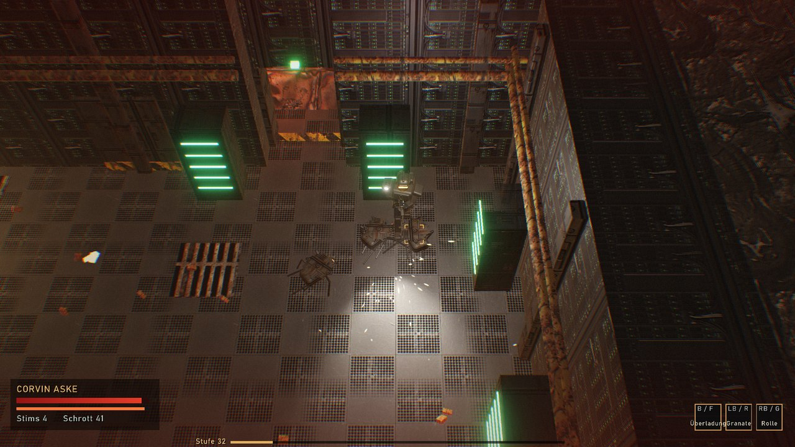
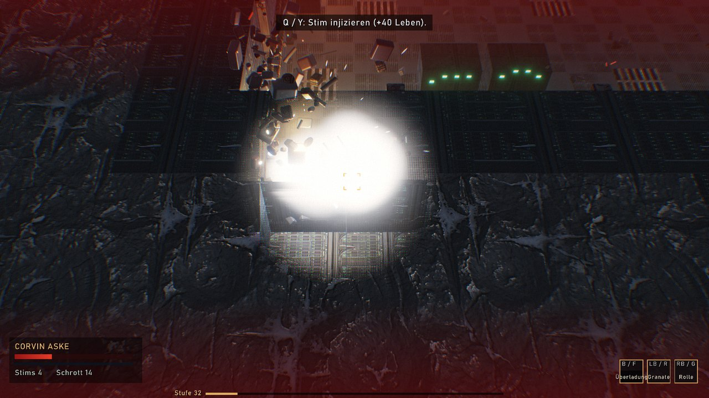
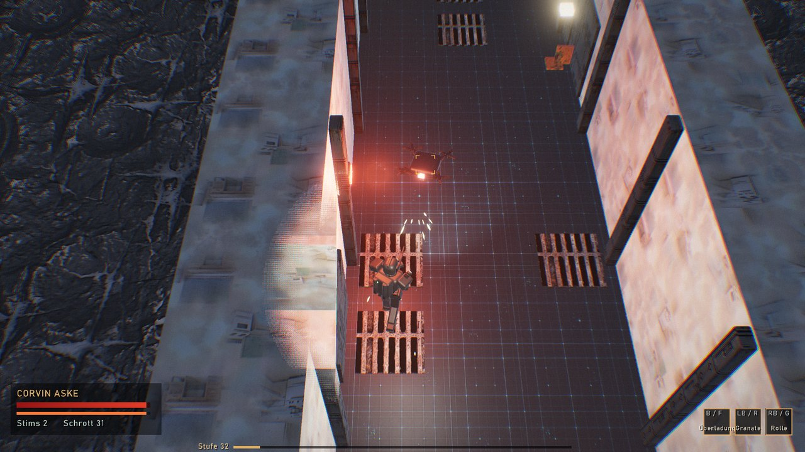
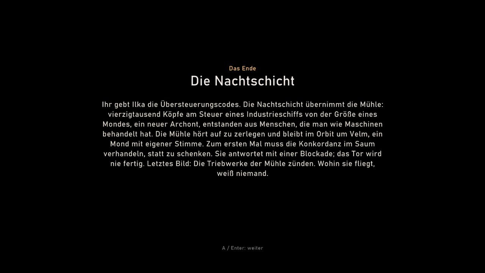

## The companions and their tales

The two heroes one does not play are along: in Velm's bar, in the ship's mess and in Ysolde's flat on the ring they
sit at a table (the nearest free stools; GameTales.cpp) and talk – about themselves, about what has just happened,
about each other – a few times in every act (`dorra`, `corvin`, `ione` in a hub's `[npcs]`; the one played is not
there). What they say to the hero depends on who the hero is (`key.dorra`, `key.ione` …); an answer can depend on
several things at once (`answer>node?hero.corvin&!done.tale_corvin`).

After each act one of them tells a story at the table, and it is played: a short level as the one who tells it, in
its own light (`teller`, `grade`, `rain` in the level file), with the gear of their kind at the real hero's strength
and their points already spent; the others cut in. What the real hero carries waits outside (half the tale's
experience comes back), and nothing found in a tale can be taken along. When the hero is the one whose tale it is,
the others ask for it.

| Tale | Told | Played as | What it is |
|---|---|---|---|
| A confession (`tale_corvin`) | aboard, after Act I | Corvin | Odile, a moon where it always rains, nine years ago: Corvin in Hakon Dreier's crew of harvesters, house by house through the settlement of Kessel, until the last door with a yellow boat on it. Noir, black and white, rain. |
| Incident report 7-114 (`tale_ione`) | aboard, after Kael | Ione | The star lifter Kael three years ago, a night shift: the new control cores wake all at once, the maintenance machines panic, unit 2281 asks for help over the maintenance line, shift supervisor Brask wants them all reset. Read out with the times, getting more personal line by line; cold, the red of the emergency lights. |
| Day forty-one (`tale_dorra`) | on the ring, after the yard | Dorra | Kalvar twenty years ago, near twice Earth's gravity, the uprising's last days: the union's barricade guns fire along, Major Siel in her walker, the conveyor station Deep Seven and the detonator. A chronicle with dates; sepia. |
| Survey log 3.112 (`tale_unzu`) | aboard, after Act III | Unzu's survey drone | Talgrund thirteen years ago, 412 inhabitants: fly close to the people to count them (`census`), while white deletions eat into the memory; Thorough Review, the archon who revised him, at the end. Unzu's drone hovers, cuts with two blade arms and jams what is close (B/F). Survey green. |

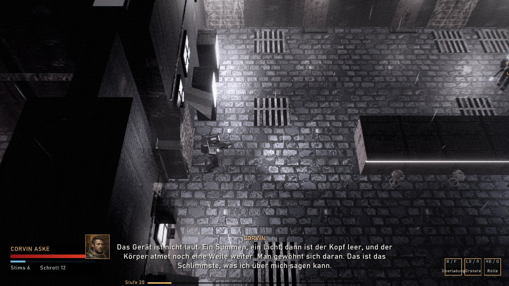

## The places' creatures

Thirteen families of their own, each in three tiers (another name, more health and harm, more of what it does):
crystal wardens (shards in fans) and phase shades (step out of nothing beside you) in the object of Tesh and the
ark; cable eels (lunge and shock) and diving drones (torpedoes that burst) in the drowned quarter; arena beasts
(horned bulls in a leathery hide that trot on jointed legs, charge in a line, dazed when they hit a wall) and strangler vines (whip close, spit acid far) in the dying gardens;
frost cores (bolts that chill) and ice spiders (leap, spin webs) on the computing moon, Seren, the cold transport and
the dark world; slag golems (slam the ground) and magma crawlers (a burning trail, they burst) in the Mill and on
Brannt; memory phantoms (flicker, volleys from beside you) and glitches (split in two when they die) in the net and
the control room; crust crabs (an armoured front: from the side) on Brannt and the twilight belt. Three of the
guardians are creatures now (a glacier spider, a nightmare, a zero-point core).

Hits are of four kinds – kinetic (slugs, blows, blades), heat (plasma, embers, fire, blasts), shock (arcs, mauls,
sparks), acid – and every enemy shrugs some off and fears others: machines are weak to shock, suits to acid, the
golems and crawlers all but shrug off heat, the eels shock, the vines burn, the crystals and phantoms laugh at slugs.
Nothing is immune: a resistance takes three quarters of a hit at most (a guardian proof against the only weapon one
carried would bar the way for good), a full one only keeps off the kind's burning or stun.
**Fighting together** (`src/GameTactics.cpp`): those that close in come from the sides – two of three bend away
from the straight line as they near, so they arrive round the hero – and one that would arrive alone while two or
more are still coming circles a little way off until they are there (two and a half seconds at most; champions never
wait). Those that shoot step behind cover when they are hit (a floor cell close by from which the hero cannot be
seen; no two take the same), stay a while and come out again to shoot; one up on a ledge stays up there while it sees
the hero. The guards, the heavies, the drones and the bosses keep their own ways.

The weapon's kind is in its description; the enemy one aims at shows its name and what it is weak to, tough
against or all but immune to; a hit on a weakness calls it out, one that barely hurts too. Burning ground, acid and frost hurt, eat at the armour or
slow the hero (shown under the stock line). `--creatures 0|1` with `--shot` lines them all up
(`--level ../../tools/creatures.txt`, a plain hall for that).

## Items, levels, skills

Kills, champions, lockers and bosses drop gear with a beam, a label and its painted picture: common, magic, rare, set
and unique. **Ten slots:** weapon, suit, helmet, gloves, boots, two implants, and three of the setting's own instead of
amulets and rings – a **utility harness** (more stims carried, air, what one finds), a **shield emitter** (an energy
shield that takes hits before the health and fills again after three quiet seconds: quick small ones, strong slow ones)
and a **power cell** (shorter cooldowns, harder skills, larger blasts, on the best a rank on every skill).
**145 kinds:** six weapon families per hero in three tiers (Corvin's rifles, carbines, scatterguns, rails, plasma and
arc throwers; Dorra's hammers, axes, picks, mauls, breakers and drill lances; Ione's cutting, needle, spark, ember, acid
and guardian swarms), the suits in three weights and three tiers, the rest likewise, and eight kinds of module.
**28 affixes** that grow with the item's level (besides the old ones: shield, recharge, skill ranks, skill damage,
health per kill, stims carried, air, resistance to the place, area, damage against machines or against people).
**70 uniques**, each with a line of its story and a **power** of its own (a crit that arcs on, kills that explode or
heal, a companion drone, a shock ring when hit, a second life once per place, rage, loot drawn from afar, a ring of
fire when the gun runs hot …); **8 sets** of four pieces (two per hero, two for anyone) with bonuses for two, three and
all four pieces worn. **Sockets:** plainer items come with up to three; modules drop on their own and go into a free
socket from the inventory; Kiri drills sockets into the weapon and the suit for scrap. The gear shows on the hero: each
weapon family has its own model, the tiers add metal and light, the suit's weight its plates, and a line of light
glows in the colour of the rarest thing worn; Ione's drones take the colour of her swarm.

Walking over an item picks it up (and puts it on if the slot is empty); the inventory shows each item's picture,
compares, puts on, takes off and salvages for scrap. Experience gives hero levels (to 40) and a skill point each: per
hero five passives and three active skills (Corvin: overcharge B/F, grenade R/LB, roll G/RB; Dorra: blast bolts B/F,
quake R/LB, charge G/RB; Ione: takeover B/F, first aid R/LB, cutting storm G/RB). The pictures are painted by
`tools/make_items.py` (Gemini's image model; `--reverse` runs a second pass from the end of the list).

## Map, inventory, character

## Dorra

Short and broad from a world of 1.9 g, in the plates of her old mining suit. The trigger strikes; held, the blows run
forehand, backhand and the overhead slam, whose blast bolt goes off in a ring. The left trigger (Shift) raises the
shield: shots and blows from the front are stopped, a boarder's baton is thrown back. B (F) throws a blast bolt in an
arc at what the auto-aim picks: for gunners far off, and for the drone press's core, which hangs too high for the
hammer; its tanks she smashes at the base. 140 health, a little slower than Corvin.

## Ione

Ione Sarrath, a Concession maintenance technician until a core asked her for help, with forty micro-drones round her
(GameIone.cpp). The trigger sends the swarm at what the aim picks; it swarms round it and cuts as long as the trigger
is held (no recoil, shorter reach than the rifle). The left trigger (Shift) couples the drones into a curved screen
that stops most of a hit from the front and the sides – but it tires the swarm (the bar under her health), and a
spent swarm neither screens nor cuts until it has recovered. B (F) takes over a machine (lice, welders, drones, saws,
fuses): for a while it turns on its own and then burns out among them; a person or a boss is only jammed for a
moment. Her skills: a bigger cloud, faster relays, coupled plates, a field medic, short circuits; first aid (her
drones close the suit and the wounds under it) and the cutting storm (the whole cloud spins round her). Swarms of
her own drop: needles that go through, sparks that jump, embers that burst, and their second tier. 95 health. Where
her past is, she has lines of her own – on Kael above all, where the lance's core is the one she installed.

## Level 1 „Die Kühlgedärme“

Heat-exchanger tunnels near Velm's axis: little gravity, fog, rust-red emergency light. Corvin Aske with his Gauss rifle
against rust lice and welder lice: from the start through a condensate cavern (heat exchangers for cover, a raised
shelf, droplet swarms, eleven lice and two welders; a pump gallery off its west side with more lice, scrap and a stim)
up into the hall of exchangers, across a cooling shaft, past the cold store with the empty bodies, to the drone press
that builds new lice from scrap. The cavern and the gallery came on 28.10.2026: the level had a third of level 2's floor
and a quarter of its foes.

- **Low gravity:** long jumps; every shot pushes Corvin back, on the ground a little, in the air a lot.
- **Aiming:** the rifle takes the nearest target ahead (as in Brotherhood of Steel); on the gamepad that is all, since
  the right stick turns the camera (as on the Steam Deck); on the PC the mouse can aim by hand, with a little assist.
  Holding the left trigger or Shift keeps Corvin's facing, so he can back off firing. The rifle heats up.
- **Camera:** turns about Corvin with the right stick or by dragging with the right mouse button, the stick's up and
  down zoom; moving is always relative to the screen; a stick click or Backspace turns it back.
- **Enemies:** rust lice (six legs in a tripod gait, they crouch and leap), welder lice (keep their distance, spit
  molten metal in arcs); they find their way on a flow field.
- **The drone press:** a ram that slams on its anvil (klaxon first, the anvil glows red), hatches that spit new lice,
  two coolant tanks as weak points (marked on screen, the boss bar in tank / core / tank); with both burst, the
  shutters open on the core. Corvin and the hints say what to do; shots on the armour bounce off grey.
- **Areas of their own:** the maintenance access (warm light, crates), the heat exchanger hall (cold blue, many pipes,
  puddles), the shaft (raw rock, rust, cable drums), the cold store (pale frosted panels), the drone works (hazard
  paint, barrels, scrap); signs name them. The level ends on a freight lift down to the Knochenmarkt.
- **Rescue capsules** are checkpoints (and count the deaths, quietly); scrap and stims to pick up; spoken lines with
  subtitles; hints; walls dissolve where they hide Corvin.
- **Difficulty** Leicht (less damage, weaker enemies, health returns slowly), Normal, Schwer; **brightness** in the
  menu; both kept in `settings.txt` beside the program.
- **Sound** is synthesised at start (rifle, hits, lice, press, steam, hum); `--mute` silences it.
- **Languages:** German and English (menu, at first the system's language). Every text lives in
  `assets/text/<language>/` (`key = text`), German fills the gaps; the signs are painted per language, the voices
  are spoken per language (see Voices).

Move with WASD, the arrows or the left stick; turn the camera with the right stick or the right mouse button held;
jump with Space or A; shoot (Dorra: strike) with the left mouse button, the right trigger or X; hold the facing
(Dorra: the shield) with the left trigger or Shift; B or F throws Dorra's blast bolt; Q or Y injects a stim; the mouse
wheel, the shoulder buttons or the right stick's up and down zoom; a click of the left stick or Ctrl rolls out of the
way (a moment untouchable, every 1.4 seconds); Esc or Start pauses (resume, options, restart, quit); F1 frame rate,
F12 picture. E (or A, where something is within reach) opens doors, searches
lockers, reads terminals and talks; M, Tab or the pad's up shows the map of what the hero has seen over the game; I or
C (the pad's View button) open the inventory (gear, supplies, jobs, notes read) and the character page (portrait,
health, damage, upgrades), with the full map as a third page.

The level is a text file, [assets/levels/kuehlgedaerme.txt](assets/levels/kuehlgedaerme.txt): an ASCII map of 2 m
cells (legend at its top), zones with their themes, signs, the keys of the spoken lines and the hints with their
triggers; their words are in [assets/text/de/kuehlgedaerme.txt](assets/text/de/kuehlgedaerme.txt) and
[assets/text/en/kuehlgedaerme.txt](assets/text/en/kuehlgedaerme.txt).

## How the figures move

The heroes, the men in suits and frames and the people in clothes move with the clips of Quaternius' two animation
libraries (CC0, `assets/models/quaternius`) on a skinned base body; the plates the figures are built of (helmets,
chest plates, pauldrons, arm and leg plates, boots, backpack and lamp, the weapon, Dorra's shield) ride on its bones
(`Figure::body`, `Figure::solveSkin`). The legs blend standing, walking, a run and a sprint by the speed, their
cycle as long as the clip's planted foot slides (each figure its own body's), so the feet keep still; the jog is the
clip's own only at about 5 m/s (slower, its long strides floated in slow bounds), so up to there the walk shortens
it; the upper body is laid over them: the rifle shouldered (see below) with its kick on a shot, the hammer and the
baton ready, the three blows
(forehand, backhand, overhead, timed so the clip's hit lands with the game's), the shield raised, Ione's swarm cast;
jumps, sitting at a table, huddling on the floor, falling dead. Each limb's plates turn about the body's own joint
and lie along its bone. With the helmet off (in the hubs) the body's own face shows, with the hero's hair as in the
portraits: Corvin's short dark hair, Dorra's red bun, Ione's black crop. The frames twice a man's height (the
Taxator, Okafor's walker, the foreman's crane walker …) move as men do, but no body shows inside their plates.
A hit makes the chest flinch, a heavy blow throws a man back; every hero rolls out of the way (the clip's roll). A
shield (Dorra's, the market guards') comes up by hand, not by the clips' sword block (which raised the right arm
and left the shield hanging): the left forearm upright in front of the chest at three quarters of that arm's
reach, the elbow down and out, the plate turned about the forearm to face ahead. The
clips hold a pistol, so a rifle is shouldered by hand: the chest turns its left shoulder forward (a fixed angle, the
stride's twist taken out), the head looks on ahead, the butt sits in front of the right shoulder, the barrel points
along the heading (a little low while running, up with the kick), and both arms reach the gun (two-bone IK with the
elbows bent down and out; each hand turned to point along it). On steps and edges the body sinks to the lower floor
and the leg on the higher one bends.

**Whole people** (`tools/make_heroes.py`, in Blender with MPFB, MakeHuman's assets, CC0): the heroes
(`assets/models/heroes`) as their portraits have them – Corvin in grey plates over a black undersuit, short and very
broad Dorra in ochre plates with her red bun, thin Ione in a grey-blue maintenance suit – and in
`assets/models/people` everyone else with a portrait (Ysolde in her violet coat, Ottla, Kiri in her orange coverall,
Okafor, Pell, Hale, Lamm, Ruul, Ilka as a girl and grown, Mira, the child, and the tales' Dreier, Brask, Siel and
Josse), nine of the crowd and two soldiers. Each stands on MPFB's game engine rig (Quaternius' bone names, so every
clip fits) with an `A_TPose` clip, keyed from time 0, that stands the body in the animation library's T-pose (each
bone turned, parents first, to point where the library's does; the game retargets every clip from it). Beside each
GLB, `<name>.glb.txt` says what each mesh is: skin and eyes are drawn as they are, hair, brows and lashes cut out
where their texture is clear, clothes and armour tinted per drawing (`Game::dressed`, loaded the first time a body is
wanted). The hero is drawn at their own size with only the weapon and Dorra's shield as boxes; the companions aboard
wear the heroes' bodies; the people to talk to are found by their look's name; the crowd takes one of the nine by
its seed, its clothes in the person's colour; the boarders, guards and heavies wear the soldier's body under the
plates' helmet (the visor shows the faction), the armour in the faction's colour (the armour surface's texture under
its tint). Where a file is missing, the plates and Quaternius' bodies stand in as before.

    blender --background --factory-startup --python tools/make_heroes.py -- corvin --out assets/models/heroes/corvin.glb --preview work/mpfb/corvin.png
    blender --background --factory-startup --python tools/make_heroes.py -- ysolde --out assets/models/people/ysolde.glb

**The people's clothes** (`src/Garments.cpp`): the shader dresses the body – a jacket's colour above the belt, the
trousers' below, a pattern (pinstripes, checks, reflective bands, quilting, worn patches), the sleeves rolled up or
the hands bare – and garments go over it, each made in the body's rest pose round the body's own outline (measured
from its mesh at load) and riding on one bone as the hair does: a long coat (its skirt behind, a flap on each thigh, a
collar), a hood down or up, a scarf, a pack with a bedroll, a satchel, a tool belt with pouches, a work vest, a
collar, a knitted cap, an apron, knee pads, cargo pockets, boots for everyone. What the people do tells what they
wear: dockers (overalls with reflective bands, tool belt, knee pads), traders (coat, satchel), spacers (a quilted
flight jacket), travellers (worn clothes, pack, scarf, the hood), technicians (a checked shirt, vest, tool belt – Kiri),
the street's people and those at a stall (an apron); Ysolde wears a trader's coat and a scarf. On a stool a coat
shows only its collar. `--lineup` with `--shot` lines ten of them up round the hero, each in another outfit.
`--figures 0|1|2` with `--shot` lines figures up in their poses in front of the hero (the hero; the men and the
people; hits, a heavy blow and the roll), best in `--level ../../tools/figures.txt` (`figures_hub.txt`: helmets
off).

## Look test (`--lookdev`)

The first room: an observation deck with a glass floor over a gas giant and a nebula, sun shafts, a monolith.

## Build and run

    .\build.ps1          # msvc Release; the game lands in bin\msvc\SpaceOpera.exe

**Linux** (WSL2 with Ubuntu 22.04, and so the Steam Deck's native build): `g++-12`, Ninja, the X11 and ALSA headers
and the system's dav1d (`sudo apt install g++-12 ninja-build libxrandr-dev libxinerama-dev libxcursor-dev libxi-dev
libasound2-dev libdav1d-dev`); built outside the Windows drive for speed, raylib's sources taken from the MSVC build:

    cmake -S /mnt/g/Tools/Games/SpaceOpera -B ~/build/spaceopera -G Ninja -DCMAKE_BUILD_TYPE=Release \
          -DCMAKE_CXX_COMPILER=g++-12 -DCMAKE_C_COMPILER=gcc-12 \
          -DFETCHCONTENT_SOURCE_DIR_RAYLIB=/mnt/g/Tools/Games/SpaceOpera/build/msvc/_deps/raylib-src \
          -DSPACEOPERA_BIN_DIR=/mnt/g/Tools/Games/SpaceOpera/bin/linux
    nice ninja -C ~/build/spaceopera -j 4      # bin/linux/SpaceOpera, reads assets/ from the source tree

It plays under WSLg (the films too: dav1d 0.9's settings where 1.0's are missing). GCC builds with `-fwrapv`, so an
`int` that overflows wraps round as with MSVC and a seed lays out the same level on both (`hashCell` had built other
house fronts before). The Windows build also runs under Wine 6 (Proton's ground): the player's files are copied by
hand, not with `std::filesystem::copy_file` (Wine lacks the `CopyFile2` it calls), and Barlow stands in for the
missing Bahnschrift.

**The manual** (`docs/manual/DarkConcordance-Handbuch.pdf` and `DarkConcordance-Manual.pdf`, German and English):
the prose in `tools/manual/chapters_de.txt` and `chapters_en.txt` (Sunstreak's small markup: chapters, sections,
lists, tables, `[shot NAME]` pictures, `[table NAME]` tables made from the sources – the controls from
`src/Bindings.cpp`, the difficulties from `src/GameShared.h` and `Game.cpp`), the pictures taken by the game itself in
each language (`tools/manual/shots.txt`, muted, three at a time), printed to PDF by Edge in headless mode. It tells
nothing of the story.

    py -3 tools/manual/make_shots.py      # docs/manual/shots/<de|en>/*.png
    py -3 tools/manual/make_manual.py     # the HTML and PDF of both

The title menu shows the version (CMake's `PROJECT_VERSION`) in its corner, and a crash report names it.

**The icon** (`python tools/make_icon.py`): a dark sun in eclipse with an amber corona and the Fringe's nine stars on
an arc under it, drawn in code; `res/darkconcordance.ico` (16 to 256 px) is the Windows program's icon
(`res/darkconcordance.rc`), `src/IconPng.h` (128 px) the window's on every platform, `res/darkconcordance.png`
(512 px) goes into the Linux package and onto the manual's cover.

**Menu test** (`--menutest "wait300,down,ok,shot:NAME,…,quit" --menudir DIR`): the menus' keys played from a script
in a real window that does not take the focus (up, down, left, right, ok, back, waitN frames, shot:NAME takes the
whole window, menus and all, quit); for the display options (window and borderless, sizes, vsync, the frame cap,
the HUD, the minimap), the saves, the hero's choice and „Wie beginnen?“. A script that starts a game stops there
(play reads no menu keys), so it ends before.

**Release packages:** `.\Deploy\build_release.ps1` builds and packs `dist\DarkConcordance-<version>-windows-x64.zip`
(the exe renamed DarkConcordance.exe, the assets without `assets/raw`, `README.txt` from `docs/README-player.txt`,
`LICENSE`, `docs/CREDITS.txt`, the manual as `Handbuch.pdf` and `Manual.pdf`) and, through WSL, `Deploy/build_linux.sh` packs
`dist/DarkConcordance-<version>-linux-x86_64.tar.gz` the same way with the system's dav1d in `lib/` (the program's
rpath `$ORIGIN/lib` finds it there first, so the Steam Deck needs no dav1d of its own). The version is CMake's
(`project( SpaceOpera VERSION … )`).

Tests and pictures without a window (always silent):

    bin\msvc\SpaceOpera.exe --shot work\a.png --autoplay --report --warm 600 --hero dorra     # the prologue
    bin\msvc\SpaceOpera.exe --shot work\a.png --level kuehlgedaerme.txt --autoplay --report --warm 900
    bin\msvc\SpaceOpera.exe --shot work\a.png --level velm.txt --autoplay --report --warm 120              # the hub
    bin\msvc\SpaceOpera.exe --shot work\d.png --level velm.txt --flags job1,done.kuehlgedaerme --talk ysolde
    bin\msvc\SpaceOpera.exe --shot work\b.png --level kuehlgedaerme.txt --at 25,25 --face 180 --awake --fire --warm 4
    bin\msvc\SpaceOpera.exe --lookdev --shot work\c.png --at 0.6,-4.3 --face 145 --walk
    bin\msvc\SpaceOpera.exe --shot work\k.png --level knochenmarkt.txt --seed 3 --herolevel 5 --loot 12 --autoplay --report --warm 1500
    bin\msvc\SpaceOpera.exe --shot work\t.png --level tiefen.txt --seed 1 --dumpgen work\tiefen_1.txt --warm 1

`--report` writes the run (finished, time, deaths, kills, shots) into `spaceopera.log` beside the program; `--bench n`
renders n frames first and logs the time per frame; `--quality low|middle|high` picks the graphics (pictures are drawn
high otherwise), `--w`/`--h` the size (1600x900, on a Steam Deck 1280x800), `--ss` the scene's scale; `--pad
keys|xbox|ps|deck` the buttons in the texts, `--colours 0|1|2` colour vision, `--cycle n` a New Game+'s cycle,
`--savefile FILE` writes the save a capsule makes, `--loadfile FILE` goes on from a save. `--autoplay` without `--shot` lets the autopilot play in the window. `--difficulty leicht|normal|schwer` overrides the saved setting; `--menu` puts the title menu over a `--shot` picture;
`--camyaw deg` turns the camera, `--camrise h` lowers it (its height over a distance of 8.1; 1.5 looks from the
side), `--clip s` writes the warm-up's last seconds as pictures (`<shot>_NNNN.png`, 15 a second, to see motion by),
`--move x,y` holds the left stick during the warm-up, `--parade` sends people (strolling, Ilka running, fleeing) and
boarders (charging, advancing, a heavy walking) to and fro before the hero at the game's speeds, `--hunt
kinds` wakes enemies of those kinds or creature families (`louse,shield,beast:2,…`) in a row ten metres north of a
hero who cannot be hurt (with `--camyaw 90` they come from the side), `--figures 3` the shield: Dorra and a market
guard ready, blocking, blocking while walking; `--lang de|en` picks the
language; `--hero dorra|corvin` skips the choice; `--level FILE` starts elsewhere than the prologue; `--flags a,b`
sets what has happened, `--talk id` opens a conversation and `--shop 1|2` the trader or the workshop for the picture;
`--panel 0|1|2|3` shows the inventory, skills, character or map page, `--map` the map over the game; `--seed n` picks
a generated level's layout, `--dumpgen FILE` writes the generated level file, `--herolevel n`, `--loot n` (items
scattered round the hero) and `--xp n` set up a hero for tests, `--trace s` logs the run (and the music's piece and
heat) every s seconds. `--silent` runs the sound (device, music, backgrounds) at volume 0, also with `--shot`;
`--campaign` (with `--shot`, `--autoplay`, `--warm s` per place) plays the story's fighting places in order from
`--level` on with what is gained carried on – between them better finds put on, the rest salvaged, stims, the
workshop, Kiri's work and crates bought – and logs a `CAMPAIGN:` line per place (hero level, area, time, deaths, kills, scrap, the gear's worth);
`--savefile FILE` keeps the hero at the end, `--loadfile FILE --plus` begins a run with them carried over, `--difficulty leicht|normal|schwer|albtraum`;
`--keep DIR` keeps the hero as they come to each place (`DIR/<place>.txt`, to play that place again with
`--loadfile`), `--places n` stops after n places; where the autopilot makes no progress for four minutes, the campaign
test puts the hero on at the next waypoint (or the lift, the boss, the machine), logs a `STALL:` line and counts it
in the place's `stalls=` (a weakness of the test's autopilot to look into, not a pass); `--slots` shows the saves, `--tier n` the Depths' tier, `--crash` crashes on purpose (the report);
`--playlog FILE` writes the play log there, `--lootfilter 0|1|2` sets the loot filter, `--stash n` puts the bag's
first n items into the stash for the picture, `--bind "<name> <key> <pad>"` binds otherwise (as in the settings),
`--controls` puts the controls' page over the picture, `--photo turn,tilt,zoom` takes it in the photo mode;
`--scoretest FILE` mixes a scripted stretch of music (title, a level calm to fight, a boss, the stingers, a change of
takes) into a WAV without playing it; `--dumpsound DIR` writes the synthesised effects and backgrounds as WAVs.

## Music and sound

**The music follows what happens.** Every place has its own piece in two layers that play in lockstep: calm while
nobody is near, its busier layer fading in once an enemy or two are close and awake. With three or more (a champion
counts two, or the hero badly hurt) the place's fight piece takes over, and five quiet seconds after the last enemy
the calm piece comes back. Boss fights have their own piece (Mother Sevenfold hers) whose second layer comes in for
the boss's second half: the press's tanks gone, the tug casting off, the masts down. Pieces cross-fade; a stinger
marks a boss beaten or the hero down; the prologue's end and the end of Act I have pieces of their own; the title
menu has the main theme. Each piece has two takes, which take turns every second time round. A level's pieces are
decoded when it loads, so a fight's music is there when the fight begins. „Musik“, „Stimmen“ and „Effekte“ in the
menus set the volumes of the music, the voices and the effects with the places' backgrounds (`settings.txt`); they
apply at once, to a line being spoken too.

| Piece | Where | Layers |
|---|---|---|
| title | title menu, choice of hero | – |
| prologue, prologue_fight | „Gute Hoffnung“ | calm, tense; fight |
| velm | Station Velm | – |
| kuehlgedaerme, knochenmarkt, tiefen, aussenhaut, ertrunken, kernbank (each with `_fight`) | the levels | calm, tense; fight |
| boss | the press, the Taxator, the tug, the Hydrauliker, guardians | fight, rage |
| mother | Mother Sevenfold | fight, rage |
| victory, death | stingers | – |
| loss, actend | the prologue's last scene, the end of Act I | – |
| ship, ring | the ship (Acts II and IV), Ring Serenity | – |
| seren, hesper, halden, arche, tesh, kael, wanderer, kuehltransport (each with `_fight`) | Act II | calm, tense; fight |
| sterbegaerten, werft, rechenmond, verlies, velm2, brannt, erzstrom, muehle, leitwerk, netz (each with `_fight`) | Acts III and IV | calm, tense; fight |
| klinik, anhoerung, anhoerung_fight | the clinic, the hearing | –; fight |
| boss2, swarm, final | the machines, the men in frames, the swarms, the last fight | fight, rage |
| boss3, purge, spy | Lamm in the arena, the purge leader at the gate, Ysolde in the control centre | fight, rage |
| hale, ysolde, ilka | while they talk | – |
| act2end, act3end, end_a, end_b, end_c, epilogue | the acts' ends, the endings, the epilogue | – |
| tale_corvin, tale_ione, tale_dorra, tale_unzu (each with `_fight`) | the companions' tales | calm, tense; fight |
| tale_end | a tale's last card | – |

**Backgrounds:** a recorded loop per place (`ambience` in the level file: ship, street, coolant, market, depths, suit,
water, vault; Act II's shiphub, ice, clouds, dusk, ark, plasma, snow, transport, alien; Act III's and IV's ring,
clinic, arena, yard, hearing, cryo, heat, siege, cutting, stream, furnace, servers, net; the tales' rain,
nightshift, kalvar and memory) in `assets/sound`; without one the synthesised hum plays as before.

**How it is made** (`tools/make_audio.py`): the pieces are written in [tools/music.json](tools/music.json) and made by
the AudioGenerator's soundtrack mode (ACE-Step 1.5 XL, local; loops cut to the measured beat grid, the tense layer a
cover of the calm one, so both layers of a take share one grid; the fight pieces made on their own: covers barely
follow a changed style, a fight needs a piece of its own). The backgrounds are written in
[tools/ambience.txt](tools/ambience.txt) and made by TextureGen (Stable Audio Open), cut into seamless loops. Both are
levelled against the game's own sounds (`--dumpsound DIR` writes the synthesised ones as WAVs) and stored as OGG
Vorbis, the music at quality 4 (~128 kbit/s), the backgrounds at quality 3: the format raylib plays, small, and
transparent enough for music. The game decodes a piece in the background when it is wanted and mixes the layers
itself (Score.cpp), so layers and takes stay sample-exact. Licences: ACE-Step 1.5 is MIT; Stable Audio Open 1.0 falls
under the Stability AI Community License (to be checked before a sale).

    G:\Tools\PythonSkripts\AudioGenerator\venv\Scripts\python.exe tools\make_audio.py music      # [--encode-only]
    G:\Tools\PythonSkripts\AudioGenerator\venv\Scripts\python.exe tools\make_audio.py ambience   # [--encode-only]

ACE-Step drifts to major keys and bright moods, and a calm piece with the loop hint "steady groove" towards a laid-back
beat; such pieces carry their own `hint` in music.json. `tools/redo_music.py` makes chosen pieces again with several
candidates and lets a listening model (CLAP) keep the darkest takes, old and new, each with all its layers; it hears
every take at one loudness, because CLAP takes a quiet file for a brighter one. Then `make_audio.py music
--encode-only`.

    G:\Tools\PythonSkripts\AudioGenerator\venv\Scripts\python.exe tools\redo_music.py make velm kernbank --candidates 4
    G:\Tools\PythonSkripts\AudioGenerator\venv\Scripts\python.exe tools\redo_music.py pick velm kernbank

## Voices

Every line is spoken, in German and in English: what the heroes say in the levels, the companions, the people in the
conversations (Ysolde, Unzu, Ottla, Kiri, Hale, Ilka …) and the machines (HAUSMEISTER, the ships of the Concordance,
the cores). Each hero has their own take of every line they say, so Corvin, Dorra and Ione sound like themselves
whoever is played. Conversations speak each step as it opens and fall silent when they close; the heroes' answers are
read, not spoken. Stage directions in brackets stay on screen only. A line without a voice in the chosen language
plays the German one, a line without any is shown for as long as it takes to read. A narrator reads the epilogue's
cards (an old chronicler's voice), each as it shows, the first after the ending's film; turning a card stops him.

**How it is made** (`tools/make_voices.py`, Qwen3-TTS 1.7B, Apache 2.0, local on the GPU from
`G:\Tools\VoiceLab`): every figure gets a voice per language, designed from a description in
[tools/voices.json](tools/voices.json) and spoken on a few of its own lines; that clip is kept in `tools/voices/`
(the heroes' come from the samples the voices were chosen by) and cloned for every line, so a figure keeps its voice
for lines written later. A take whose length does not fit its text is made again. Radios, machines and loudspeakers
get their effect afterwards; all lines are levelled to -17 LUFS (a step above the effects) and stored as OGG Vorbis
(quality 3) in `assets/voice/<language>/<key>.ogg`, `<key>.<hero>.ogg` for the heroes' takes.
`work/voice/voices_<language>.wav` has all voices one after the other, to listen to.

**Checked by ear, a machine's:** `tools/check_voices.py` lets Whisper (large-v3-turbo, faster-whisper from Text2Video's
venv, on the GPU with miniforge's CUDA 12 libraries) transcribe every take and every voice clip and compares them with
their texts, numbers left out (Whisper writes digits). A take below 0.8 goes to `work/voice/redo_<language>.txt`; a
voice clip that does not end as its text does is reported, because every clone then says the missing rest first (it
happened once: the lance's German voice). Names (Kael, Hale, Sarrath) and counted numbers are the usual false alarms.
The first full run: 2548 takes, 4 redone.

    set PYTHONNOUSERSITE=1
    G:\Tools\VoiceLab\env-qwen\python.exe tools\make_voices.py --list               # lines per figure
    G:\Tools\VoiceLab\env-qwen\python.exe tools\make_voices.py                      # what is missing
    G:\Tools\VoiceLab\env-qwen\python.exe tools\make_voices.py --who unzu --force   # a figure again
    G:\Tools\Text2Video\venv\Scripts\python.exe tools\check_voices.py [--refs]      # Whisper against the texts

A figure's new voice: delete its clips in `tools/voices/`, change its description, run with `--who` and `--force`.

## Films

Thirteen films (about ten minutes, 30 to 75 seconds each) carry the big moments: the prologue's opening (a moon cut
open, the refugee fleet before the red dwarf, Ilka at the porthole, the patrol that watches, the skimmers at the
airlock), the end of Act I (Mother Sevenfold's last body, the empty core vault, Unzu's offer, the departure), of Act II
(the boarding, the Mill up close, the cores in the hold, the Collegium's ships) and of Act III (Ruul's cell, the
Lullaby, Ysolde, the Mill over Velm), the openings of Act III (waking in the clinic, Ring Serenity) and Act IV (Velm
besieged), the three endings before the epilogue's cards, and the openings of the four tales. A level names its film
(`film <name>`, once per game; `endfilm <name>` when all goes white at an act's end); the endings play
`end_a`/`end_b`/`end_c`. The game holds while a film runs; a press asks, a second one skips.

The films are photographic and silent: the game speaks their lines in the chosen language with the same voices as
everywhere (the hero played says the hero's lines), draws the subtitles and plays the film's music cue under them.

**How they are made** (`tools/make_films.py`, all local): the shots are written in [tools/films.json](tools/films.json)
(picture, motion, lines), their words in `assets/text/<language>/films.txt`. `pictures` paints each shot with FLUX.2
in WSL2 (the speakers' portraits as references for faces; a contact sheet per film in `work/film/<film>/sheet.jpg`),
`motion` sets each picture moving with LTX-2.3 distilled through Text2Video's production batch in WSL2
(`~/Projekte/Text2Video/LTX-V`, fp8, each model loaded once; silence as its sound, so no mouth moves), each shot as
long as its lines need in the longer language, `cut` cross-fades them and encodes AV1 (SVT-AV1, CRF 23) in IVF with
a cue list beside it (`assets/films/<name>.ivf` and `.txt`). The game decodes them with dav1d (BSD-2, built for MSVC
into `third_party/dav1d`, 8 bit, no assembly: 1280x704 at 24 fps is easy for the CPU).

    python tools\make_films.py all                        # what is missing
    python tools\make_films.py all --redo prolog:3        # one shot again (picture and motion)
    SpaceOpera.exe --level velm.txt --film act1          # a film over a level (tests)

## Textures

    G:\Tools\ImageGeneration\venv\Scripts\python.exe tools\make_textures.py [--force NAME ...] [--only NAME ...]
    G:\Tools\ImageGeneration\venv\Scripts\python.exe tools\make_textures.py --lang en    # only the English signs

Gemini's image model on Vertex AI (the PC's gcloud ADC, project `plenary-office-432719-u6`); Imagen 3 and 4 are gone
(404). The pictures are made seamless, the baked light removed, normal, roughness, metal and occlusion maps derived.
Sign plates are painted once per language from the `sign_...` lines of the text files.

`--local` (make_dress.py, make_items.py) paints locally instead, with no quota and no cost: FLUX.2-dev on the GPU in
WSL2 (`tools/flux_wsl.py`, Text2Video's conda env `flux` and model cache, FLUX.2's own text encoder in 4 bits; about
45 s per picture on an RTX 5090). Under Windows the same pipeline only paints noise. The decals and variants painted
after 27.10.2026 come from there.

The later places have walls and floors of their own (Game::themeSurfaces): plaster and alley paving in the drums,
hull plates, the Core Bank's ceramic and polished stone, glacial ice and snow, dust and sandstone, the refinery's
rust-red deck, the ark's padded walls, lawn and hedges on the ring, clinic tiles, arena sand and sandstone, yellow
construction plating, veined stone, hoarfrost, scorched plates, regolith, slag, server racks and floors, the net's
grid and its walls of memories; for the tales rain-dark brick and wet cobbles, a workshop's tool walls, ochre rock
and mine floors with rails, a farm yard's soil. A level may choose others for a theme (`walltex theme texture`, `floortex theme
texture`; the drowned quarter has algae and wet floors). The speakers have portrait paintings
(`tools/make_portraits.py`); Ilka has two, the child of the prologue and Velm (painted locally with FLUX.2) and the
woman of thirty-nine she is in the Net (`ilka39`).

    G:\Tools\ImageGenerationenv\Scripts\python.exe tools\make_dress.py [--local] [--part k/n] [--force NAME ...] [--list]

The dressing (`tools/make_dress.py`, `src/LevelDress.cpp`): every wall and floor texture has two variants
(`<name>_v1`, `_v2`, their colours pulled towards the plain one's), which the levels lay as a patchwork – floors in
ragged patches of a few cells, walls in short runs. About 150 decals are painted and keyed out
(`assets/textures/decals`, listed with their size, roughness, glow and the places that use them in `decals.txt`):
oil, rust and coolant on the works' floors, cracks, scorch marks, boot prints, painted markings, litter and chalk in
the streets, guidance lines and emblems in the clean halls, frost and snow drifts, sand and tracks outside, glowing
glyphs in the object of Tesh, leaves and flowers in the gardens; on the walls rust streaks, soot, impacts,
propaganda and advertising posters, wanted posters, safety plates, graffiti, neon signs, screens, banners, frost,
ivy. Stains multiply what is under them (its grain shows through), the rest is blended; neon, screens and glyphs
glow and light their surroundings. Each place adds clutter by the walls of its wider rooms (gas bottles, cable
drums, pallets of sacks, workbenches, vending machines, noodle stands, scooters, fruit stalls, terminals, cleaning
robots, care trolleys, cryo canisters, a heater glowing in the cold, racks of frozen samples, boulders, sensor masts,
supply crates, crystals, stones hanging around a light, bushes, bird baths, lamp posts …; about sixty kinds) and a show piece in the middle of its larger
rooms: a reactor column, a heap of ore under a crane, a worn drill head, a fountain, a founder's statue, a column
of advertising light, a model of the station, a planter with a tree, cryo tanks, a crashed shuttle's nose, a dish,
a monolith. Corridors stay clear; the autopilot walks around them. Textures are kept from level to level and freed
when a level does not use them.

**Detail on the walls and their tops** (28.10.2026, measured against Baldur's Gate: Dark Alliance's 80–180 kinds of
pieces per level): every wall face carries fittings of its kind of place, flat on the wall so nothing stands in the
way – in the works and ships a girder along the top with knee braces, kick plates, junction boxes with their
conduits, pipes with valve wheels, vents, ladders, breaker cabinets, caged lamps (some of them light the place),
sealant canisters, gauges, data terminals, cables along the foot of the wall; in the clean halls panel seams, a lit
cove, displays, handrails, data ports, cabinets; in the cold heater pipes with rime, quilted insulation, thermostats;
outside rock bolts, mesh, the legs of steel mine arches, cables on hooks, floodlights; in the object of Tesh lines of
light, stepped relief, crystal nodes; planters and trellises in the gardens; panelling and sconces in the bar. The
tops of the walls (which the camera looks down on) get a coping along their edge, runs of pipes, cable trays or ducts
that line up along a wall, lines of light, and now and then an air unit, a tank, a cabinet or a mast with a red
light. All of it dissolves with its wall when the wall stands between the camera and the hero. The floors get flat
things to walk over – hatches with handles, cable bundles across the floor, guidance lights along the corridors, vents,
rime, pebbles, glowing nodes – and every door a status light over its lintel and a control panel on its jamb.

**Things that break** (`src/GameBreak.cpp`): supply crates, fuel drums, gas canisters, equipment cases, glass tanks of
glowing coolant, cable spools and, in the object of Tesh, crystals stand in ones, twos and threes by the walls of the
wider rooms (20 to 170 per level, never in a corridor). Slugs, swarms, hammer blows and blasts break them: they jolt
when hit, burst into pieces that fly, bounce and lie a while, spill their light, and now and then hold scrap, a stim
or a find. The autopilot's report counts them (`broke=n/m`).

**What lies on the floor** is the find itself: each hero's weapon (Corvin's rifle, Dorra's ram hammer, Ione's swarm
gauntlet, Unzu's blade module), a chest plate, a helmet with its visor, gloves and boots in pairs, an implant's
capsule, a harness with pouches, a shield emitter, a power cell, a module's board; a beam of light over the better
ones shows their rarity.

**The rooms' shapes** (28.10.2026; no columns): the walls stand on a grid of 2 m cells, so from above every room was a
set of square corners. Now three of four outer corners of the walls are cut off at 45° (bulkheads light the bevel
with a line in their place's colour), more than half of the rooms' inner corners are filled with a slanted block,
now and then a cell of a straight wall stands back 35 cm as a niche (a dark floor plate, two strips of light in
bulkheads), and along the straight walls of the larger halls of works, clean halls and the cold, where the walls are
high enough to walk beneath, galleries run on brackets: a walkway of slats, a railing, a ladder up the wall at one
end, lights beneath on the floor below (six at most a level; they dissolve like the walls when they hide the hero).
Per level 20-170 cut corners, 10-80 filled ones, up to 110 niches and two to six galleries (`Level::planShapes`).
Only the look changes: the cells the hero walks are the same. `--level ../../tools/hall.txt` is a hall with all of
it.

**Heights to fight on:** in nearly half of the larger rooms indoors a walkway runs along a long wall, a metre and a half
up with two steps at one end, and at the other end stands one who shoots from up there (the level's own shooters;
`raise r c h` in a level file raises a marker's cell, since the map holds one character a cell). Every edge that drops
more than 0.9 m has a railing. Heroes, foes and the autopilot take the steps; the drop is a jump down.

## Credits and licences

`docs/CREDITS.txt` lists what DARK CONCORDANCE is made from: raylib (zlib licence) with GLFW, miniaudio, cgltf and
stb, dav1d (BSD 2-Clause), the Barlow font (SIL Open Font License), MakeHuman's assets through MPFB and Quaternius'
characters and animations (CC0), and the tools the pictures, films, music, sound beds and voices were made with
(Gemini's image model, FLUX.2 [dev], LTX-2.3, ACE-Step 1.5, Stable Audio Open, Qwen3-TTS). The release packages
carry it beside the game.

DARK CONCORDANCE is free software under the GNU Affero General Public License 3.0 (`LICENSE`): use it, change it, pass
it on, with the source of what you change.
