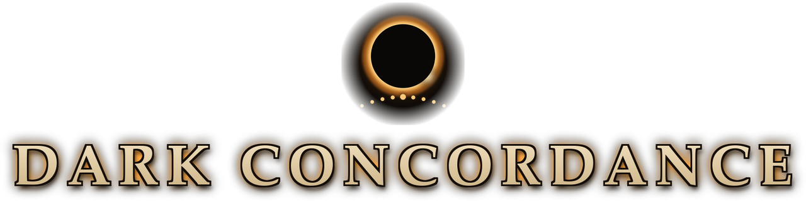
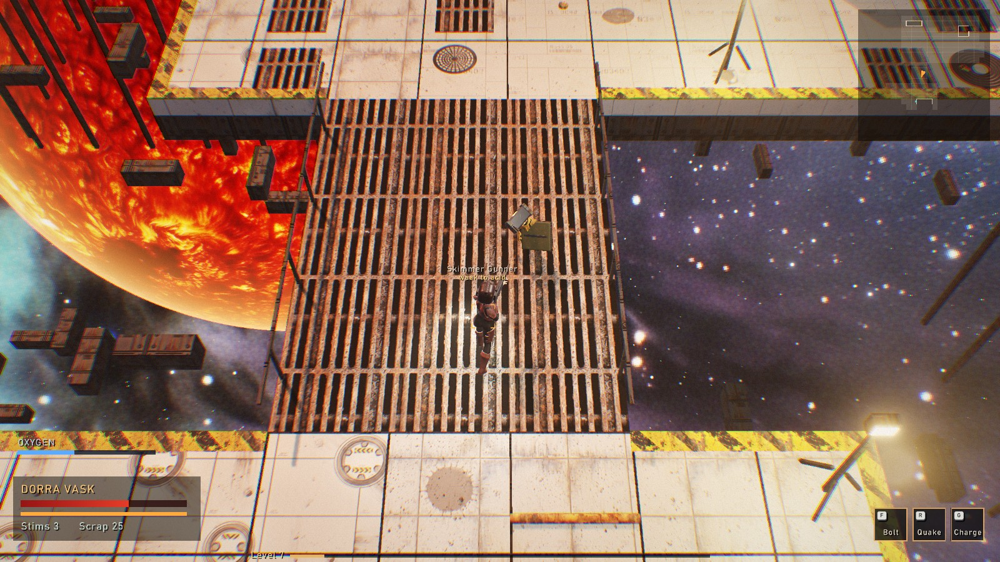
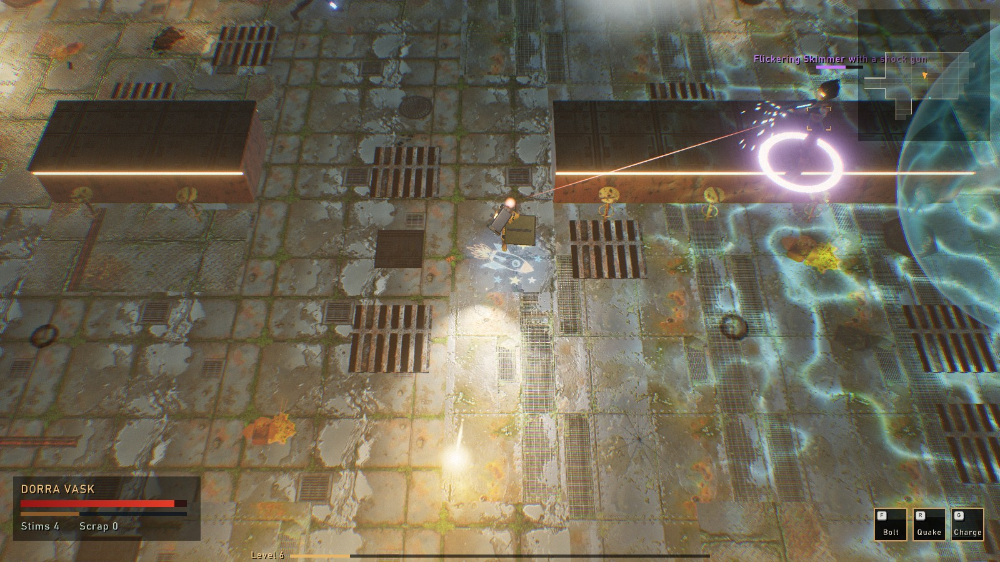
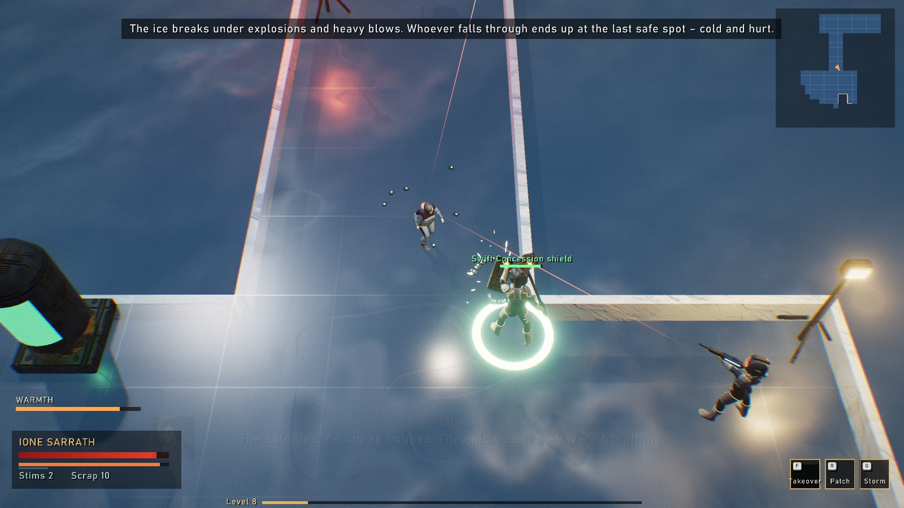
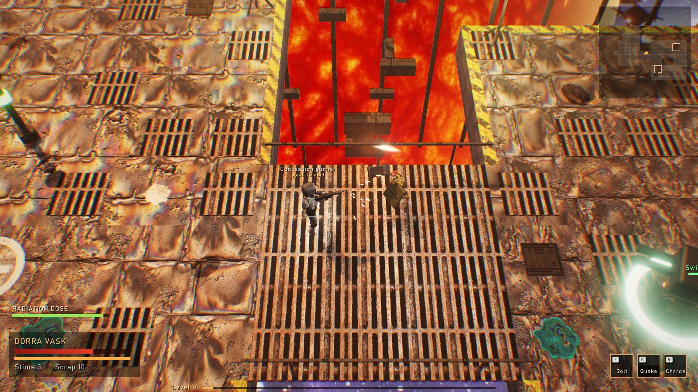
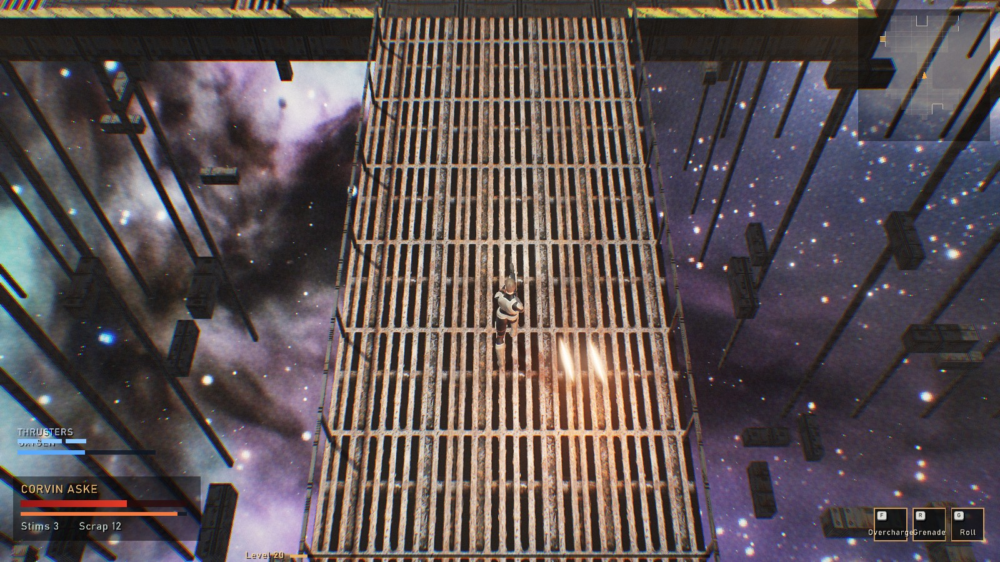
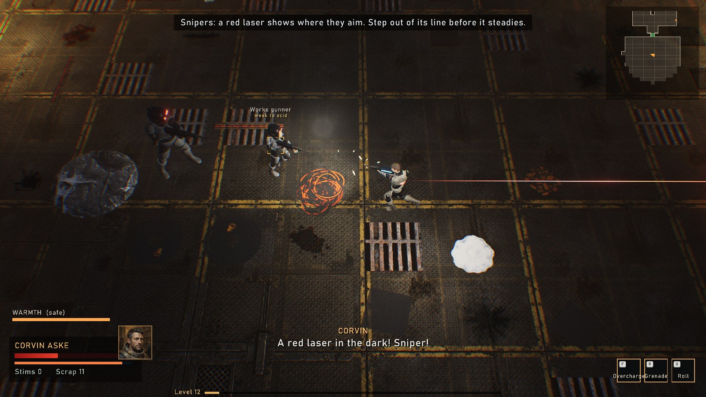

<h1 align="center"></h1>

<a href="https://reneweller-coding.itch.io/dark-concordance"><b>itch.io</b></a> ·
<a href="https://github.com/reneweller-coding/DarkConcordance/releases/latest"><b>Download</b></a> ·
<a href="docs/manual/DarkConcordance-Manual.pdf">Manual</a> ·
<a href="LICENSE">AGPL-3.0</a>

A dark space opera action role-playing game: three heroes, a prologue and four acts, three endings. The Fringe is nine
poor stars at the edge of the Concordance, and whoever dies there stays dead – unless someone harvested what was in
them first. Seen from three quarters above, with one of three heroes you fight your way through vacuum on the Outer
Skin, the Drowned Quarter, a world that does not turn and a centrifuge that flings you outward, talk to the people of
the stations between the missions, gather gear, rise in rank and decide in the end how the story goes.

**Windows, Linux and the Steam Deck**, free and open source under the AGPL-3.0. English and German: menus, subtitles
and voices.

## Download

**[DarkConcordance-1.0.0-windows-x64.zip](https://github.com/reneweller-coding/DarkConcordance/releases/download/v1.0.0/DarkConcordance-1.0.0-windows-x64.zip)**
(about 1 GB) for Windows 10 and 11: unpack it anywhere and start `DarkConcordance.exe`, nothing to install. The
**[Linux archive](https://github.com/reneweller-coding/DarkConcordance/releases/download/v1.0.0/DarkConcordance-1.0.0-linux-x86_64.tar.gz)**
runs on any x86-64 distribution with glibc 2.35 or newer, SteamOS included (add `DarkConcordance` to Steam as a
non-Steam game). Both carry the manual (English and German PDF), the player's readme, the credits and the licence.
The same packages are on **[itch.io](https://reneweller-coding.itch.io/dark-concordance)**.

Requirements: OpenGL 3.3 and a graphics card of the last ten years. On the Steam Deck the graphics start at "Low"
with at most 40 frames a second. The program is not code-signed: Windows' SmartScreen may warn once ("More info",
"Run anyway").

## Pictures

| | |
|:---:|:---:|
|  |  |
| The Drowned Quarter: Dorra's shield against the guards | Seren, the Glass Sea: ice that breaks |
|  |  |
| The star lifter of Kael | The Ore Stream: containers in open space |
|  |  |
| The Wanderer: a sniper's laser in the dark | Ione and her drones in the Depths |
|  |  |
| Velm, the Third Drum: Ysolde Varn | The inventory |

## The game

- **Three heroes:** Dorra Vask (melee: ram hammer, shield, blast bolts), Corvin Aske (ranged: the Gauss rifle) and
  Ione Sarrath (drones), each with their own skills, gear and tale.
- **A prologue and four acts** with three endings; stations between the missions with people to talk to, traders,
  a workshop and jobs.
- **Places put together anew** on most visits, each with its own wonder and danger: vacuum, water, heat and frost.
- **After the credits:** the endless Depths, New Game+ with everything gained, and Nightmare.
- **Two players on one screen** (a second gamepad), **one life** (hardcore) and a **daily challenge** the same for
  everyone.
- Four save slots, a photo mode, rebindable controls; made for the gamepad and the Steam Deck.

## Controls

| | Keyboard and mouse | Gamepad |
|---|---|---|
| Move | WASD or the arrows | left stick |
| Shoot, strike | left mouse button | right trigger |
| Jump | Space | A |
| Dodge roll | Ctrl | click of the left stick |
| Special; skills 2 and 3 | F; R, G | B; shoulder buttons |
| Stim | Q | Y |
| Use, talk | E | X |
| Swap weapon | T | d-pad right (or left) |
| Hold the facing (Dorra: shield) | Shift | left trigger |
| Map, inventory, character, photo mode | M, I, C, P | |
| Pause | Esc | Start |

Everything can be rebound under "Options > Controls". The [manual](docs/manual/DarkConcordance-Manual.pdf) explains
the screen, the heroes, the gear and the stations without giving the story away.

## Building

    .\build.ps1                    # Windows, MSVC: bin\msvc\SpaceOpera.exe (the repository keeps the working name)
    bash Deploy/build_linux.sh     # Linux / Steam Deck (WSL Ubuntu 22.04, GCC 12)
    .\Deploy\build_release.ps1     # both packages into dist/

C++20 on raylib. How the game is built, played through, tested and made – places, figures, films, music, voices and
textures – is in [DEVELOPMENT.md](DEVELOPMENT.md), the working log of the game (it uses the German working names of
the places); the production plan is in [docs/PLAN.md](docs/PLAN.md).

## Credits and licences

`docs/CREDITS.txt` lists what DARK CONCORDANCE is made from: raylib (zlib licence) with GLFW, miniaudio, cgltf and
stb, dav1d (BSD 2-Clause), the Barlow font (SIL Open Font License), MakeHuman's assets through MPFB and Quaternius'
characters and animations (CC0), and the tools the pictures, films, music, sound beds and voices were made with
(Gemini's image model, FLUX.2 [dev], LTX-2.3, ACE-Step 1.5, Stable Audio Open, Qwen3-TTS). The release packages
carry it beside the game.

DARK CONCORDANCE is free software under the GNU Affero General Public License 3.0 (`LICENSE`): use it, change it, pass
it on, with the source of what you change.
