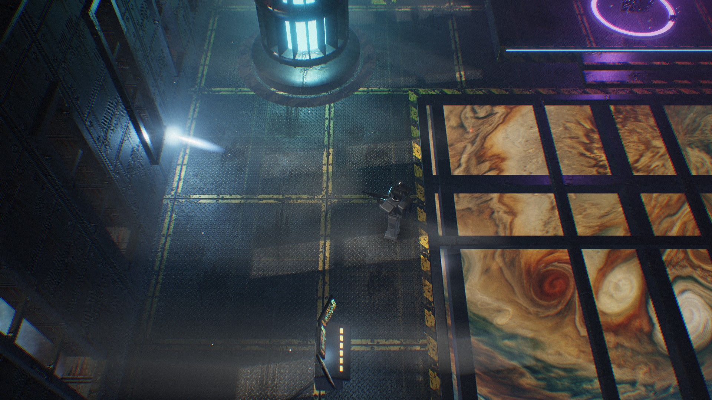
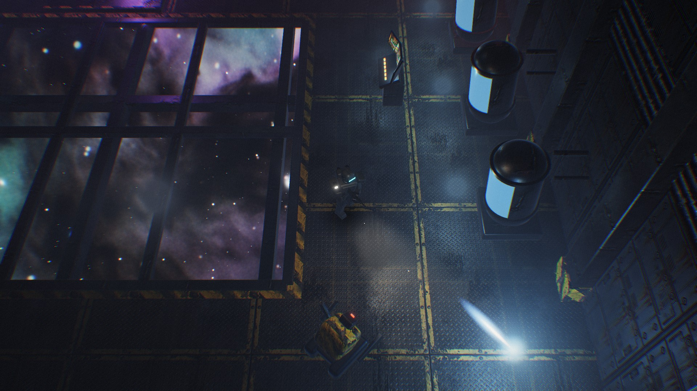

# SpaceOpera (working title) — look test

A dark space opera action RPG in the manner of *Baldur's Gate: Dark Alliance*: fixed three-quarter camera, gamepad,
ranged combat as in *Fallout: Brotherhood of Steel*, pools of light in the dark. This is the look test: one room of an
abandoned station, nothing of the game yet.

## What is in it

- **Room:** an observation deck with a glass floor over a gas giant and a nebula, seven narrow windows the sun falls
  through in bars, a reactor behind cooling fins, cryo pods, consoles, crates, a wrecked maintenance robot and an alien
  monolith with orbiting shards on a platform. Everything is built in code from boxes, rounded boxes and lathed
  profiles; no modelled assets.
- **Textures:** generated with Gemini's image model on Vertex AI (`tools/make_textures.py`), made seamless, the baked
  light removed, normal, roughness, metal and occlusion maps derived. The raw pictures are in `assets/raw/`.
- **Renderer** (`src/Gfx.*`, `src/Shaders.h`): forward PBR (GGX), triplanar texturing with normal maps, shadow maps for
  the sun and the suit lamp, up to 32 point lights, volumetric fog raymarched through both shadow maps (light shafts,
  the lamp's beam) plus analytic halos of the point lights, a bloom chain, ACES, a split tone, vignette, grain.
- **Hero** (`src/Figure.*`): a hardsuit soldier from rounded boxes, walk cycle, rifle held with two-bone IK, recoil,
  a shoulder lamp, a blob shadow and a warm light that follows him.
- **Effects:** plasma bolts with light and impact sparks, a broken conduit raining sparks, motes rising around the
  monolith, dust that glitters where light reaches.

## Build and run

    .\build.ps1          # msvc Release; the game lands in bin\msvc\SpaceOpera.exe

Walk with WASD, the arrows or the left stick; shoot with Space, the left mouse button, A or the right trigger. The
mouse wheel or the shoulder buttons zoom, F1 shows the frame rate, F12 saves a picture next to the program.

Pictures without a window:

    bin\msvc\SpaceOpera.exe --shot work\a.png --w 1920 --h 1080 --ss 2 --at 0.6,-4.3 --face 145 --walk
    bin\msvc\SpaceOpera.exe --shot work\b.png --at -8,-1.2 --face 250 --fire --bench 120

`--bench n` renders n frames first and writes the time per frame to `spaceopera.log` beside the program.

## Textures again

    G:\Tools\ImageGeneration\venv\Scripts\python.exe tools\make_textures.py [--force NAME ...] [--only NAME ...]

Needs the PC's gcloud application default credentials (project `plenary-office-432719-u6`). Imagen 3 and 4 are gone
from Vertex (404); the script asks `gemini-3-pro-image` and falls back to `gemini-3.1-flash-image` (on 429).
